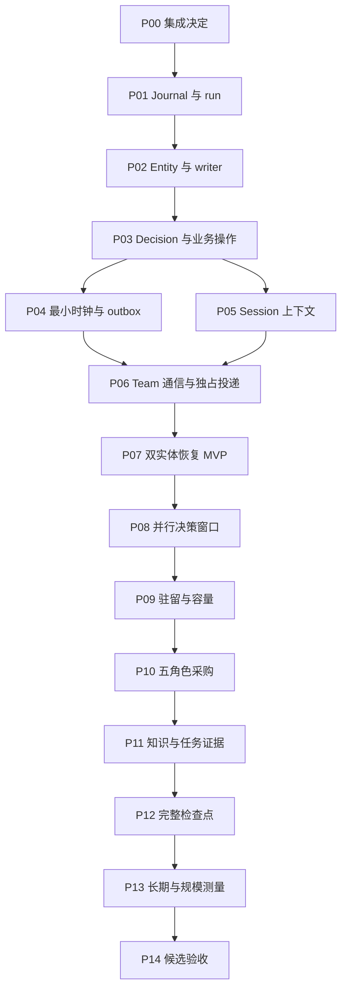

# 持久模拟协同开发计划

本文落实[持久模拟协同设计提案](../../notes/proposed/architecture/2026-09-17-durable-simulation-coordination.zh.md)。设计提案拥有架构决定，本计划拥有工作包、依赖、交付顺序和验收方法。计划日期为 2026-09-18，工作包状态见下表；未交付部分的 API、事件和文件名仍为拟议名称。

## 当前实施状态

| 工作包 | 状态 | 已交付与剩余验收 |
|---|---|---|
| P00 | verified | 第 5 节冻结三个集成所有者、调用顺序与拒绝路径；单节点替换反例通过。此状态只确认集成决定，生产执行入口验收仍属于 P02/P05/P06 |
| P01 | verified | 服务注册、本地 JSON/SQLite run、严格重放、串行状态写入、进程排他锁及真实 Loader kill/restart；源码覆盖率、类型、lint、构建产物与 doc-sync 通过。全仓 hygiene 既有失败单列记录 |
| P02 | verified | 补充完成设计遗漏的组织作用域：配置 `scopeKinds`、作用域内环检查与查询，日志版本 35 拒绝旧格式；64 项相关测试、双后端 Loader 与 40 项产物回归通过；可选作用域配置已规范化，显式 undefined 不再破坏重开。六项功能与退出条件已验证：Entity／时态组织、唯一规范绑定、持久 epoch 预留、控制器强制协调、撤销与接受串行化、同 Session 恢复。新增接受区间／活动 epoch invariant，补齐损坏投影与退役后持久迟到 acceptance 拒绝；历史已接受工作继续保留。641 项相关测试、26 项源码及 26 项产物场景通过（均覆盖双后端）；6 个专属实现／协议文件四项覆盖率 100%，类型、lint、构建和 29 项文档门禁通过。逐项证据与共享模块范围见 [verification-evidence.json](verification-evidence.json) |
| P03 | verified | 七项功能与退出条件已验证：串行 Decision／原子接受意图、独立交互与承诺、证据履约、守恒资源事务、鉴权幂等和持久依赖。修复日志重放允许本地操作越序结算的问题，实时执行与重放共用同一顺序检查；新增双后端真实 Loader 越序拒绝场景。479 项组合测试通过，含共享 Decision 模块的 6 个业务／协议文件四项覆盖率 100%；22 项源码及 22 项产物场景、类型、lint、构建和 29 项文档门禁通过。逐项证据见 [verification-evidence.json](verification-evidence.json) |
| P04 | verified | 七项功能与退出条件已验证：持久事件键／时间、原子消费责任、固定 phase／microstep、到期与依赖准入、同键对账、限额／退避及暂停／停滞恢复。修复 Outbox 重放绕过冻结窗口和未完成依赖的问题，保持失败分类与实时入口一致；已受理传输仍可在暂停后落盘。498 项组合测试通过，4 个调度／Outbox 实现及协议文件四项覆盖率 100%；双后端 16 项源码与 16 项产物场景、类型、lint、构建及 29 项文档门禁通过。逐项证据见 [verification-evidence.json](verification-evidence.json)；真实 Team 授权／独占接收完整验收归 P06 |
| P05 | verified | 七项功能与退出条件已验证：必读 context-view、精确输入与 flush、单次 Team 渲染、单节点替换、必需预算／可选裁剪及双 SDK 严格读取。修复对象属性名决策 id 的首次执行误拒绝，验证真实工具执行、无重复推理的重试与持久化拒绝。550 项组合测试、337 项 Session／JSONL／快照回归通过；4 个上下文模块四项覆盖率 100%。TS/Python 各 63 项共享语料、两个 SDK 快照（含新打包 Python 可执行产物）、12 项源码及 12 项产物场景通过；类型、lint、构建与 29 项文档门禁通过。完整证据见 [verification-evidence.json](verification-evidence.json) |
| P06 | verified | 补齐完整发布回执：run／Team／接收者／频道日志位置均保留并校验，日志版本 36；错误来源不确认成功，重试不重复发布。八项功能与退出条件已验证：journal 派生受限发布、锁内复核、退役后幂等责任、共享 Team WAL／renderer、独占 claim／receipt、到期可见性、休眠邀请和收件后决策恢复。补齐真实 Hub 篡改／proof 撤销、分页／flush／退役失败与恢复负例；恢复内部类型明确限定已保留 delivery。222 项聚焦测试、231 项普通 Team／客户端回归通过，4 个专属模块四项覆盖率 100%；双后端 20 项源码与 20 项产物场景、类型、lint、构建和 29 项文档门禁通过。此轮未发现新的运行时行为缺陷；逐项证据见 [verification-evidence.json](verification-evidence.json) |
| P07 | verified | 八项功能及 F01–F10 已逐项验收。修复参与者邀请／阶段响应身份不匹配时可能提前绑定的问题，错误响应拒绝且可重试；真实公司场景验证修复。补充已落盘未返回、到期前发布、claim 后未 flush 的 kill/restart，并验证重新绑定后拒绝原模型提案与旧 epoch 提交。242 项聚焦测试通过，7 个工具／引导模块四项覆盖率 100%；双后端 88 项源码与 88 项产物恢复场景、源码／产物各 20 项完整公司场景、类型、lint、构建和 29 项文档门禁通过。无真实模型凭据，可选带密钥 smoke 未执行；全部关键验收无需密钥。逐项证据见 [verification-evidence.json](verification-evidence.json) |
| P08 | verified | 六项功能与退出条件已验证：冻结窗口／唯一 slot、有界推理、按序接受、持久超时与重启、后续 microstep 冲突重试、稳定 ingress。补齐暂停／恢复输入不变、部分接受写失败重试及许可取消顺序／迟到回调边界；简化空队列排空判断。554 项组合测试通过，6 个窗口／调度／超时／许可模块四项覆盖率 100%；双后端 48 项源码与 48 项产物场景、类型、lint、构建和 29 项文档门禁通过。此轮未发现新的业务行为缺陷；逐项证据见 [verification-evidence.json](verification-evidence.json) |
| P09 | verified | 六项功能与退出条件已验证：独立 Entity／驻留／模型计数、按需换入与完全停稳、未知清理保留容量、持久公平分配和独立预算、零模型策略、关闭排空。修复确定性特殊 id 误判及手动入口抢占已提名 wake 导致队列阻塞的问题。577 项组合测试通过，12 个预算／派发／策略及相关模块四项覆盖率 100%；双后端 52 项源码与 52 项产物场景、类型、lint、构建和 29 项文档门禁通过。逐项证据见 [verification-evidence.json](verification-evidence.json) |
| P10 | verified | 报告已补齐阻塞依赖和有持久唤醒支撑的下次更新时间，20 项源码及 20 项产物场景通过。五角色 Agent／工具流程（脚本化模型）及全部列出变体已通过 JSON/SQLite 源码与产物快照，包含预留／调岗后恢复、真实私有历史隔离和 CEO 证据报告；原子管理批次有回滚与重放测试。此状态确认 P10 场景出口，基础设施完整验收与覆盖率缺口仍归 P02–P09 |
| P11 | verified | 七项功能与拒绝／恢复矩阵已完成：版本化知识、时间与传递权限、来源隔离摘要、压缩重物化、任务 revision／独立履约及持久任务 outbox。已修复深层前提栈溢出、压缩请求路由绕过，以及确定性策略误用报告可见性提示；候选选择按授权结果上限停止。12 个专属模块／协议文件四项覆盖率 100%，208 项聚焦测试、168 项 Core／Team 回归、48 项源码场景、66 项产物场景及两 SDK 验证通过。最终 29 项文档门禁、类型、lint 与构建通过；完整证据及逐项范围见 [verification-evidence.json](verification-evidence.json)。共享运行时其他工作包的覆盖率缺口保留在对应工作包 |
| P12 | verified | 补齐跨日志因果校验：逐条核对已应用 Envelope 和任务创建归属，缺失／篡改目标拒绝，原样修复可重试；目标校验模块四项覆盖率 100%。七项退出要求已逐项验证：精确 manifest／责任清单、准入关闭与有界排空、全历史保护、所有者重查与原子发布、幂等管理终态、保留前缀／后缀恢复，以及检查点期间拒绝新 ingress。损坏来源不修复、不推理、不发布；上一完整 manifest 保留，原样修复后可重试。9 个专属模块／引用协议文件四项覆盖率 100%，440 项组合测试及新增排空边界测试通过；双后端 38 项源码与 38 项最新产物场景、类型、lint、构建和 29 项文档门禁通过。完整逐项证据见 [verification-evidence.json](verification-evidence.json)；共享基础设施其他工作包覆盖率缺口不在此宣称通过 |
| P13 | verified | 无密钥功能与验收完成：615 项组合测试、核心协调实现四项覆盖率均为 100%、64 项产物场景通过。真实样本 `deepseek-flash`／high 以 3 次调用、8,042 token 完成观察决策，重试不重复推理，检查点冷恢复一致且无模型调用／发布；思考参数及预算拒绝路径在双后端源码／产物各 12 项场景中通过。规模结论为需要调优：[SQLite A/B/C 与真实样本](current-scale-baseline.json)中 B 达到 1M 世界更新／100 驻留／20 脚本模型流，A 完成 30 条消息、C 完成 0 天；[JSON B](actor-world-baseline.json)超时。复跑命令、原始数据、源码摘要及检查见[证据](verification-evidence.json)，后续调优不计为已达容量 |
| P14 | in-progress | Simulation 79 个源文件四项覆盖率 100% 及共享 Core／Team／SDK 的已完成验收见[证据](verification-evidence.json)。已补齐组织作用域、报告、回执与跨日志一致性，并修复通知丢失、工作区投递／销毁、任务停止准入和子 Team 失败记录。当前恢复使用最新激活记录与合并取消信号；插件卸载通过 effect 排空激活，关闭等待已接受恢复停止，清理失败同时向恢复与关闭调用者报告。Hub index、TeamRun index 的完整覆盖率仍未达标；最终候选重冻结、全仓 lint 既有诊断及其他平台／CI 证据仍未关闭。用户确认延期能力保持延期 |

本次开发基线为 `2a958f7fdb7759b0e3224b2877d4986c2d5212c7`。已有其他计划、设计和构建产物修改保持原样。相关实现位于 `packages/simulation/`；验证原始输出保存在 `.tmp-simulation-development/`；[验证记录](verification-evidence.json)保存源码摘要、产物摘要、命令、结果和未覆盖项。

## 1. 交付目标与范围

首个可用版本应能通过真实 Cordis Loader 启动两个模拟角色，完成“请求 → 延迟投递 → 接受 → 承诺 → 原子资源操作 → 结果通知”，在关键持久化点杀进程后恢复，且不丢失责任、不重复业务效果、不接受旧激活的新决策。随后扩展到五角色采购、有界模型并发、角色休眠和长期恢复。

| 交付层级 | 必须包含 | 暂不包含 |
|---|---|---|
| 可恢复 MVP | 单 run 写入者、单执行 Team、稳定 Entity/Participant/Session、单受理者交互、资源事务、Decision/outbox、最小上下文、串行时间调度、本地恢复 | 多 Team 共享认知、生产分支、真实外部副作用 |
| 公司模拟版本 | 并行推理与有序提交、休眠/唤醒、配额、五角色采购、任务证据关联、知识隔离、可观察 stalled | 自动多 Hub 联邦、世界分区、任意经济模型 |
| 长期运行版本 | 完整检查点、可恢复的管理操作、上下文有界策略、规模与存储增长测量 | 未经引用保护的物理删除、未经测量的万人容量承诺 |

MVP 首先支持同宿主、本地 AgentRuntime 与 Team Link。JSON 和 SQLite 都验证持久化行为。SDK/ACP 必须能读取新增必读 Session 事件，但“能读取事件”不等于已经支持远端 Simulation 执行。远端执行在生命周期协调与恢复测试齐备后单独开放。

不增加 GUI。运行入口、检查、暂停、恢复和推进先由实际示例及程序化接口提供。新增 GUI 时另行执行设计规范和真实流程 GIF 要求。

## 2. 已核对的基础与不能假设的能力

本次规划参照工作树的源码；规划时 HEAD 为 `2a958f7fdb7759b0e3224b2877d4986c2d5212c7`。工作树存在其他未提交修改，HEAD 不是完整候选版本；开发开始时重新记录相关路径和输入摘要，不能把本次文档检查当作未来代码验收证据。

| 已有所有者 | 可复用能力 | 必须补齐的部分 |
|---|---|---|
| [Storage log](../../../packages/storage/storage/src/log.ts) | 单流 expected-tail 原子 batch、checkpoint | Simulation 格式、fold、操作去重与恢复流程；不能假定多流事务 |
| [Team Hub](../../../packages/team/team-hub/README.md) | WAL、claim、receipt、运行时 proof、任务与激活 fence | 只允许已接受模拟操作的 post scope，以及相关锁内验证 |
| [Activation Controller](../../../packages/team/team-activation-controller/README.md) | bind-or-dispose、fence、完全停稳 | 与 Simulation writer epoch 撤销串行协调的真实入口 |
| [Activation Recovery](../../../packages/team/team-activation-recovery/README.md) | 持久 epoch 的恢复扫描 | 不绕过 Simulation 准入/退役协调 |
| [Agent Client](../../../packages/team/team-agent-client/README.md) | 投递持久化屏障、重放去重、邀请处理 | 独占消费选择、模拟时间准入，不能复制一套更弱的投递逻辑 |
| [Session surface](../../../packages/core/session/src/surface.ts) | 已记录内容投影和区间替换 | 新事件的类型、验证、精确投影及替换目标语义 |
| [SDK 协议](../../../packages/sdk/protocol/src/schema.ts)与[Python 事件读取](../../../python/sdk/src/clocky/api.py) | 显式协议解析 | 新必读事件在所有读取路径一致通过或明确拒绝 |
| [示例规范](../../../examples/AGENTS.md) | Loader、keyless 与真实模型验收层 | 双实体和采购场景的真实组合及快照 |

特别注意：`SessionEventMap` 可以声明合并，但 surface 可用事件和投影并不会因此自动支持新事件；`known-event-types.ts` 是生成产物，必须修改来源并运行生成器。不能只加一个类型后宣称日志可回放。

## 3. 实施约束与包布局

采用一个 Simulation 权威日志，不复制 Team 的消息队列和任务执行状态。世界、实体、交互、知识与调度保留独立模块和验证器。没有独立提供方或消费需求前，不按每个领域拆包。

| 新包（拟议） | 角色 | 初始职责 |
|---|---|---|
| `packages/simulation/simulation` | Service Definition | run 注册/解析、请求与规格、品牌 id、JSON schema、状态和错误约定 |
| `packages/simulation/simulation-local` | Service Provider | 单 run 日志、fold、领域操作、时钟、窗口、配额、恢复 |
| `packages/simulation/simulation-team` | Consumer | Team 绑定与通信、激活协调、Session 输入、投递所有权 |
| `packages/simulation/tool-simulation` | Consumer | 受限观察、暂存操作、提交决策；随实际 preset 一起交付 |

`simulation-local` 可以同时注册提供方并消费 Storage；三种角色明确不代表必须为每个内部函数增加服务。拟议 `ctx.simulations` 拥有命名 run；Provider 注册必须可替换且 effect 可撤销。首次提交包含实际提供方和最小可运行消费路径，类型定义本身不算完成。

新组按[添加包指南](../../../docs/cookbook/adding-a-package.md)配置 Host aggregate、workspace 依赖、源码解析、`./invariant`、README 与 Model Experience。包使用 `@clocky/clocky-*` 名称，Cordis 依赖遵循项目实际的 `@clocky/cordis` peer/dev 规则；不得从低层 Team、Session 反向导入 Simulation 提供方。

跨层事件数据须采用无循环依赖的声明位置。优先由 Simulation Service Definition 拥有业务品牌 id，基础 Session 只承担其可重建模型内容和持久引用表示；若必须下沉公共类型，P00 先证明独立需求，不能为绕开循环创建空洞的公共类型包。

所有业务状态变更由执行入口检查；仅隐藏工具、限制提示词或依赖 listener 注册顺序不能防止其他调用者绕过权限。部署可调限额使用验证后的 Config，run 创建时保存影响回放的配置与版本。

## 4. 里程碑与依赖

| 里程碑 | 完成条件 | 包含工作包 |
|---|---|---|
| M0：可落地的集成决定 | 三个高风险集成点均有明确所有者、拒绝路径和可表达的测试 | P00 |
| M1：持久基础 | 同一组命令在两个后端写入、重启、折叠一致，重复操作无重复效果 | P01–P03 |
| M2：可恢复双实体 MVP | 真实 Loader、真实 Team/Session、最小时钟、完整故障恢复闭环 | P04–P07 |
| M3：受控并发与采购 | 确定提交顺序、休眠与配额、五角色场景 | P08–P10 |
| M4：长期运行 | 知识与任务证据、上下文有界、完整检查点和测量报告 | P11–P13 |
| M5：候选交付 | 当前候选的所有必要验收完成，范围与限制可复核 | P14 |



图表示验收依赖，不要求等前一个工作包所有文档写完才研究下一个。P04 与 P05 可在约定固定后独立开发，P08 后的纯知识选择算法也可提前实现；共享 Team/Session/SDK 文件的修改由同一集成人协调。计划不要求特定模型或固定人数，也不将多人并行的工作量直接折算为日历时间。

每个工作包只在实现、负例、恢复、必要快照及文档均完成后标记 `verified`。允许 `planned → in-progress → implemented → verified`，阻塞时记录具体缺失依赖。代码已写但无验收证据仍为 `implemented`。

## 5. P00：完成三个集成决定

**输入与范围。** 读取 Team proof admission、Activation Controller/Recovery、Agent Client 和 Session surface 的真实入口。产出本计划目录下的接口草案与调用序列，不提前增加公共框架。

1. 明确激活退役如何在控制器操作之前持久撤销 Simulation writer epoch；覆盖 `activate`、`coldReplace`、stale fencing、Team cancellation、正常 dispose 和恢复扫描。
2. 确定该协调的 enforcement owner。不能只由 `simulation-team` 提供便利 wrapper，而让现有控制器其他入口继续绕过。方案必须说明锁顺序、不可重入回调、异步终止期间的状态和死锁规避。
3. 确定同一 binding 的唯一 delivery owner 在何处选定与验证。采用声明式绑定路由或所有权租约，重复订阅必须明确拒绝；不能依靠“配置时记得不要同时挂载”。常规 Team 组合保持原路径。
4. 明确新 context view 与原 Team 输入之间的关系：Team 来源只渲染一次；额外 context view 引用其证据，不能再次插入同一消息。Hub 生成的非 direct view 必须完整保留。
5. 验证 Session 的连续区间替换能否只替换旧 simulation view；不得连带遮蔽两次 view 之间的工具结果/普通消息。先用最小固定日志证明方案，再确定生产代码调整。
6. 冻结受限 post scope 的字段、JSON 序列化与幂等比较规则；Hub 不能通过导入 Simulation Provider 来验证 proof。
7. 证明现有 keyless harness 能表达 kill/restart、两个 SDK 新事件与独占投递；不足时将最小 harness 扩展并入对应工作包。

**交付与验收。** 三张可审阅调用序列：决策提交/epoch 撤销、消息准入/flush/receipt、上下文替换/SDK 重建。每条指出实际执行检查的函数位置、锁/队列所有者、持久记录和崩溃后责任。无法落实的接口决定不以 TODO 进入 P02/P05/P06。


### 集成决定（2026-09-18）

| 顺序 | 执行所有者与拒绝路径 | 恢复责任 |
|---|---|---|
| 决策 → 撤销 → 停稳 | Simulation run 队列同时拥有 decision 接受和 writer 撤销。控制器 `activateOwned`、`coldReplaceOwned`、`fenceStaleOwned` 与 `disposeOwnedEntry` 在调用运行时之前必须通过持久 binding 的协调所有者；缺失所有者时拒绝，不能退回普通路径。协调回调仅写 run 日志，不重入控制器；调用回调时不持 Team/channel 队列。释放 run 队列后才等待控制器，接管必须等 `quiesceOwned` 的持久停稳证明。 | 撤销后崩溃保持不可决策；已接受 outbox 不受撤销影响。Team cancellation、恢复扫描与正常退出共用这些入口；远端 Simulation binding 在完整接入前拒绝。 |
| 消息 → claim → flush → receipt | 保留 `FixedBindingTeamAgentLinkDelivery.deliver` 对 claim、Hub view、Session 屏障、去重和回执的所有权。在 binding 的声明式投递路由中选择 ordinary/simulation；由 Link/Hub claim 执行独占租约检查，重复消费者或路由缺失拒绝。Simulation 准入只在 deliverAt 后发布到 Team，不能先 inject。 | Session 已 flush 但无 receipt 时重建同一输入；receipt 存在不证明输入已消费。邀请仍由精确端点确认。 |
| context → 精确替换 → SDK 重建 | `surface.ts` 的 `replacementRange` 支持 `start=end=旧 view seq`，`sourceEventSeqs` 引用旧节点；连续两次替换已由 `surface.spec.ts` 验证，普通消息/工具结果保留。P05 新事件只包含补充上下文及 Team 证据引用，不复制已经投影的消息；Hub 非 direct view 原样记录。 | 新 view、queued input 和 durable consumed 分开对账；新事件仍需 TS/Python/ACP 读取与快照成套验证。 |

受限发布沿用 `TeamSystemEnvelopePostProofSource`。P06 为闭合 scope 增加 run/decision/operation 身份、已接受日志游标、精确 Team/channel/sender/recipients、delivery、完整 draft 和幂等键；这些字段均为 JSON 数据。源只为已接受且到期的操作生成不可序列化 proof。`TeamHub.postChannelEnvelope` 在 Team → channel 队列内重新解析 proof，按结构比较全部 draft/键字段，并复核当前成员、频道和策略；不导入 Simulation Provider，不要求已经退役的发送者激活在线。结果丢失使用原键原 payload 重试，不换发送者。payload 指纹采用确定编码；原始对象属性顺序不构成业务差异。

P01 的执行消费者是实际 `cordis.yml` 加独立进程 driver。它已能表达 kill/restart、活进程竞争和 keyless 输出快照；P05 仍由两个既有 SDK 快照所有者负责新 Session 事件，P06 补 claim/flush/receipt 故障注入，不能用基础 run 快照替代这些验收。

## 6. P01：run、格式与单日志提供方

**主要修改。** 新增 `simulation` 与 `simulation-local`，提供最小 Loader composition。建议模块为 `types.ts`、`schema.ts`、`error.ts`、`journal.ts`、`fold.ts`、`run.ts`；文件名以实现职责为准，不要求机械拆分。

1. 定义 run 与必要对象 id；SimTime、slot 使用规范非负十进制字符串，运行时按数值比较。拒绝前导零的非规范形式、负数、浮点、超出配置范围及非法持久值。
2. 定义 journal record 的版本、kind、runId、因果引用和 payload。Storage 分配 sequence；不再制造另一套独立递增日志游标。
3. 实现 `resolve(request): spec`，固定存储选择、时钟单位、规则与策略版本。相同 run 重开必须匹配持久配置；未知格式明确拒绝。
4. 单 run 队列串行处理写命令，以 expected tail 原子追加；fold 为纯函数，从实际持久数据派生投影。写失败不发通知、不更新可见状态。
5. 实现 create/open/read snapshot/close。关闭停止新准入、排空已接受写入，再释放流和注册；未知清理结果不报告成功。
6. 同一 run 不允许两个活动协调器。使用明确的部署独占/已有可证明所有权机制；单进程队列和 expected-tail CAS 本身不能证明另一进程没有先派发副作用。首版第二写入者必须拒绝，进程崩溃后须有可验证的接管条件。

**测试。** 两后端原子 batch、尾游标冲突、重开折叠、格式不兼容、写失败不通知、关闭期间排队和重复 run 所有权。id 静态区分由类型测试承担，不写“服务存在”式 runtime invariant。

**出口。** Loader 可创建 run、提交一条受验证命令、退出并重开，快照一致。`./invariant` 比较 journal tail 与已发布投影版本；提供方销毁后的注册清除有 HMR 测试。

## 7. P02：Entity、组织与唯一认知写入者

**依赖。** P01；涉及控制器的实现须符合 P00 决定。

1. Entity 支持创建、profile revision、active/inactive/terminated 与 JSON 元数据。无认知实体不分配 Session。
2. 组织关系使用 subject/relation/object；验证存在性、端点 kind、有效期、revision，以及场景声明的环约束。World 仅引用关系，不另存雇佣真相。
3. 固定 Entity 到唯一 Team/Participant/Session。Team 绑定由服务端推导，工具不能传入其他实体身份。
4. 持久预留 writer epoch，调用控制器，确认精确绑定后激活写入权。绑定失败先完成清理或记录阻塞，不直接释放不确定容量。
5. 决策接受与 writer 撤销共用 run 串行队列。退休先撤销，后执行控制器终止；新的 epoch 等完全停稳证明。
6. 接入全部已允许的生命周期入口；未协调的远端恢复路径对模拟 binding 明确不支持。一个旧决策已接受的 outbox 责任不随 writer 退役消失。

**测试。** 错 Team/Session 拒绝、重复 Entity binding、两次并发激活、旧 epoch 晚到、撤销后 crash、终止不确认、重启接管、manager 变更不改写旧请求地址、绕过便利 wrapper 的直接控制器操作。

**当前集成与验收。** 规范 Team 的持久 `rules.activationLifecycleOwner` 强制协调直接启动、冷替换、stale fence、正常 dispose 和 closure recovery；启动前固定实际提供方，全部阶段保留同一 reservation 身份。run 关闭等待退役，并为未停稳 writer 保留进程锁和容量。双后端 Loader 已验证绑定、撤销、未发布启动、Team 预留、业务接受和 outbox 派发后的 kill/restart；调岗前后请求地址及原责任方保持不变。实时提交通知携带追加前 revision，invariant 按接受区间核对活动 epoch；历史接受在退役后仍有效，重放按顺序检查原准入。六项功能、负例、故障矩阵及共享模块范围见 [verification-evidence.json](verification-evidence.json) 的完整 P02 记录。

**出口。** 同一 Entity 任意故障点最多一个有效 cognition writer。记录的 runtime invariant 检查 accepted decision 的 epoch 归属及区间，而不是仅检查内存 Map 大小。

## 8. P03：Decision、交互、承诺与世界原子操作

**依赖。** P02。

1. 定义 Decision 输入快照引用、writer epoch、cognition revision、slot、操作序列与 payload 指纹；首次使用严格串行 slot，P08 再开放并行推理。
2. 接受 Decision 时，将 `decision accepted` 和全部初始 operation intent 写入同一 batch。操作 id 固定为 run/decision/operation index 的归属关系。
3. 实现 request/accept/reject/defer、取消与结果。接受请求与创建 Commitment 同批提交；检查精确 assignee 和预期 revision。
4. 建立履约策略：世界事件证据或明确验收为默认场景依据；任务完成仅在声明该策略时可作为充分证据。违约事实与后续履行不能相互覆盖。
5. 实现最小资源世界：金额使用带固定单位的整数表示，库存用非负整数，验证整数范围；资金与库存的读取集、更新、结果和后续事件原子提交。业务不变量拒绝余额/库存不足。
6. 幂等命中先比 payload，再返回既有结果，不因旧 expected revision 失效而重新执行；查询结果仍鉴权。同键异 payload 明确冲突。
7. 操作依赖顺序持久化。失败前置操作阻塞后续成功通知；取消或补偿追加新事实，不修改历史记录。

**拟议事件族。** `entity/*`、`writer/*`、`interaction/*`、`commitment/*`、`decision/*`、`operation/*`、`world/*` 仅为命名草案；不要同时维护重复的状态快照与事件源。具体字段随首次真实消费需求确定。

**测试。** 接受/取消竞争、重复 accept 只建一份承诺、两人争抢最后一件资源、世界已提交但本地调用响应丢失、幂等键篡改、错误权限、defer/期限规则、result-before-effect 拒绝。

**当前证据。** `business.spec.ts` 与新增拒绝矩阵覆盖原子资源交换、读取集、精确授权、余额／数量限制、接受与取消竞争、结果证据及幂等返回。Decision 重放矩阵覆盖截断接受批次、篡改指纹、错误归属、伪造结果、依赖与窗口／时序约束。已修复实时执行与重放的结算顺序检查不一致：同一 Decision 内及跨 Decision 的越序本地结算均拒绝，双后端真实 Loader 反复重开仍拒绝。业务接受／应用后的 kill/restart 保持一次效果；真实公司与采购场景验证正常、迟交、逾期及提交前后恢复。日志格式为 34，未改变持久格式。逐项验收和命令结果统一记录于 [verification-evidence.json](verification-evidence.json)。

**出口。** 不接模型也能用结构化命令运行请求与资源事务，并验证 crash/restart 后不重复扣款。为交互与世界操作分别保留失败结果，不把“Decision 已接受”显示成“业务已完成”。

## 9. P04：最小时钟、事件消费与 Outbox

**依赖。** P03。

1. 引入事件键 `(time, microstep, phase, slot)`，持久化入队、取消、消费和时钟推进。首先只允许一个进行中的决策窗口，不把并行调度作为 MVP 前提。
2. 固定 phase 次序和同刻后果进入下一 microstep 的规则。不能调度到已提交过去；数值字符串按数值排列。
3. 事件“已消费”与其引出的本地决定/待执行意图在同一批次形成可恢复责任，防止先移除队列后崩溃丢失任务。
4. outbox 派发只选择依赖已满足、到达 deliverAt 的操作。pending、applied、rejected、blocked-authority、outcome-unknown 及重试时间可回放。
5. 目标端已接受但本地未确认时，用相同键和同一 payload 对账或重试。异步派发不能改变已分配的本地世界提交顺序。
6. 引入可配置的每次 drive 上限、重试退避和最大尝试数。现实时间用于技术重试，模拟时间用于业务期限；不互相替代。
7. 暂停不接收新业务决策，继续必要清理与监督。run 进入 stalled 时保存结构化原因和可采取的恢复动作。

**测试。** 队列消费边界 crash、未到 deliverAt 不发布、到时只发布一次、同刻循环达到上限、现实 TTL 与模拟期限独立、恢复后 phase/slot 不重分配、取消事件不会复活。

**当前证据。** 日志格式 34 保留事件键、分配游标、消费后责任和 Outbox 尝试；派发使用相同操作键与 payload 对账，技术重试时间与模拟期限分离。新增重放矩阵核对引用、键、来源、期限、冲突谱系及收件责任，取消和停滞恢复均保留历史。已修复 Outbox 日志绕过冻结窗口和未完成依赖的准入缺口；派发前拒绝仍按依赖失败优先分类，已受理传输可在暂停后完成持久化。双后端真实 Loader 覆盖 queued／consumed／claimed、started／published／uncertain 六类 kill/restart 及两类损坏准入记录拒绝。完整逐项验收与命令见 [verification-evidence.json](verification-evidence.json)；真实 Team 授权与独占接收的完整验收仍归 P06。

**出口。** 结构化操作驱动的单线程模拟已具备持久时间和 outbox；重启后可继续处理尚未完成责任。进入 P07 的 MVP 不能仅有 wall-clock 定时器。

## 10. P05：可重建上下文与协议贯通

**依赖。** P02；context 中的业务读取依赖 P03。可以与 P04 分开推进。

**修改位置。** `packages/core/session/src/types.ts`、`surface.ts` 与相关解析/校验；`packages/sdk/protocol`、SDK 事件消费路径、`python/sdk/src/clocky/api.py`；实际使用该事件的 ACP/持久化读取路径。生成的 known-event 列表和目录通过所属生成器更新。

1. 实现最小 `simulation/context-view`：run/entity/window/slot、epoch、各投影游标与版本、来源引用、精确有序 content。标记为 required-on-read；不能通过 `ignorable` 绕过旧读取器拒绝。
2. 从已记录内容投影模型输入，不在回放时再次查询 world 或向量库。静态提示词、工具集及动态身份内容的版本或实际快照必须沿现有 Session 机制可重建。
3. 建立精确 input id 和 flush barrier；记录 view 不等于消费，恢复必须判断 queued、durably consumed 与尚未准入三种情况。
4. 落实 P00 的单次渲染规则：沟通内容由其既有 Team 来源投影，补充上下文不复制该消息；每次实际模型请求可按事件引用追溯输入。
5. 实现旧 simulation view 的有界替换，不吞掉中间普通消息与工具结果。检查 `sourceEventSeqs` 和 replacement 元数据的真实约定；若现有语义不够，先完成最小 Session 扩展及反例。
6. 必需上下文超限时拒绝本次模型准入；可选历史按照固定策略裁剪并记录实际结果，不能悄悄删掉当前权限和待履行责任。
7. 补齐 TS/Python wire 校验：缺少 surface marker、错误字段、非法时间、乱序 content、未知版本或不允许的 ignorable 均拒绝。

**测试与快照。** Session 纯投影、JSONL 重开、SDK schema 测试；headless 新场景；TypeScript 的 `examples/jsonrpc-agent/tests/snapshots/` 和 Python 的 `scripts/snapshots/python-sdk-single-exe/` 同步覆盖。ACP 如消费此 surface，补所属示例快照。

**当前证据。** required-on-read 的 `simulation/context-view` 保留精确分节、来源、游标、版本与 input id；同一 run/entity 的单节点替换保留中间普通消息和工具结果。必需内容超限会停滞，可选裁剪结果持久保存；完整请求与已消费输入 flush 后复核权限才派发。固定 input id 的排队／唤醒重试不重复消费。修复 `executeDecision()` 把对象属性名误认为既有决策的问题，真实工具流程验证三个特殊 id 的执行、幂等重试、错误 wake 与最终持久化拒绝。双后端 prepared／queued／flushed／consumed 四类 kill/restart 保留同一 Session 的可恢复责任。TS/Python 共享语料逐例验证相同读边界；TS 原整组语料共用超时已改为逐例计时。TS SDK 快照与新打包 Python 单文件产物均通过。日志格式为 34，事件与 wire 格式未改变；逐项证据见 [verification-evidence.json](verification-evidence.json)。

**出口。** 对同一日志，直接运行、重启、TS SDK 与 Python SDK 重建相同模型内容。事件相关快照缺一不能标记 verified；没有 Python artifact 证据时明确保持 pending。

## 11. P06：受限 Team 发布与独占投递

**依赖。** P04、P05。

**修改位置。** 新 `simulation-team`；`packages/core/team/src/types.ts`、`runtime.ts`、`schema.ts` 的实际相关声明；`packages/team/team-hub/src/index.ts` 的 post authority；Agent Client 的共享投递路径/所有权选择与必要生命周期协作。

1. 在 closed system post scope 中新增受限分支，绑定 accepted decision、operation key、run、发送者归属、Team/channel、audience 和 payload 指纹。服务端构造这些字段，模型不能传入任意 sender。
2. Simulation 执行器从 journal 验证持久责任，取得当前 runtime proof；Hub 在锁内校验 source、membership、channel、payload 与作用范围。不能将 proof 写入日志或跨 wire 传输。
3. 支持发送者退休后完成已接受操作；权限撤销或频道关闭明确阻塞/拒绝。新决策仍须当前 writer；旧 accepted intent 与旧 activation 新请求不能混淆。
4. 使用已有 Team 幂等发布，不制造平行 Envelope 队列；本地保存目标端 Envelope 引用。direct v4 payload 按现有文本/图片协议渲染，结构化业务对象留在 Simulation 日志。
5. 所有权选择落实到实际准入入口：模拟 binding 只由模拟消费路径认领。复用 claim、冻结 view、去重、flush、receipt 和 reconnect；禁止多个消费方竞争后“碰巧只有一个成功”。
6. 调度器在消息具备模拟可见性时才允许其进入当前或下一窗口。单有非唤醒 inject 不是保护；查询工具、channel view、summary 也必须受同一时间可见性规则约束。
7. dormant recipient 的新频道先建立精确端点、确认 invitation，但不请求模型。已获准频道保留离线待投递。邀请失效与失败不能伪装成完成通知。
8. 明确 receipt 后接收者尚未形成 Decision 的恢复责任：Session 未消费输入与 run 待决策事件必须能互相对账，不依赖再次收到 Hub pending 通知。

**测试。** post 目标与指纹篡改、source 卸载、退休发送者恢复、撤权、跨 run/Team 越权、双消费方拒绝、flush 失败无 receipt、receipt 后 crash、丢失 Link 通知后重扫、休眠邀请。

**当前证据。** 受限发布 scope 由已接受、到期且具有持久尝试的操作推导；Hub 在锁内及策略等待后复核来源、身份、draft、幂等键和当前权限。新增真实 Hub 负例覆盖正文／收件人／关联身份／指纹／键篡改、proof 调用结束及来源卸载、跨 run／Team／Session 替换。claim 与 receipt 必须具备专用 owner proof，通用消费者无法竞争准入。分页重扫、退役期间拒绝、flush 失败、已消费输入、取消后不重入队及缺失 Session 历史均有明确结果。恢复只对已保留 delivery 解析 wake 完成状态，内部类型体现该关系。日志格式 34 保留投递失败证据、输入和后续决策责任；修复／对账后仍须显式恢复。

八项验收均通过；源码／产物的真实 Loader 场景覆盖正常与单驻留公司流程，以及邀请、发布、收件、receipt 和失败记录八类 kill/restart。常规 direct/basic/workflow/task-assignment 与客户端回归保持通过。此轮未发现需改变的运行时行为，新增验证与完整命令统一记录于 [verification-evidence.json](verification-evidence.json)。

**出口。** 两个实际 Team Participant 可延迟通信；投递不提前泄露，也不会因 receipt 已存在而丢失后续决策。常规 direct/basic/workflow/task-assignment 投递回归通过。

## 12. P07：双实体端到端 MVP 与最小工具集

**依赖。** P06。这是首个面向使用者的 Simulation 交付点。

1. 新 `tool-simulation` 提供有限操作：授权观察、暂存业务操作、提交当前决策。工具只返回模型需要的目标、证据、pending/accepted/conflict 等含义，不暴露 runtime proof 或存储实现。
2. submit 固定一次决策提案及其操作序列；窗口尚未提交时结果明确是“已提交提案/待裁定”，不能宣称世界效果成功。确定的世界结果通过后续已记录输入返回。
3. preset 只开放模拟工具与必要只读能力；通用 shell/network/session-search/team-history 默认不进入该角色能力集。安全检查仍在执行服务，不只在工具 schema。
4. 新增示例 `examples/simulation-company/`，MVP 配置只启用两个角色。可复用的驱动逻辑进入包，示例只放 composition、输入场景、快照和验证。
5. 两个角色完成 request、delayed delivery、accept、commitment、resource transaction、result。使用本地脚本化 LLM 提供方驱动真实 Agent turn，不能直接调用业务服务冒充模型闭环。
6. 配置以真实 Loader 启动，声明 `examples/package.json` resolver 依赖及必要 aggregate；源码与产物模式分别选择正确 launcher。
7. 在 F01–F10 指定点真正终止子进程，以相同存储重新启动，检查权威日志和资源余额，再检查模型 transcript。
8. 提供最小 run inspect/advance/pause/resume 的程序化使用步骤。恢复以 journal 和 Team/Session 对账为基础，不等待完整跨域 checkpoint 功能。

**当前证据。** 三个工具按实际 Agent、writer 和已消费的准备输入执行授权观察、完整提案替换与提交；提交结果明确区分 submitted／accepted 与 pending 效果。受限 native preset 隐藏既有和后加的通用能力，服务入口仍强制校验身份与权限。根 Team、参与者、频道均采用持久预留和可恢复确认，示例使用真实 Loader、Agent turn 与脚本化模型完成双实体闭环，并提供检查、推进、暂停与恢复的程序化步骤。

已修复参与者邀请／阶段响应返回另一身份时可能提前确认绑定的问题；身份不匹配会保留预留并拒绝，重试继续原身份。新增公司故障场景验证拒绝后可继续完整流程。F01–F10 已逐项映射：补充批次已落盘但尚未返回、deliverAt 前、claim 后未 flush 的真实进程终止点；恢复后以原模型提案验证旧 view／旧 epoch 拒绝，已接受效果仍只结算一次。七个专属模块覆盖率与全部源码／产物恢复场景通过；完整逐项证据和命令见 [verification-evidence.json](verification-evidence.json)。未检测到真实模型凭据，可选带密钥 smoke 未执行；关键验收均为无需密钥的实际运行场景。

**出口。** `pnpm run test:snapshot` 可定向运行双实体 keyless 场景；real Loader smoke、JSON/SQLite crash recovery、全部 M2 负例通过。无密钥不跳过关键验收。with-key smoke 在具备凭据时补充模型调用适配证据，不取代 keyless 协议保证。

## 13. P08：并行推理与确定提交窗口

**依赖。** P07。

1. 固定 window 的世界/知识/交互/组织游标、可见输入、参与者和 slot 次序。每个实体只占一个 cognition slot。
2. 增加有界推理并发；所有只读工具读取固定 snapshot，提案暂存不执行 world mutation。
3. 收集结果但按 slot 串行提交。慢 slot 阻塞后续提交，直到其完成、取消、失败或记录配置的超时。
4. 在世界提交处验证资源读取集；冲突记录结果，并在后续 microstep 创建新决策机会，不在相同 slot 无限重跑。
5. 对未提交但模型已返回的提案规定持久恢复语义：已记录结果可继续处理；没有完整结果记录的调用不能伪造为成功，按恢复策略重新调度并记录原因。
6. 固定外部 ingress 顺序与分配事件键，人工干预进入后续窗口。pause/resume 不修改已固定窗口的历史输入。

**当前实现与验收。** `openWindow()` 原子固定 slot、投影 revision 与独立复制的授权上下文；提案持久为 submitted，`commitWindow()` 按 slot 接受并等待未完成项。世界执行与行政修改等到窗口关闭。部分接受写入失败后重试跳过已接受前缀，期间不提前执行世界效果。暂停／恢复及新 ingress 不修改冻结视图或已提交提案，外部输入仅进入后续事件与窗口。

模型许可有界且按 FIFO 分配，取消的等待项不占额度；已授予许可直到流清理才释放，迟到取消不能移除其他等待项。绝对 `decisionTimeoutMs` 跨模型／工具步骤保持不变，完整提交后不因等待排序而过期；超时及其持久化失败均有真实 Loader 证据。资源冲突与有界重试责任原子记录，后续 microstep 重新规划，不自动重放已应用效果；耗尽必须显式确认并恢复。恢复保留接受前缀与已提交证据，撤销不完整旧执行并重新分配责任。完整源码／产物窗口、重试、ingress 与超时失败场景已通过，逐项证据统一记录于 [verification-evidence.json](verification-evidence.json)。

**测试。** 固定相同模型提案，反转返回顺序，commit trace 一致；最后资源争抢只有一个成功；超时结果本身被记录；window 收集中 crash；冲突重试上限；同刻循环上限；用户输入不会插入已冻结窗口。

**出口。** 保证“相同记录输入/提案/超时轨迹得到相同权威投影”，不承诺同 seed 的真实 LLM 每次文本一致。

## 14. P09：休眠、配额与公平调度

**依赖。** P08。

1. 建立 Entity、resident activation、in-flight model call 三种独立计数；结合 Team 容量限制，不另造能绕过 Team 的启动通道。
2. 事件触发按需启动，轮次结束后评估休眠：Session flush、输入对账、责任持久化、投递停止、控制器完全停稳。未知外部操作由 run 执行器继续拥有，不永久占住空闲 Agent。
3. 启动先预留容量；失败清理不确认则保留 reservation 并暴露 stalled。恢复不得重复扣容量或提前返还。
4. 公平派发根据固定策略考虑优先级、期限与等待时长；slot 分配持久化。模型并发额度与 Token/消息/决策次数预算分别核算。
5. 确定性角色使用相同业务操作和权限流程，但不分配模型请求；避免为固定记账或事件派发唤醒 LLM。
6. dispose 停止新增 drive、取消计时器、排空已接受工作；effect 移除后不得产生晚到通知或隐式重新激活。

**测试。** 容量 1 下多实体轮换、预算耗尽、长期饥饿、有待投递时休眠、清理失败恢复、请求完成晚于 disposal、deterministic actor 与 LLM actor 的等价资源授权。

**当前实现与验收。** Entity、驻留 writer、模型许可和区间预算分别核算；未知清理保留容量并返回 recovery-required，不伪造释放。事件驱动可按显式策略换入角色，Session flush、输入责任与控制器停稳完成后才释放驻留。优先级／期限／等待轮数决定持久分配，数值时间与 FIFO 不依赖对象键顺序。已修复手动入口抢走提名 wake、留下阻塞队列项的问题；确定性策略也已修复特殊 id 的首次执行误判。策略输出持久保留，重试不重算、不推理；策略替换、输入预算和持久化失败均拒绝。完整模块覆盖率、源码／产物场景与逐项证据统一记录于 [verification-evidence.json](verification-evidence.json)。

**出口。** 固定 resident/model 上限在失败与重启中均不超限；饥饿指标可观测，无法继续时有准确 stalled 原因。

## 15. P10：五角色采购场景

**依赖。** P09。

场景角色为 CEO、Warehouse Manager、Purchasing Manager、Finance Manager 和 Supplier。组织关系用于寻址和可见性，不用 Subagent parent 表示管理关系。

1. Warehouse 观察到库存低于场景阈值，创建明确补货请求。
2. Purchasing 在工作时段被唤醒并接受，形成带期限与兑现策略的承诺。
3. Purchasing 请求 Finance 批准或预留资金；Finance 可基于余额与规则拒绝，拒绝有稳定结构化原因。
4. Supplier 返回数量、报价和模拟交付时间；首版可通过已有 request/result 表达询价，不强行提前实现完整谈判协议。
5. 获准后一次原子世界事务预留资金与库存/采购单；后续交付事件使接收方获得货物，再满足承诺证据。
6. 在资金预留后、结果发布前杀进程；恢复后不重复扣款，继续发出结果并完成后续交付。
7. 采购向 CEO 输出变化、风险、待决策与证据引用；CEO 不获得未授权的完整供应商或财务私有历史。

**场景变体。** Finance 拒绝、Supplier 延迟、manager 调岗、采购休眠、重复回复、过期但未兑现、已违约后最终交货，以及询价信息未到 deliverAt 不可见。

**出口。** happy path 与关键拒绝/恢复变体进入 keyless runnable-example snapshots；检查真实库存、资金、承诺和日志引用，不能只检查最终自然语言写着“成功”。

## 16. P11：知识投影、上下文压缩与任务证据

**依赖。** P10；可以提前开发纯选择器，但验收使用完整场景。

1. 扩展 observation/report/inference/belief，保存 owner、availableAt、observedAt、版本与 provenance。初始信念引用配置；推断引用前提与决策。
2. 实现授权、固定游标和时间可用性的知识选择。未来计划可以现在被知晓；未来观察不能提前被检索。
3. 对可选历史使用有界选择或派生摘要，保留来源。摘要只在源材料对目标查看者可见时生成，不套用频道级摘要处理私有子集。
4. 与现有 Session compaction 协作，替换动态 context view 并保留审计日志。明确模型上下文有界与磁盘历史增长是两个问题。
5. TeamTask linkage 只保存权威引用和履约规则。review、retry、rework、completed 与 Commitment 的 fulfilled/breached/cancelled 保持可解释；源任务变更通过 revision 和证据对账。
6. 新增任务创建等跨域操作时复用 outbox，同样配置 narrow authority 和幂等键；不能为了任务关联偷偷增加第二条不持久工具通路。
7. 权限撤销阻止新检索，但不声称已从历史 Session 或摘要抹除秘密。要求遗忘的场景列为独立能力，不用 prompt 承诺。

**出口。** A 知道 X、B 不知道 X 的差异在工具、摘要、Session 与重启后都成立；任务完成但欠缺交付证据时承诺不兑现；上下文预算不足明确阻止新请求。

## 17. P12：完整检查点与管理恢复

**依赖。** P11。MVP 的 journal 恢复不得依赖本阶段完成。

1. 定义 manifest：精确 stream id/cursor、run 版本、各投影位置、窗口/slot、writer epoch、ingress、pending event/operation、Session 输入状态、RNG 信息、引用指纹。
2. 提供 run checkpoint 操作的生命周期控制器：关闭新决策与 outbox 派发，排空已准入跨域操作或记录确定的不确定结果，关闭模拟投递准入，等待 Session flush 与 receipt 的已接受写入。
3. 收集前取得历史引用保护；专用部署继续关闭破坏性 retention。快照候选必须来自一致位置，不能用最新 pending 列表配旧游标。
4. 收集后再次验证所有者游标及因果关系；发生推进时丢弃候选并有限重试。只把完整候选原子发布为最新 manifest。
5. 管理 pause/resume/recover/checkpoint 操作使用请求 id 或明确幂等语义；进程重启后可区分尚未开始、正在处理、已完成和失败。
6. 恢复先验证日志格式与引用存在，fold 到指定位置，再消费保留后缀并对账；重建完成前不能发新模型请求或 outbox。
7. 对外部输入只允许进入独立 post-cut 持久队列；如果当前输入所有者没有该能力，则关闭其准入，不宣称 checkpoint 可以不停机接受外部写入。

**测试。** manifest 写入前后 kill、Session flush 失败、owner cursor 移动、checkpoint 后 suffix、旧 checkpoint 引用仍可用、缺失前缀、错误配置/版本、重复管理请求、pending intent 与 manifest 不一致。

**出口。** 从同一完整 manifest 与保留后缀恢复，权威投影一致；不完整候选从不成为恢复入口。未实现引用 pin 协议前仍不得启用历史物理删除。

## 18. P13：长期运行与规模测量

**依赖。** P12。

按“零模型的存储与调度压力 → 脚本化模型的并发与驻留 → 小规模真实模型成本”分别测量，避免把本地 deterministic actor 吞吐当成大模型吞吐。

| 场景 | 初始目标 | 主要观测 |
|---|---|---|
| A | 1,000 entities、20 resident、10 model calls、100k messages | 调度饥饿、待投递增长、重复效果、恢复时间 |
| B | 10,000 entities、100 resident、20 model calls、1M world events | journal fold、内存/磁盘增长、检查点耗时、容量不变量 |
| C | 500 employees、20 departments、50 managers、30 simulated days | 责任遗失、上下文增长、组织寻址、延迟和 Token 成本 |

每次报告 CPU/内存、OS、Node、后端、源码输入摘要、数据量、模型类型与并发，记录峰值 RSS、磁盘用量、吞吐、p50/p95/p99 延迟、恢复耗时及 timeout/stall 分类。大规模场景默认使用 keyless/deterministic 数据；真实模型只做有明确预算的小样本，不由 benchmark 隐式发起大量付费调用。

先记录可重复基线，再为目标部署确定具体 SLO。没有目标硬件前不编造毫秒或 GB 门槛；无论性能数值如何，重复业务效果、越权、未来信息泄露、超 resident 上限、丢失已接受责任均为零容忍失败。

如果单日志成为瓶颈，先验证分页、索引、checkpoint 和 bounded drive 的收益，再提出分区设计。若历史增长不可接受，另开 cross-owner pin + segmentation 工作包；仅切频道不能作为解决磁盘增长的证据。

**出口。** 保存可复跑命令、原始计量和限制报告，给出满足目标、需调参、需架构扩展三种结论之一。未通过 B 不阻止如实交付已通过 A 的容量范围，但不得宣传 B。

## 19. P14：候选交付与回退

**依赖。** P13；如只发布 MVP，在 P07 后按 MVP 范围执行本节，不能声称 M3/M4 完成。

1. 冻结当前候选的相关源码摘要，检查声明的支持后端、运行模式与格式版本。
2. 按修改范围执行类型、lint、focused coverage、示例快照、产物/打包以及文档门禁；复用未被后续修改影响的通过证据，不机械重跑全仓。
3. 验证未安装 Simulation 的默认 Team/headless 组合行为不回归；安装但未创建 run 时不创建模型请求或后台无限扫描。
4. 验证插件退出无遗留进程、订阅和写入，故障与 stalled 可通过 inspect 理解并通过明确管理操作恢复。
5. 完成包 README、相应 subsystem 文档、示例使用步骤、配置和持久化生成目录。受双语规则覆盖的文件同步更新并记录 pairing。
6. Agent Note 只把实际完成的决定转为 implemented；保留未交付的分支、分区等提案范围，不能因 MVP 完成把全部计划标记已实现。
7. 回退采用关闭 Simulation 组合并保留其日志；旧二进制拒绝无法理解的新格式/事件。需要回滚数据时恢复匹配二进制与一致备份，不能通过删除事件或强行降版本恢复。

**出口。** 交付说明明确支持范围、已跑检查、pending CI/平台证据、已知限制与恢复方法。计划本身不授权发布、合并或大规模真实模型调用。

## 20. 故障注入矩阵

注入点由测试驱动在真实持久操作边界控制，不向生产 Config 暴露“测试专用 crash 开关”。仅抛异常的单元测试不能替代杀进程后的真实磁盘恢复。

| 编号 | 注入点 | 必须验证的权威结果 | 最迟完成 |
|---|---|---|---|
| F01 | Decision batch 追加前/中/后 | acceptance 与初始 intents 同时存在或同时不存在 | P03/P07 |
| F02 | 世界资源更新成功，响应丢失 | 同键返回原结果，余额/库存只变化一次 | P03/P07 |
| F03 | 事件出队与后续责任生成之间 | 事件仍待处理或责任已持久存在 | P04/P07 |
| F04 | deliverAt 尚未到达 | 所有接收者读取路径均看不到内容 | P06/P07 |
| F05 | Team Envelope 已提交，本地 outbox 未确认 | 重试命中同一 Envelope，没有第二业务效果 | P06/P07 |
| F06 | claim 后 Session append/flush 失败 | 不发送 receipt，后续可恢复投递 | P06/P07 |
| F07 | Session flush 后 receipt 前 | 输入不重复；未消费输入不丢失 | P05/P07 |
| F08 | receipt 后、模型决策前 | 从 Session/run 对账继续，不依赖 Hub 再通知 | P06/P07 |
| F09 | epoch 撤销后、控制器终止前 | 无新决策准入，接管等待终止证明 | P02/P07 |
| F10 | 新激活已绑定，旧模型结果晚到 | 拒绝旧决策，已接受旧操作仍可结算 | P02/P07 |
| F11 | 同一幂等键更换 payload | 明确冲突且不修改原结果 | P03 |
| F12 | slot 结果收集中 crash/timeout | slot 不重排，恢复/超时结果有持久解释 | P08 |
| F13 | dormant invitation 与容量清理失败 | 不伪造同意、不提前返还容量 | P06/P09 |
| F14 | Task completed，交付证据缺失 | 不无条件兑现 Commitment | P11 |
| F15 | 权限撤销或未来知识被检索 | 拒绝新读取，不伪称删除旧记忆 | P11 |
| F16 | checkpoint 期间 owner 继续写入 | 候选失效或纳入明确 post-cut 流，不发布混合状态 | P12 |
| F17 | manifest 发布中 crash | 上一完整检查点仍有效 | P12 |
| F18 | compactor 试图删除被引用历史 | 禁止删除，或引用固定协议明确拒绝 | P12/P13 |
| F19 | plugin unload 与 write/delivery 竞争 | 已准入责任可恢复，没有晚到副作用逃逸 | P07/P09 |
| F20 | 第二进程试图启动同一 run | 拒绝第二写入者；合法接管有终止/所有权证据 | P01/P07 |

对于真实外部系统“效果已发生但无法查询”只验证 `outcome-unknown` 的状态和禁止自动重试，不伪造外部 exactly-once 保证。该能力不属于 MVP。

## 21. 测试层次、命令与证据

遵循[测试政策](../../../docs/testing.md)与[dsh-pre-push-checks](../../skills/dsh-pre-push-checks/SKILL.md)。下面命令是未来实现后的执行模板；新路径尚不存在时不能当作已执行证据。每个新增测试必须验证行为或可发生故障，不测试文档措辞。

| 层次 | 范围 | 必要证据 |
|---|---|---|
| 纯函数/属性 | schema、fold、排序、幂等、资源读取集 | 非法输入、随机合法事件序列、反例和相同 trace 相同投影 |
| 服务集成 | Core/Provider/Consumer、Hub proof、控制器、Session | 真实所有者约定、错误权限、竞争、dispose/HMR |
| 持久化 | JSON、SQLite、Session JSONL | kill/reopen、原子性、持久状态与投影一致 |
| keyless 示例 | 双实体、五角色、模型可见拒绝/恢复 | 真 Loader、真 Agent turn、持久日志与实际世界效果 |
| SDK/协议 | TS SDK、Python SDK、相关 ACP | 同一事件内容、必读拒绝、Session replay |
| artifact | 新 package exports、resolver、built launcher | 最新 build/pack 安装后的真实启动 |
| 长期压力 | 容量、并发、调度、日志增长 | 可复跑基线和不变量；不是 unit 数量 |

聚焦源码行为，例如新增包完成后：

```sh
pnpm exec vitest run packages/simulation/simulation-local/tests --coverage --coverage.include='packages/simulation/simulation-local/src/**/*.ts'
pnpm exec vitest run packages/simulation/simulation-team/tests --coverage --coverage.include='packages/simulation/simulation-team/src/**/*.ts'
```

修改 Core/Hub/Session 时，将相关 owner 测试与实际变化源文件加入同一次 scope，不以新包 coverage 代表已有包通过。每个纳入范围的源文件仍遵循仓库 100% coverage 标准；动态 Loader/worker 不依赖 `vitest related` 自动发现。

示例与 SDK 的执行模板：

```sh
pnpm run test:snapshot examples/simulation-company/tests
pnpm run test:snapshot examples/jsonrpc-agent/tests/sdk.snapshot.ts
pnpm run test:e2e examples/simulation-company/tests
```

Python 的[产物验收工作流](../../../.github/workflows/build-exe-for-python-sdk.yml)当前调用以下命令；必须替换为当前候选实际构建的 executable 路径，不能拿旧产物验证新源码：

```sh
uv run --python 3.10 --group test --project python/sdk python scripts/smoke-python-runtime.py --scenario all --exe <current-candidate-executable>
```

包导出、配置 resolver 和构建路径变化需要相应 `pnpm run build`、hygiene 与产物 smoke。文档变更运行 `pnpm run doc-sync` 和 `git diff --check`。源码相关 lint/typecheck 选择所属 face 和实际范围；CI 保留完整矩阵。只写计划时不执行这些未来功能测试。

每条验证记录包含工作包/故障编号、完整命令、源码与产物摘要、后端、平台、开始时间、退出码、pass/fail/skip、日志位置与未覆盖项。日志和临时文件放项目目录，不记录密钥。后续新增 `verification-evidence.json` 时用真实记录初始化，不能预填预计 PASS。

## 22. PR 拆分、风险与启动顺序

| 建议变更单元 | 内容 | 合并前最低证据 |
|---|---|---|
| A | P00 集成决定 | 实际源码对应、拒绝路径、测试可表达性 |
| B | P01 最小完整 seam | Loader + 两后端持久化 + package/产物检查 |
| C | P02 身份与生命周期协调 | epoch 撤销/接管、不可绕过的控制器拒绝 |
| D | P03 业务事务与幂等 | 原子操作、竞争、重复效果反例 |
| E | P04 时间/outbox | 事件消费原子性、到时派发、恢复 |
| F | P05 Session/SDK | 所有读取器和双 SDK 快照成套通过 |
| G | P06 Team 集成 | proof 负例、独占投递、claim/flush/receipt 故障 |
| H | P07 MVP | 双实体 runnable example 与 F01–F10/F19/F20 |
| I–K | P08/P09/P10 | 并发、驻留、采购分别可独立验收 |
| L–N | P11/P12/P13 | 隔离与履约、检查点、规模证据分别验收 |

这些是逻辑拆分建议，不要求立即创建 PR。存在同仓依赖链并需作为栈落地时，使用仓库规定的官方 stacked-PR 流程，不手动反复改 base 模拟栈。独立变更尽量独立落地；尚未完成的 Simulation 组合保持显式 opt-in。

| 风险 | 最早发现点 | 处理方式 |
|---|---|---|
| 控制器入口仍能绕过 writer 撤销 | P00/P02 | 在拥有操作的入口执行协调；未集成路径不开放 |
| 两套投递消费者竞争、消息渲染两次 | P00/P06 | 独占所有权 + 单次模型输入定义 |
| Session 局部替换误删中间历史 | P00/P05 | 最小日志反例先行，必要时扩展拥有该操作的 Session 机制 |
| 任意 system source 获得通用发送权限 | P00/P06 | 窄 scope、服务端推导、Hub 锁内拒绝 |
| 单日志被误认为跨域事务 | P03/P04/P06 | 本地原子、外部 saga、目标端去重、明确未知状态 |
| 第二进程通过 CAS 轮流写入并重复派发 | P01/P07 | 明确单协调器所有权与接管证据，不能只有 expected tail |
| 规模要求推动过早拆包/分区 | P13 | 先测量，再按瓶颈增加机制 |
| 普通 Team/SDK 路径回归 | P05/P06/P14 | 受影响既有用例和真实组合回归 |

开始开发时，先完成 P00 的三项集成决定，随后实现 P01 的最小完整 seam。第一个阶段性演示是“真实 Loader 创建 run、持久写入、重启重建”，第一个产品演示是 P07 的“两个角色在崩溃后继续完成一次补货”。五角色、万人规模和分支执行不能替代前两个可验证结果。
