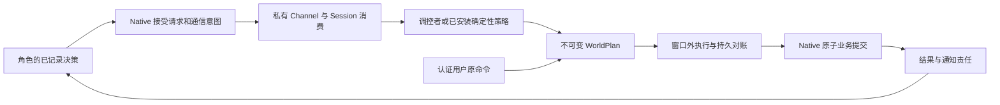

# 世界模拟完整 MVP 剩余设计

本设计补齐[完成度评估](assessment.md)中的未完成能力，以[原设计](evidence/source-design.html#s17)的三个领域和完整剧本为验收范围。以下新增名称、字段和状态均是拟议契约，不是已存在的导出。已有招聘协议、私有 Channel、原子入职与恢复行为作为必须保留的回归基础。决定记录归属[世界调控者提案](../../notes/implemented/feature/2026-10-08-world-director-mvp.zh.md)，执行顺序见[开发计划](development-plan.md)。

## 1 目标与约束

交付一个可从 JSON/YAML 或基础网页表单创建的暂停世界：CEO 提案，委员会独立投票，制度生效；HR 自主申请录用已有候选人或生成新人；新人联系未展开供应商，独立外部代表回应；人员随后调岗、交接并结束任职。公司、研究实验室和第三个小型社区/协会场景共用 driver。JSON 和 SQLite 均能同机冷恢复，恢复后保持暂停，所有已接受生成内容和已提交业务效果不重复。

继续使用一个 canonical Team、一个最终 Native 提交顺序、一个有独立 Session 的 director。保持 observe/stage/submit 三工具；真实用户管理通过认证产品命令，不冒充世界内角色。MVP 的外部世界全部为模拟；没有网络、付款、邮件或任意代码执行。有限模板生成已经满足 Persona 的 MVP 要求，不强制增加开放式长文本生成。

MVP 支持一个世界中的任意命名组织单位、委员会、岗位、人物和稳定外部组织；以一个主组织和其子单位覆盖验收。多个彼此独立的雇主之间的复杂法律/薪酬关系属于后续能力，场景必须明确拒绝尚不支持的组合。部门或委员会可复用现有组织实体与结构化类型属性，不要求为每个业务词新增 Native kind。任意命名不等于允许任意 schema 或任意执行代码。

## 2 所有者和分包

| 所有者 | 新增责任 | 继续禁止的耦合 |
|---|---|---|
| `simulation-scenario` | v1 定义、JSON/YAML 解码、语义编译、初始事实/知识/资源、日历和领域引用 | 不加载 provider、不分配身份、不推理；浏览器入口不引入 Host |
| `simulation` | WorldIntent/Plan/Mutation/Fact 的服务定义、严格协议、领域注册接口和封闭核心效果 | 不依赖 `simulation-world` 实现包；Native 不依赖产品 UI |
| `simulation-local` | run journal、纯 fold、业务唯一性、授权/read-set/额度检查、原子结果与 wake | 不在 reducer 内 IO 或调用模型；没有第二个 world 数据库 |
| `simulation-world` | driver、安装的 organization/governance/external 模块、受限认知策略、效果适配协调 | driver 不按公司/实验室/领域名分支；不导入 local provider 私有实现 |
| `simulation-team` | Participant/Session/Channel 准备、受控退休、跨日志回执、checkpoint/recovery | 不把 Team membership 直接当岗位权限；不允许伪造 sender |
| `simulation-product` | 原创建/管理命令、查询授权、预览、唯一运行 owner、人工处理 | 不赋予“可读”调用者可写恢复或调度权限 |
| Host、Client runtime、UI、双 SDK | 严格 DTO、领域检查器、编辑草稿、原命令重试、撤权清理 | 不把 Native snapshot 当公共 API，不在 React mount 时创建执行 owner |

先在现有两个新包和 Native 所有者内补模块，不按治理/人事/外部名词立即拆包。领域接口放在 Service Definition 所有者，注册遵守 `ctx.effect()` 生命周期并返回 disposer。模块将受控 transition 交给 Native 核验；核心 Entity、资源守恒、Session 身份和日志顺序仍由原所有者控制。

用户命令到计划的箭头表示可信 owner 验证后生成审计计划，并非客户端可提交任意已授权 plan；命令来源和世界内决策来源使用不同判别值。

## 3 通用领域协议与自主请求

### 3.1 请求封装

新请求输入由 `domain + operation + version` 选择严格 payload schema，保留业务事项键、目标、期望生效时间和结构化证据引用。普通模型不得提交 requester、run、writer epoch、Participant、Session 或授权结论；这些字段从当前 writer 与已消费决策上下文派生。首版每个决策最多一个逻辑世界请求，可信展开保留逻辑位置到实际 operation 的映射。

| 字段组 | 写入者与校验 |
|---|---|
| domain、operation、version、payload | 模型提出；必须匹配已安装且对该角色允许的严格 schema |
| businessKey、priorCaseId | 模型可引用当前授权目标中的稳定事项键；Native 核验所属范围、前案关系与唯一性；管理新事项由 owner 分配 |
| requester/decision/epoch/source | Native 从真实调用身份和日志派生；用户管理命令另记 authenticated-user 来源 |
| evidence、expectedTime | 引用当前上下文可见、已存在且类型匹配的事实；引用不能授予读取其他私密正文的权限 |
| requestId、payloadHash、notificationOperationId | 接受前确定并原子保留；同身份异 payload 拒绝 |

当前 `world/request` 只能引用已打开 HireIntent。v1 在普通目标决策中允许提交受控领域意图，Native 在一次 acceptance 内建立或查找业务事项、保存请求及依赖它的标准 `communication/post`，按展开后的 operation/消息/字节总量计费。没有初始 HireIntent 的“为项目补充工程能力”目标也能产生申请；文本目标本身不越过 can-hire、岗位、预算或制度检查。

技术幂等用原 command/decision/operation 身份和内容 hash。业务防重使用 `(run, domain, operation, businessKey)` 加领域约束：招聘岗位事项、制度提案版本、离职任职 ID、外部交互 ID。跨 decision 重复引用同事项返回原案；刻意新建不同事项仍受岗位、资源和每 actor/周期额度限制。不得承诺识别任意两段自然语言是否语义重复。

### 3.2 Channel 和消费准入

请求记录和通知意图同次接受，通知正文由可信格式生成，仅携带索引和指纹。只有原 Channel/Envelope/recipient/input 精确匹配并到达 deliverAt，才能给 director 准备上下文；director 提交仍要求 Session 已消费对应输入。沿用 [transport](../../../packages/simulation/simulation-team/src/transport.ts) 的精确 proof，不新增任意 system sender。

请求状态为 recorded、awaiting-delivery、awaiting-evidence、planning、resolved、cancel-requested 或 cancelled；它与 plan、mutation、notification 分开。`awaiting-evidence` 保留缺失字段码、允许响应者、截止模拟时间和最大补证次数；补证是同 case 的新输入修订，经同一通道验证，不改原请求。到期或额度耗尽明确拒绝；不能一直自动重试。保留当前“缺信息拒绝后关联前案的新申请”作为一种明确终止路径。

### 3.3 计划和结果

WorldPlan 保留 request revision、supersedes、实际选择/生成内容、模型与策略版本、implementation generation、typed read-set、authority basis、effects 和 disclosure。已 accepted 的内容不可更改；旧计划因关键读项变化 stale 后可有限重规划，普通无关 revision 不使其失效。准备过但未提交的规划尝试仍占规划预算。

read-set 从当前招聘专用字段扩为类型化引用：Entity revision、Relation revision/区间、Proposal/Resolution hash、Norm version、资源版本/额度、ExternalIdentity revision、角色权限 generation。每种读项有拥有者的比较函数；不存在通用 JSON path 读取或 patch。

结果用严格 outcome 联合描述不同领域产生的对象引用。拒绝、等待、未知分别存在：rejected 是确定性否决；blocked 表示前提尚未满足；outcome-unknown 表示已接受 IO 缺精确结果。未知不允许重新生成另一 plan。通知只投影获准字段，director 私密理由不随 result 自动公开。

### 3.4 领域定义和实现固定

领域注册声明请求/计划/事件 schema、纯验证/折叠/投影、允许的核心 transition、策略和适配器需求。外层 Native envelope 和核心不变量保持闭合；内层 domain/version 通过注册表严格解析。未知必需领域事件拒绝可写恢复；浏览器 SDK 至少解析版本化 envelope 和已安装内建领域，不能把未知 payload 当成功对象。

保存的 plan 固定 schema version、implementationRef 和 generation。执行取得该 generation 的 lease，卸载先关闭新准入、排空已接受执行，再释放注册；无法完成的责任保留为 implementation-unavailable。重启先核对对应 schema/reducer/provider；不能用相同名称的新实现猜测旧结果。用一个会议室预约测试领域证明无需修改主 driver 就能复用请求、Channel、计划和结果路径。

## 4 WorldFact 与制度投影

WorldFactVersion 最少包含 factId、version、schemaRef、subject/scope、payload、source、recordedAt、effectiveFrom/effectiveUntil、availableAt 和 audience。recordedAt 使用记录时钟；生效、截止、可知与日历用规范模拟时间。区间一律左闭右开 `[from, until)`，until 为空表示未结束。禁止逆改已提交历史；更正追加新版本及 supersedes。

NormVersion 在事实层上增加文档正文/hash、提案与 resolution 引用、enforcement、已安装 policyRef/参数和授权作用域。advisory 只影响角色可见材料；validated 必须有对应操作准入检查器，未知 policy、超范围参数和自然语言执行代码均拒绝。首个 validated 原语选择“招聘需指定委员会批准且满足岗位/金额上限”。创建资源账户、转账和世界 source/sink 不混为一种效果。

当前背景是按读者、模拟时刻、已知来源与 revision 生成的投影。今天公告、明天生效的制度可以今天可知但明天才约束新准入；生效不代表所有人收件或理解。控制平面的硬授权检查读取权威制度，即使角色尚未获通知也不能绕过；拒绝只返回该读者可知的原因码。模型输入只选择可知事实，经 `simulation/context-view` 保存精确版本和正文。

已有承诺默认沿用接受时的合法条件，不被新制度悄悄改写。制定新规范若需要影响已有责任，必须列出受影响对象并采用专门的取消/补偿协议；MVP 对不支持的迁移返回 existing-obligations，保留原义务。

初始公开背景、私有 belief/report 和资源都经 compiler 分开落地。belief 不因 director 总结而升级为事实。知识来源沿用已有 [knowledge](../../../packages/simulation/simulation/src/knowledge.ts)；新事实不复制为第二份可独立写入的知识真相。

## 5 治理领域

### 5.1 固定提案和独立投票

GovernanceProposal 保留 committee Entity、适用组织、原正文 hash、Norm 目标版本、提案者、冻结 electorate、策略版本、截止时间、quorum 和通过规则。默认支持 unanimity 与绝对票数阈值，阈值必须为正且不超过 electorate；支持 yes/no/abstain。首版不支持改票；需改票或改正文必须形成新提案，不覆盖旧票。

每票从实际角色的 accepted Decision 派生 voter。`(proposalId, voterId)` 唯一，同票原件重试幂等，异 choice 拒绝。投票引用准确 hash 与提案 revision；非成员、替别人投票、旧 epoch、截止及结案后投票拒绝。委员会成员后续变动默认不改变被冻结的 electorate。若成员无法完成投票，等待 deadline，不临时降低门槛。

### 5.2 结案、时间和生效

确定性 close 计算真实票据。早结案只允许所有人已投票，或结果在剩余票任何组合下已不可改变；否则等待 deadline。quorum 计所有已提交合法选项，abstain 不计 yes；unanimity 要求全 electorate 为 yes；阈值规则要求 yes 达标且 quorum 满足。选定后持久冻结，director 无权改变。

投票准入要求 `now < deadline`；在 deadline 时刻拒绝迟到票，close 在 deadline 阶段运行并读取此前接受的票，窗口未结算不得提前 close。resolution 由一次 Native append 保存结果、票据引用、hash 和后续 wake。同一次重复 close 返回原件。

通过不自动 enact。授权角色发 `governance.enact-norm` 请求，经 world Channel 到 director；plan 提出 advisory 或已安装 validated 映射。Native 提交前核验 passed resolution、同正文/hash/目标版本、当前 enacted revision、scope、policy 和执行时间。一次 append 写 NormVersion、结束旧有效区间、保存结果和公告责任。原案只生效一次。取消/撤销产生新命令或新版本，不删除投票和历史制度。

### 5.3 原子性和风险

团队讨论消息和 Team task review 可辅助沟通，不能替代独立 votes。单 reviewer API 不承载委员会共识。持久化成功但 close/enact 回复丢失时查询原 resolution/mutation；绝不重新计算一组不同 electorate。完整故障矩阵和越权测试见 checklist G 组。

## 6 人员和任职生命周期

### 6.1 既有人物录用

organization.hire-existing 输入 personId、目标组织/岗位、业务事项和批准依据。引用已有 person 必须符合当前策略允许录用、没有冲突任职、未 terminated；已有 cognition/binding/profile 不可替换。复用 Person/Participant/Session，保存新任职 Relation 和独立 onboarding wake。若已有非认知人物无法满足 agent 任职要求，明确拒绝，不能修改 immutable cognition。

普通“候选人可录用”事实或当前批准承担 MVP 同意条件；不能任意强迫其他组织在职人员入职。完整 offer/面试市场不在范围。generate-and-hire 继续使用现有有限 Persona，复用 [hire](../../../packages/simulation/simulation-local/src/world-hire.ts) 的准备/取消语义；新的批准和资源约束在 reserve 和 commit 两次核验。

### 6.2 人事 mutation 状态机

结构变更采用 retained → reserved → quiescing → preparing → ready-to-commit → committed → notifying。任一未提交阶段可进入 blocked 或 cancel-requested；清理确认后才 cancelled。committed 之后取消返回 already-committed；如需离职，提交独立请求。未知 IO 保留占用和精确清理责任。

reservation 保存岗位、资源、实体和跨 owner 幂等身份；占用按 occupied + reserved 检查。native 提交前重验最新授权、approval、read-set、有效期和额度。所有模型/Team IO 在写队列外，只有纯校验和 append 进入队列。一个 run MVP 同时最多执行一个结构 mutation；部署额度冻结在 resolved scenario，不隐藏在 driver 常数中。

若录用包含一次性费用，资源 owner 在 reserve 时计算可用量 = 当前余额 − 所有有效预留，冻结账户、单位、数量和实际控制/批准依据；commit 将约定转移、任职、预留结算和结果放入同一 Native 批次。取消只能释放预留，已提交支付不能静默反向。MVP 不把一次录用承诺扩展成未定义的长期工资系统；循环薪酬需要后续独立日历结算策略。

### 6.3 调岗

输入原 assignmentId/revision、目标 position、requestedEffectiveAt、事项和批准。到安全边界时读取实际提交时间；若预定严格时刻已错过，返回 stale-time，需新计划，不回填过去。允许“下一安全边界”的请求显式记录 actualEffectiveAt。

先预留目标岗位并核对任务、资源控制和未接受决策，进入维护、fence 旧岗位授权 generation。一次 Native append 关闭旧 assignment 区间、建立新区间、更新岗位授权、释放对应预留、保存 result 与 wake。人数不增加，Person/Participant/Session 不变。源岗位的职责或已接受任务不会自动转给目标岗位；不支持的责任转移返回 handoff-required。下一次上下文取新职责，旧 context-view 保留原事实。

### 6.4 离职和退休

先保留 departure intent，并在 Native 关闭这段任职的新工作/授权准入。盘点项至少包括 open/submitted decisions、已接受 operations/outbox、Team task attempts、commitments、资源控制、未来 wake、收发消息和 subordinate 关系。盘点返回稳定引用、责任 owner、可用处置及 revision；预览不执行处置。

默认允许等待原责任完成，或使用其既有 owner 支持的显式取消后另建新工作；不支持自动责任继承。已接受 effects 继续按原证据对账，不能靠 phase=inactive 让它们失踪。MVP 在责任未处理完时保持 Entity active，但岗位新授权已 fencing；这种暂停不会恢复旧岗位的新请求能力。需要特殊清偿权必须是只针对原责任的精确能力，不能授予一般执行权。

确认清偿后关闭 assignment 区间，撤销未来岗位检索与新权限，保存 departure result 和通知。按用户/场景选择是否保留独立个人活动；若需停止认知，撤销 writer 并等待 controller 确认退休，确认前占用 resident 和清理责任。无法确认返回 retirement-unknown，冷恢复对账原 Activation；不能启动第二 writer 或提前释放容量。

普通离职不等于 terminated；重新入职创建新 assignment 并保留原人物记忆。terminated 是不可逆实体生命周期，只有独立授权的终止操作可执行。UI 分别显示在职人数、非终止人物、resident、未释放 writer 和历史 Participant/Activation；离职不保证释放历史额度。

## 7 外部世界领域

### 7.1 稳定身份和三种模拟方式

ExternalIdentity 用 `(run, scope, externalKey)` 唯一标识组织/对象，保留 Native Entity 引用、revision、已知事实、representation、允许展开模板/策略和最多一个有效代表 generation。显示名字不作主键。未知库存/信用以 unknown 保留，不默认零；引用已有事实的所有新结果必须保持一致。

| 方式 | 执行和持久来源 | 结果限制 |
|---|---|---|
| simulated-rule | 已安装确定性规则或有记录采样；保存实际样本、规则版本和输入事实 | 纯函数不 IO；重放只读实际结果，不重新抽样 |
| director-mediated | director 提议严格 AdjudicatedOutcome，保存允许依据和模型/策略版本 | 不能冒充外部人物或真实观察；不可覆盖已知库存、合同和资源账 |
| simulated-actor | 原外部实体的独立代表 Person/Participant/Session，标准 Channel 发言 | 输入不包含买方私密底价或 director 历史，所有模型/驻留消耗计入统一额度 |

允许 latent 身份第一次按需创建，也允许预配置 registry。请求 external.interact 选择稳定身份、目标事项、输入和响应范围；表示策略允许 director 选择上述已安装方式。新 registry entry、计划和表示预留都进 Native 日志，不由临时模型输出直接分配身份。

### 7.2 代表准备与首次回应

同一外部身份展开竞争先做持久 reservation，复用同一代表的 Entity/Participant/Session/Channel；并发请求等待该 reservation，不能生成多个互不知情的供应商。非认知组织保持 cognition:none，代表以 represents 关系指向原组织，既有资产、报价与合同仍在原主体。

准备流程复用维护、readiness 和跨 owner receipts；commit 原子写 represents、representation generation、ready、结果及首次交互 wake。请求方在 commit 后通过新 direct Channel 与代表交流，代表用自身真实 sender proof。展开失败/取消先清理未确认责任，再释放可释放占用；已确认的历史身份不抹除。自动降级、替换代表和多表示来回切换留待后续。

### 7.3 裁决和资源

AdjudicatedOutcome 只允许授权的环境事实、延迟事件、失败结果或代表准备计划，包含 subjectRef、sourceKind、policyRef、evidence 和 disclosure。与既有权威事实冲突时拒绝；可明确记录未核实报价为 report，不能同时把它记为权威库存。

MVP 默认使用初始资源与合法转移完成主剧本。若所选规则确实需要来源/消耗，必须增加受限 source/sink grant：数量、单位、对象、原因、策略、周期上限与一次性业务键，维持“期末 = 期初 + 来源 − 消耗”的台账。没有该领域安装就拒绝此效果；模拟展开本身不铸造资产。真实适配器不注册到 MVP allowlist，也不接受 URL/凭证 payload。

## 8 场景协议和通用事件

### 8.1 新定义版本

使用显式 `clocky.world/v1`；不在 v0 上默许新增字段。字段分组为 metadata、runtimeProfiles、domains、entities、organization、governance、facts、knowledge、resources、communication、externalWorld、behavior、limits。每个 domain 配置采用已安装 versioned schema。初始人必须有完整允许模板/Persona；预检或暂停创建不隐式调用生成模型。

保留 v0 fixture 作为旧招聘行为参照；新格式落地后整体更新活动场景、SDK 和文档。项目处于 pre-release，可明确拒绝不支持的旧 Native stream，不写伪造缺失事实的兼容 shim。若保留 v0 导入，仅作显式定义转换并重新预检，不用于迁移旧运行日志。准确格式版本由实施时所在基线决定，不能预先假设下一个一定是 stream 61。

### 8.2 JSON 与安全 YAML

两个输入先解码成同一 JSON 数据模型，再使用同一纯 compiler。优先复用仓库已有维护中 YAML 依赖，按真实 parser 配置与 AST 检查验证安全规则；不手写 YAML parser。拒绝重复键、自定义 tag、merge key、alias/anchor、非字符串键、多文档流和不受支持标量；不支持 include、文件路径执行、JS 或模板插值。YAML 时间必须显式字符串，禁止隐式日期转换影响 hash。

限制原始字节、深度、节点数、集合大小和引用总量；在解析、语义编译和最终序列化接受边界分别检查。拒绝应带 source format、path 与行列位置，网页定位字段。两格式同语义导入得到相同 canonical definition hash；导出 JSON 或规范 YAML 保留支持的语义，不要求保留注释和原排版。不能通过重新导出覆盖正在运行的世界。

### 8.3 编译和暂停准备

编译验证全局符号身份、组织无环关系、任职重叠/容量、委员会成员/门槛、事实时间/可见性、资源单位/数量/控制权、通道成员、外部唯一键和事件接收者。宿主解析已安装模型/策略/模板/领域实现以及全部额度，生成 frozen resolved + preview；create 在同一受理边界重新验证 generation/hash，并先保留原输入与 resolved，再做任何身份 IO。

准备按照可恢复顺序建立实体、人物绑定、关系/资源/事实、通道和初始事件，每一步有原 reservation/receipt。最终完成初始 checkpoint 后返回 paused。任意中断以同 commandId 恢复同身份；不存在部分准备却被展示为可运行的世界。

### 8.4 事件与自主行为

持久事件分初始目标、日历 wake、治理截止、制度生效、reservation 到期、外部回应和普通通信。日历声明 period、起止时间、角色/岗位目标、最大触发次数；事件键由 calendarId + occurrence 确定，一次消费只生成有限下一次事件，禁止预展开无限未来。岗位接收者在触发时解析并保存精确选择，不事后随调岗变更旧事件。

普通模型可选择现有 task/resource/message 操作，或在已记录能力范围内发起新 world request；director 的主动环境请求只能由场景授权的日历/事件触发，记录独立预算和触发来源。公平性继续使用 Native queue 的等待顺序，系统 case 不能无限抢占普通角色。每周期新增人物数、外部展开数、请求数、pending mutations、domain event bytes 和规划尝试均设限，连同历史身份/模型/token/驻留计费。

## 9 原子提交和恢复

### 9.1 线性化点

纯本地领域变化在一次 Native append 中成为事实：业务变更、旧版本结束、reservation 结算、结果、派生 wake 和通知责任不可拆分。Team/Session/Channel IO 使用持久 intent → 原 key 执行/查询 → 精确 receipt → Native 确认；即便共享 SQLite，也不假设跨日志事务存在。

计划提交只记录，不等待维护或新人启动。owner 等窗口关闭后关闭新准入、排空已接受 IO、确认需要退休的 writer，再进行结构变更。恢复只处理已保存责任，不调用模型重新生成 accepted 内容；只有新的显式 start 可以开启生产性调度。期间新的用户 pause/cancel 通过持久世代比较保持优先，不被维护完成后的自动恢复覆盖。

### 9.2 领域故障矩阵

| 故障点 | 必须保留与恢复 | 不允许 |
|---|---|---|
| 请求 accepted 后、Channel 前；Channel 后、receipt 前 | 原 request/businessKey/operation/Envelope | 再造 case 或绕过交付延迟 |
| vote/close/enact append 前后 | 原票、electorate、hash、resolution 和至多一份 Norm | 重复投票、生效两次、修改历史正文 |
| Persona/plan accepted 后、身份准备前 | 实际生成物、版本、原 plan | 为同计划重新推理 |
| 代表/候选人 Participant 已建立、binding 未确认 | 原全部身份与精确 Team receipt | 换 Session、提前行动或遗失容量 |
| 调岗 append 前后 | 旧/新 assignment、授权世代、result 为零或完整一批 | 两个当前岗位或两个岗位都丢失 |
| 离职撤权后、writer 停止未知 | 保持新工作关闭、旧义务与容量责任 | 恢复旧权限或创建第二 writer |
| 外部 reservation/采样结果保存后 | 原外部 key、实际结果、代表 generation | 再抽样、重造组织、重复库存 |
| 业务 committed 后、通知未知 | 查询原结果，仅恢复原通知 | 重复扣资源、入职、生效、离职 |
| 取消与任何准备/提交竞争 | 同一 run 队列的先提交者决定终态 | 取消已提交结果或悄悄执行反向业务 |
| 注册卸载/实现缺失 | retained generation、lease 和未完成责任 | 套最新模块静默恢复 |

每行覆盖 JSON/SQLite；涉及跨 owner 及业务 append 的关键窗口用 barrier + 子进程 SIGKILL + 新进程 reopen。不能只用 mock 抛错代替断电语义。checkpoint 增加领域 manifest、facts/norms/votes、外部 registry、所有 mutation/清理/通知责任及跨日志引用。校验依据缺失就拒绝 writable restore；只读原始检查必须标明不完整，不能报告运行已恢复。

## 10 隐私、权限和模型输入

权限分操作授权、事实读取、模型上下文选择和产品展示四层。产品拥有 run 不自动解锁 votes 正文、私有人物知识或 director rationale；服务端每个正文接口独立检查。分页 cursor 绑定 run、query、revision 和 reader/disclosure generation，权限变更即失效。

director 只获得当前 case 所需世界事实和审批/容量，不扫描所有聊天。外部代表和新人只读获准 Persona、自身事实及新通道消息；不复用 director Session。向低权限角色发布结果采用可信模板/结构化投影，字段过滤不能证明一个读过机密的模型自由文本没有泄漏。

所有首次模型输入、变化的制度、权限来源和外部事实均由 Session/context-view 重建；不得增加未记录的 system-context callback。离职撤销未来检索与岗位权力，不承诺擦除历史 Session 和已知记忆。授权撤销后 UI 清空敏感内容、取消读取世代并拒绝迟到结果；普通断网保留明确过时标记及原命令。

## 11 产品和 SDK 契约

### 11.1 扩展现有 API

保留现有 `simulation.world.preflight/create/prepare/export` 与 `cases.list/inspect/cancel` 的原命令语义，通过明确 DTO 版本扩展。新接口名实施前遵循 Host RPC 风格统一；下面是责任分组，不是已可调用的方法声明。

| 拟议能力 | 输入和输出 | 副作用/准入 |
|---|---|---|
| domains/catalog | 可编辑领域、版本、模板/策略元数据与 schema | 只读，无身份和模型 |
| commands.preview | typed action、期望 revision；返回影响、义务、额度与 previewHash | 只读，不保留业务预留 |
| commands.submit/query | 原 commandId/payload/hash；返回 accepted/pending/terminal receipt | 认证管理权；受理时重验，不模拟角色 sender |
| organization.query | scope、simTime、revision、cursor、limit；返回节点/关系/覆盖范围 | 有界只读，时点固定；不伪装全量图 |
| governance.proposals/resolutions.inspect | proposal/resolution 引用和独立正文授权 | 返回真实 electorate/票据/状态，不返回伪造投票 |
| documents.list/inspect | fact/norm ID、version、时间/权限选择 | 当前/历史正文、生效与通知分别表示 |
| external.list/inspect | 稳定 key、representation generation、分页 | 明示 simulated 来源和实际代表身份 |
| obligations.inspect | assignment/person 引用和 revision | 给调岗/离职预览及下一步，不自动取消工作 |

生产 SDK 只暴露严格 browser-safe DTO。TypeScript client/server/protocol、Python parser/client/server、Host carrier 同次更新；未知必需事件和坏分页世代拒绝。恢复验证覆盖源码、compiled TS 和已安装 Python wheel，不以源码 import 成功代替分发证明。

### 11.2 创建与运行界面

创建入口提供模板、JSON/YAML 导入、空白定义。基本表单覆盖背景、组织/岗位/成员、委员会/规则、资源、外部身份和事件；表格编辑与源码共用一个文档草稿，不互相静默删除字段。无效字段阻止预检并定位；切换视图保留错误草稿和引用诊断。预览列出角色、执行模型、治理规则、advisory/validated、外部来源和全部有效限额，主按钮为“创建暂停运行”。

运行页面在已有案件四分区上增加制度、组织任职历史、外部世界和待处理义务视图；状态由 DTO 投影，不从聊天文本猜测。展示 pending votes、handoff-required、policy-unavailable、retirement-unknown、capacity 与 outcome-unknown，并给可执行的查看、补证、查询原命令或显式取消动作。

所有变更先 preview，再固定一个 commandId/payload 提交；HTTP 超时保留原件，先查询后精确重试。预检明确未受理的错误才允许新意图；通用 invalid 或 not-found 不能自动证明原命令没有执行。读页面、刷新、多标签和导出均不开始推理或创建第二 owner。

图仅显示服务端查询覆盖范围；MVP 用表格和局部只读关系图即可，不需要拖拽组织建模器。布局遵守项目 DESIGN/UX 规范；实现时需实测键盘、焦点恢复、窄屏、浅深主题和减少动效。GUI PR 的 GIF 必须来自真实 server/model 流，不以 mock 截图宣称功能完成。

界面契约见 [UI 设计](ui-design.md)；在其已交付基础上的布局重构、组件、动效与留白背景设计见 [UI 第二轮](ui-refinement.md)，其 V 组验收不计入本设计的 MVP 完成条件。

## 12 版本、容量和观测

当前 Native stream 为 60。新增 durable 结构变更必须递增 stream 并明确拒绝不支持格式；只有 SQLite 表结构变化才递增 SCHEMA_VERSION，Session format 继续由其 owner 决定，不能机械同步三个版本。场景、domain schema、implementation generation、model/template version 各自保留，不混为一个版本。

结构化观测至少包含 run/case/plan/mutation/command/decision ID、领域、停止原因、规划调用和 token、队列龄、维护时长、通知状态、未知责任数、人数/resident/history/capacity。日志不得附带未授权私密正文。性能测试固定 workload、版本和硬件，保存原始数据；先测 actor churn、votes/norm 历史、重复外部交互和冷恢复成本，再确定支持规模，不把示例限额当吞吐承诺。

## 13 默认决定与替代方案

| 决定 | 采用方案与原因 | 未采用方案 |
|---|---|---|
| 领域通用化 | 用现有招聘链提取严格注册和 typed effects，保留 Native 核心校验 | 在 driver 增加每种业务 if 分支会使恢复与版本逻辑重复 |
| 治理 | 独立 votes 和确定性 resolution，绑定同正文/hash | 单 reviewer task、会议纪要或 director 声明不能证明集体授权 |
| 人事变更 | 原身份、时态任职、安全维护和义务清点 | 改 profile.role、直接 inactive/terminated 会破坏权限、记忆或旧效果 |
| 外部代表 | 独立 Person/Session，稳定 external key，受限初始上下文 | 复用全知 director 的历史无法建立信息隔离 |
| 持久化 | 同 run 原子事实 + 跨 owner intent/receipt | 第二 world 数据库或假定跨日志事务会产生双重真相 |
| 文件版本 | 明确新定义/stream，pre-release 下拒旧或显式转换 | 无声兼容和默认填审批/ready 会制造不存在的证据 |

## 14 完成条件

[checklist](checklist.md)全部必需项有当前实现证据，三个场景经过实际产品入口和两后端，完整治理→招聘→外部→调岗→离职剧本通过；关键故障点恢复原身份与原结果；真实模型小样本记录预算、版本和人工评估。任何高风险缺口如重复效果、越权、隐私串用、失踪义务或未知退休提前释放均阻止整体验收。文档和示例明确拒绝未支持功能，旧采购及现有招聘路径不回归。
