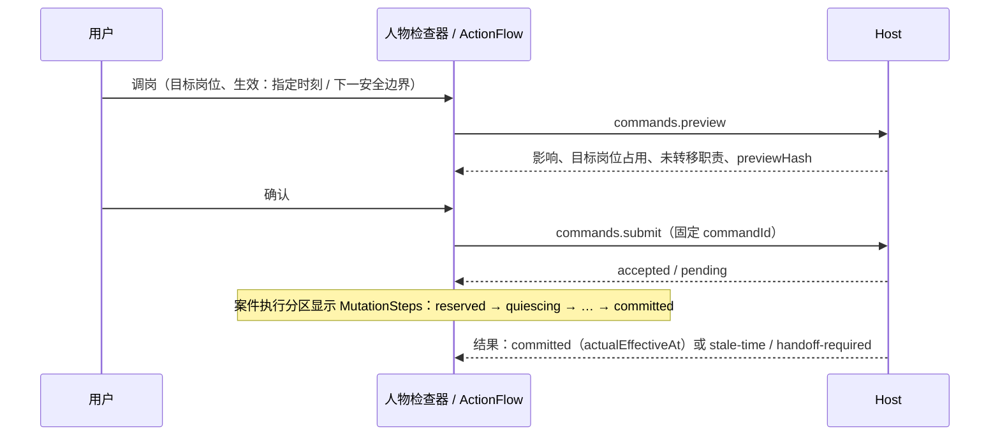

# 世界模拟完整 MVP 的 Web UI 设计

本文细化[剩余设计](design.md) §11.2 与[开发计划](development-plan.md) C6，回答“界面怎么组织、长什么样、怎么动、怎么操作”。它服务 [checklist](checklist.md) 的 U01–U15，并为 F/G/O/X 组能力提供可观察入口；它本身不构成任何 checklist 项的完成证据。U01–U15 交付后的布局重构、组件、动效与留白背景设计见 [UI 第二轮](ui-refinement.md)。

文中出现的模块名、组件名、路由参数、DTO 字段和配置项均为**拟议**，不是已存在的导出。界面只渲染 Host DTO 投影出的事实：任何状态、计数、按钮可用性都来自服务端，UI 不从聊天文本、名字或页内计数推断业务状态。

视觉、动效和交互规则以 [DESIGN.md](../../../DESIGN.md)、[UX-CONTRACT.md](../../../UX-CONTRACT.md)、[可视化层提案](../../notes/proposed/feature/2026-10-04-swarm-and-world-visual-layer.md)和[主题 token](../../../packages/client/ui-theme/src/styles/tokens.css)为准；本文只在这些规则之上补充世界模拟专属的布局、组件和流程，冲突时以上述 owner 为准并回改本文。

## 1 现状与缺口

现有 `ui-simulation` 已提供：运行目录、共享运行头（身份/控制/状态事实）、七个主模块加 More 中的请求历史、`CollectionWorkspace` 表格 + 360px 非模态检查器、四种可视化视图（World/Timeline/Effects/Checkpoint）、原命令 `CommandRecord`、世界 JSON 导入弹窗 `WorldCreationDialog`、案件表 `WorldCases` 及请求/计划/执行/通知四个分区。

对照新范围的缺口：

| 缺口 | 现状 | 本文给出的方案 |
|---|---|---|
| 作者体验 | 一个 form 弹窗：名称 + 文件 + JSON textarea + 列表式预览 | 独立的“世界作者台”页面：分节表单、表格编辑、源码视图、诊断定位、实时预览侧栏（§4） |
| 领域观察 | 只有招聘案件，状态用单个文本 | 组织、制度、外部世界三个领域模块与“四轨状态”组件（§6–§9） |
| 人工管理 | 只有取消案件 | 统一的“预览 → 提交 → 回执”管理流（§11） |
| 导航容量 | 7 个平铺模块，再加 4 个会溢出 | 世界运行使用“世界 / 引擎”两层导航（§3.2） |
| 状态表达 | 文本 + `role=status` | 统一的状态语义表、FactValue 五态、陈旧/撤权表现（§12） |
| 动效 | 已有 L0–L3 分层和 5 个 Moment | 为新领域映射具体触发、属性、时长与降级（§14） |

## 2 设计原则

1. **事实先于叙述。** 每个可见状态都对应一个 DTO 字段；“未知”“不可用”“已隐藏”“陈旧”和“零”在视觉上不同。没有观测就不画进度。
2. **两段式变更。** 所有改变世界的操作都先 preview，再以固定 commandId/payload 提交；提交后界面围绕原命令，而不是围绕按钮。
3. **时间显式。** 区分模拟时间与记录时间；区分“已记录 / 已生效 / 可知 / 已通知”。区间一律显示为左闭右开 `[from, until)`，until 为空写“至今”。
4. **权限分层可见。** 能看到运行不等于能看到正文；正文、Persona、票据理由、director 理由各自独立显示“已授权 / 已隐藏 / 不适用”。
5. **有界且自述覆盖范围。** 每个列表、图和时线都说明“已加载 N / 共 M、修订号、时点”，绝不把一页当全量。
6. **安静的工作面，有意义的动。** 动效只解释导航或真实状态变化；常驻界面保持静止，减少动效模式下保留全部文本反馈。
7. **复用而不新造。** 优先使用 `ui-primitives` 与 `ui-viz` 现有组件；新组件放在 `ui-simulation` 内，只有确有第二个消费者时才上移。不为看板、检查器或弹窗新建插件。

## 3 信息架构

### 3.1 页面地图

```text
Simulation（侧栏入口，与 Team 并列）
├─ 运行目录 ───────────────── 新建 ▸ 选择器（模板 / 导入文件 / 空白）
│                                 └─ 世界作者台（独立页面，无 run）
└─ 运行工作区（共享运行头）
   ├─ 世界（world 运行的主导航）
   │  ├─ 概览            需要你 · 时钟与日历 · 治理 · 人员 · 外部 · 事项流
   │  ├─ 事项            案件表 + 四轨检查器（请求/补证/计划/执行/通知/来源）
   │  ├─ 组织            结构 · 任职时线 · 人员   （人物检查器含义务预览）
   │  ├─ 制度            提案与投票 · 现行制度 · 制度历史
   │  └─ 外部世界        外部身份 · 交互记录
   └─ 引擎（菜单）       实体 · 决策 · 操作 · 检查点 · 记录 · 请求历史
```

### 3.2 两层导航

世界运行在主 tab 行显示五个世界模块，现有的实体/决策/操作/检查点/记录和请求历史收进一个标为“引擎”的菜单按钮（复用当前 More 的 `Menu`）。非世界运行（现有采购模板）保持当前 tab，不受影响。

是否为世界运行只读运行创建版本中保留的定义类型，与现有“cognition-only”判断同源；不按运行名称或当前 catalog 推断。读取失败时退回现有平铺导航，并保留恢复入口。

选择理由：DESIGN 要求主模块数量可控、次要目的地进 More；世界用户的首要问题是“这个组织发生了什么”，引擎层是追溯证据的二级视角。所有世界模块里的 ID 都能直接跳到引擎层的精确对象，跳转保留 Back/Forward。

### 3.3 路由参数（拟议）

保持现有原则：URL 只含不透明 ID、已提交筛选和分区选择，不含草稿正文或私密内容。

| 参数 | 取值 | 用途 |
|---|---|---|
| `simulationModule` | 新增 `organization`、`governance`、`external` | 世界模块 |
| `simulationLens` | `structure` / `timeline` / `people`；`proposals` / `norms` / `history`；`identities` / `interactions` | 模块内视角 |
| `simulationAt` | 规范十进制模拟时间字符串 | 组织与制度的“查看时点”；缺省为最新 |
| `simulationCaseSection` | 现有四值加 `evidence`、`source` | 案件检查器分区 |
| `simulationAuthor` | 不透明作者草稿槽 ID | 打开世界作者台；正文仍只在内存 |
| `simulationDomain` | 已安装领域 ID | 事项表领域筛选 |

### 3.4 数据归属

| 内容 | 归属 | 说明 |
|---|---|---|
| 领域查询窗口、检查详情、原命令与回执 | Client runtime | 每个集合一个有界窗口，绑定 revision 与 reader/disclosure generation |
| 视图选择、已提交筛选、滚动位置、查看时点 | UI store + URL | 不含正文 |
| 作者草稿（规范数据模型 + 源码文本 + 视图模式） | UI store 内存槽 | 关闭、切模块、普通断线保留；撤权/换账号清除；离开页面警告 |
| 管理命令草稿 | UI store 内存槽 | 与现有 input/review 草稿共享计数，独立字节上限（§16） |

## 4 世界作者台

### 4.1 入口：新建选择器

目录页“新建世界”打开一个小型 `Modal`，三张并列选项卡片，键盘方向键切换、Enter 确认：

```text
┌ 新建世界 ─────────────────────────────────────────────────┐
│ ┌──────────────┐ ┌──────────────┐ ┌──────────────┐        │
│ │ ◇ 从模板开始  │ │ ⇪ 导入文件    │ │ ＋ 空白定义   │        │
│ │ 公司治理招聘  │ │ JSON / YAML   │ │ 只含必填骨架  │        │
│ │ 研究实验室    │ │ 拖放或选择    │ │              │        │
│ │ 小型协会      │ │              │ │              │        │
│ └──────────────┘ └──────────────┘ └──────────────┘        │
│ 未完成的草稿：「新药研发实验室」· 3 处诊断   [继续编辑]       │
└───────────────────────────────────────────── [取消] ──────┘
```

- 模板列表来自 Host `domains/catalog` 与已安装模板，不在前端写死。模板卡展示领域徽章（组织/治理/外部）与“将创建 N 个人物、M 个委员会”的静态摘要。
- 导入卡同时接受点击和拖放；拖入时卡片边框变为 accent，显示“松开以读取”。只接受 `.json`、`.yaml`、`.yml`，超过字节上限立即在卡内报错，不进入作者台。
- 存在未完成草稿时在底部列出（最多 3 个），点击“继续编辑”直接打开作者台。
- 选择后关闭弹窗并推入 `simulationAuthor=<slot>` 路由；Back 返回目录。

### 4.2 作者台布局

作者台是 Simulation 工作区内的整页视图，不是弹窗：完整定义包含十余个分节和表格，DESIGN 禁止把完整应用嵌进模态层。

```text
┌ 侧栏 ┬───────────────────────────────────────────────────────────────────────────┐
│      │ ← 目录   新药研发实验室  ·  草稿 · 已保留在本标签页        [表单|源码] [JSON▾] │
│      │                                       [检查定义]  [创建暂停运行 ▸]           │
│      ├──────────────┬───────────────────────────────────────┬────────────────────┤
│      │ 分节          │  组织与岗位                              │ 检查结果            │
│      │ ● 基本信息     │  ┌───────────────────────────────────┐ │ ⚠ 3 处问题           │
│      │ ● 组织与岗位 2 │  │ 名称       上级      类型    容量    │ │  组织与岗位 · 2       │
│      │ ○ 人物与任职   │  │ 研发部     实验室    部门     —     │ │   positions[2].org   │
│      │ ○ 委员会      │  │ 首席科学家 研发部    岗位     1  ⚠  │ │   引用不存在的单位     │
│      │ ○ 制度与事实   │  │ ＋ 添加行                           │ │  委员会 · 1           │
│      │ ○ 知识        │  └───────────────────────────────────┘ │ ─────────────────── │
│      │ ○ 资源        │  选中行详情（行内展开）                    │ 预览  · 已过时        │
│      │ ○ 外部世界     │                                       │  角色与模型 …         │
│      │ ○ 通道        │                                       │  治理规则 …           │
│      │ ○ 事件与日历   │                                       │  外部来源 …           │
│      │ ○ 运行与额度   │                                       │  有效额度 …           │
│      │               │                                       │  预览 hash 1f3a…      │
└──────┴──────────────┴───────────────────────────────────────┴────────────────────┘
        200px            自适应（最小 520px）                       320px，可拖拽 280–440
```

- **顶栏**：返回、草稿名（可就地编辑）、保留状态说明、表单/源码分段控件（`ViewSwitch`）、导出格式菜单、“检查定义”（次按钮）与“创建暂停运行”（主按钮）。创建按钮仅在预览为当前草稿且无错误时可用。
- **分节栏**：每节一个圆点：空心=未填写，实心=已填写，⚠=有诊断（带计数）。点击滚动到该节并聚焦标题；当前节随滚动高亮（IntersectionObserver，不改焦点）。
- **编辑区**：每节一个表格编辑器或字段组；表单与源码共享一个文档模型（§4.4）。
- **检查侧栏**：上半为诊断列表，下半为预览；两部分各自滚动，侧栏宽度用现有 `SplitPane`，记忆在 store。

### 4.3 分节内容

| 分节 | 编辑形态 | 关键校验提示（来自 compiler，不在前端复制规则） |
|---|---|---|
| 基本信息 | 字段组：名称、描述、背景文本、时间单位、起始时间、horizon | 时间必须为十进制字符串 |
| 组织与岗位 | 表格：单位/岗位、上级、类型、容量；右侧只读局部关系图 | 组织环、容量非正、悬空上级 |
| 人物与任职 | 表格：人物、Persona 模板、cognition、初始任职（岗位 + 起始时间） | 任职重叠、超容量、未知模板 |
| 委员会 | 表格：委员会、成员、通过规则（全票 / 绝对票数）、quorum、默认期限 | 门槛超过成员数、空 electorate |
| 制度与事实 | 列表：事实/制度条目，含 scope、audience、生效区间、可知时间、enforcement | validated 必须选择已安装 policy |
| 知识 | 列表：私有 belief/report，归属人物、来源 | 不能声明为权威事实 |
| 资源 | 表格：账户、单位、数量、控制者 | 单位不一致、控制者不存在 |
| 外部世界 | 表格：externalKey、显示名、表示方式（三选一徽章）、已知事实，未知字段显式标为 unknown | key 重复、真实 URL/凭证类字段 |
| 通道 | 表格：通道、成员 | 成员不存在 |
| 事件与日历 | 表格：日历 ID、周期、起止、目标角色/岗位、最大触发次数；初始目标列表 | 无限周期、horizon 外事件 |
| 运行与额度 | 字段组：模型路由、各类额度（留空 = 安装默认，旁注默认值和上限） | 超过 Host 上限 |

表格编辑器交互：

- 单元格单击选中、Enter 或双击进入编辑、Esc 取消、Tab/Shift+Tab 横移、↑/↓ 纵移；编辑态边框 accent，非编辑态无边框以降低噪音。
- 引用列（上级、岗位、成员、控制者）使用 `ReferencePicker` 组合框：只列出**草稿内已声明**的符号，按类型过滤，输入即筛选，支持 IME；选中值显示名称 + 灰色符号 ID。引用一个不存在的符号时单元格保留原值并显示虚线下划线 + ⚠。
- 行操作在行尾悬停或聚焦时出现：复制行、上移/下移、删除。删除不确认，改为底部 5 秒“已删除 1 行 · 撤销”内联条（不是 toast 唯一副本：撤销条位于表格下方，且草稿撤销栈保留 20 步）。
- 新增行后自动进入首个单元格编辑；行以 `--clocky-duration-fast` 自上而下展开（高度 + 透明度），减少动效下直接出现。

### 4.4 表单与源码共享草稿

规则对应 U01/U02：

1. 草稿以**一个规范 JSON 数据模型**为真相，另存用户最后一次在源码视图输入的原文本与格式（JSON/YAML）。
2. 表单编辑修改数据模型的具体路径；只有在用户切到源码视图时，才按所选格式重新序列化。若源码原文存在未同步的手写注释或排版，切换前提示“表单修改将重新生成源码，注释与排版不保留”，用户确认一次后本草稿不再提示。
3. 源码编辑后切回表单：先用与 Host 相同的解码器做**仅语法**解析（不执行语义检查）。语法失败时表单进入只读，顶部显示“源码有语法错误（第 12 行第 5 列），修复后表单可编辑”，并给出“回到源码并定位”按钮；源码原文原样保留。
4. 表单不认识的字段**不删除**：分节标题旁显示“另有 2 个字段只能在源码中编辑”芯片，点击切到源码并高亮这些路径。
5. 任何编辑都使当前预览失效（§4.6），但不会触发自动检查。检查始终是显式动作，避免对 Host 产生连续预检压力。
6. 草稿在内存中受 `maxWorldDraftBytes` 约束（§16）；接近上限 90% 时顶栏出现容量提示，超限的编辑被拒绝并保留上一个有效状态。

源码视图：等宽字体、行号栏、当前行淡色背景、诊断行在行号栏显示红色/琥珀色标记；`Ctrl/Cmd+Enter` 触发检查；`F8`/`Shift+F8` 在诊断间跳转。首版用原生 textarea + 同步滚动行号栏，满足 IME 和可访问性；是否引入 CodeMirror 6 作为维护中依赖，在 C6b 实施前按[依赖政策](../../notes/implemented/process/2026-07-26-dependencies-over-hand-rolling.md)单独决定（§19）。

### 4.5 诊断定位

- 诊断项格式：严重度图标 · 分节名 · 人可读路径（“岗位 › 首席科学家 › 上级”）· 消息；下方小字显示原始 `path` 与 `行:列`。
- 点击诊断：表单视图下滚动到对应分节、展开对应行、聚焦对应单元格，并让单元格做一次 `--clocky-duration-base` 的边框高亮淡出（不是抖动）；源码视图下把光标放到 `行:列` 并选中该 token。
- 分节栏 ⚠ 计数与诊断列表同步；修复后的诊断不立即消失，而是变为删除线 + “已修改，待重新检查”，直到下一次检查结果覆盖。这避免用户误以为前端已经确认修复。
- 检查失败（网络、权限）显示在诊断区顶部，保留上一次结果并标记“陈旧”。

### 4.6 预览面板

预览来自 `preflight` 的冻结 resolved 结果，分组如下，每组可折叠，默认展开前三组：

| 组 | 内容 | 表现 |
|---|---|---|
| 角色与执行模型 | 每个人物：名称、角色、cognition、provider/model/version；director 单列 | 模型版本等宽显示；director 行带“世界调控者”徽章 |
| 调控者权限 | director 可提出的计划类型与主动事件授权 | 列表 + “不能冒充角色发言”固定说明 |
| 治理规则 | 委员会、通过规则、quorum、期限；每条制度的 advisory / validated 徽章与 policyRef | validated 用实心徽章，advisory 用描边徽章 |
| 外部来源 | 每个外部身份的表示方式 | 三种 `SourceKindBadge`；顶部固定“全部为模拟，不访问真实网络、付款或邮件” |
| 有效额度 | 全部冻结额度、默认值来源（安装默认 / 定义覆盖）、Host 上限 | `KeyValue` 两列；超过 12 项时折叠为“查看全部” |
| 指纹 | 预览 hash、catalog generation | 可复制 |

**预览失效表现**：草稿被编辑后，预览整体降为 60% 不透明并在顶部显示“草稿已变更，预览已过时 · [重新检查]”，主按钮回到禁用；不清空内容，方便对照。

**创建**：主按钮文案固定为“创建暂停运行”。点击后打开确认弹窗，复述运行名、模型路由、额度摘要与“不会开始推理”的说明；确认后保留原命令并锁定草稿（所有编辑控件只读，顶栏显示锁形图标与“已提交原件”）。之后的交互完全沿用现有 `CommandRecord`：未知结果先查询原件，再精确重试；预检变化拒绝提供“基于当前草稿新建意图”。成功后显示“打开运行”主按钮，不自动跳转、不自动开始。

### 4.7 导出与往返

运行概览“导出定义”菜单提供 JSON 与规范 YAML 两项；文件名为 `<运行名>.world.<json|yaml>`。导出前提示“定义文件不是运行备份，不含运行日志、凭证或宿主路径”。导入导出的同语义文件预检得到同一 hash 时，预览指纹旁显示“与运行 X 的定义一致”。

## 5 运行概览（世界运行）

### 5.1 布局

本节布局已由 [UI 第二轮 §4.1](ui-refinement.md#41-概览从六张同权卡到一屏世界)取代（世界仪表、三张领域卡、事项流胶囊与本页变化列表）；下列卡片职责与计数口径保持有效。

```text
┌ 运行头：新药研发实验室  · 暂停 · 模拟时间 1,240 · 修订 382           [开始] [⋯] ┐
│ 世界：概览  事项  组织  制度  外部世界                      引擎 ▾                  │
├────────────────────────────────────────────────────────────────────────────────┤
│ 需要你  ⚠ 交接未清 1   ◌ 结果未知 2   ⏸ 退休未确认 1   ⛔ 实现缺失 0               │
├──────────────────────────────┬─────────────────────────────────────────────────┤
│ 时钟与日历                    │ 治理                                            │
│  1,240 ──●────▸ 下一事件 1,300 │  「招聘需委员会批准」 投票中 3/5 · 期限 1,400       │
│  · 1,300 周例会（研发部）       │  ███▒▒░ 赞成 2 · 反对 1 · 未投 2   通过需 4        │
│  · 1,400 提案截止              │  现行制度 4 · 明日生效 1                          │
├──────────────────────────────┼─────────────────────────────────────────────────┤
│ 人员                          │ 外部世界                                        │
│  在职 12 · 非终止人物 15        │  身份 6 · 已有代表 2 · 规则模拟 3 · 裁决 1           │
│  驻留 8/10 · 未释放 writer 1   │  最近：BioSupply 代表回应报价（1,180）              │
│  历史 Participant 19           │                                                 │
├──────────────────────────────┴─────────────────────────────────────────────────┤
│ 事项流   已记录 2 → 等待交付 1 → 待补证 1 → 规划中 1 → 已解决 14 · 已取消 1           │
│ 预算与模型池（折叠）                                                               │
└────────────────────────────────────────────────────────────────────────────────┘
```

- **需要你**扩展现有 `NeedsYou`：每个芯片 = 图标 + 计数 + 文本，点击打开能解决它的精确视图（例如“交接未清”→ 组织模块人员视角，筛选 handoff-required）。计数为 0 的芯片不显示；全部为 0 时整条收起为一行“当前没有需要你处理的事项”。
- **时钟与日历**：模拟时间用 `SimClock`；“下一事件”只列服务端已排定的有限事件（最多 3 条），不画无限未来。时间轴是静态刻度，不随墙钟流动；仅在观测到模拟时间推进时更新。
- **治理卡**：列出最多 2 个进行中提案，用 `VoteTally`（§10）；“明日生效”指已可知未生效的制度数。
- **人员卡**：严格按 O15 分别显示在职人数、非终止人物、驻留/上限、未释放 writer、历史 Participant，**不合并**为一个“人数”。每个数字悬停有一句定义。
- **外部卡**：按表示方式分组计数，最近一次交互摘要只显示获准元数据。
- **事项流**：按请求状态显示一条横向分段条，每段可点击进入事项表并带上状态筛选。这是计数，不是进度条，段宽按计数比例且带数字，不做流动动画。
- 预算与模型池沿用现有披露，放在最后。

### 5.2 卡片规则

卡片是同一张网格里的分区（12px 圆角、1px 分隔线、无阴影），不是嵌套浮层。每张卡的标题行右侧是“查看全部 →”，进入对应模块。读取失败的卡只在卡内显示错误与重试，其他卡不受影响；未加载的数字显示 `FactValue` 的 unavailable 态（虚线短横），不显示 0。

## 6 事项模块

### 6.1 表格

在现有案件表上增加：领域（徽章）、操作、业务事项键、请求者、目标、四轨状态迷你图、最近更新时间（模拟时间）。筛选条：领域菜单、请求状态菜单、“只看需要处理”开关；筛选写入 URL 并回到第一页。

### 6.2 四轨状态 `StatusTrack`

请求、计划授权、执行、通知是四个独立状态机（P12/U04），用四行水平轨道而非一个状态字表示：

```text
请求   ●──────●──────◐  待补证（缺：预算依据 · 截止 1,350 · 剩 1 次）
计划   ○  尚未开始
执行   ○
通知   ●  请求通知已投递 · 已被 HR 消费
```

- 每轨的节点为已发生的阶段，实心 = 已完成，半实心 = 进行中/等待，空心 = 未开始，⨯ = rejected，? = outcome-unknown，⏸ = blocked。颜色取 `--clocky-status-*` 对应语义，但每个节点旁都有文字，颜色不是唯一信息。
- 表格行里只显示 4 个小点的压缩形态（`StatusTrack` 的 `compact` 变体），悬停/聚焦显示完整说明的 `Tooltip`。
- 检查器顶部显示完整形态，点击某轨跳到对应分区。

### 6.3 检查器分区

在现有四分区外增加“补证”和“来源”：

| 分区 | 内容 |
|---|---|
| 请求 | 领域/操作/版本、业务事项键、前案链接、请求正文（独立授权）、证据引用列表 |
| 补证 | 缺失字段码、允许响应者、截止模拟时间、剩余次数、每次补证修订的时间线 |
| 计划 | 现有计划卡 + supersedes 链（竖向小时间线）、read-set 列表（类型化引用，stale 的项标琥珀色并注明原因）、实施版本 `implementationRef@generation` |
| 执行 | 结构 mutation 状态机进度（§10.2 的 `MutationSteps`）、预留、结果 outcome |
| 通知 | 现有内容 |
| 来源 | 触发此事项的 Decision、Envelope、Channel、日历 occurrence；全部是跳转到引擎层精确对象的链接 |

检查器宽度保持 360px；在 ≥1440px 的宽屏上允许拖到最大 520px（`SplitPane`，记忆在 store）。

## 7 组织模块

### 7.1 视角与时点

模块顶部：视角分段控件（结构 · 任职时线 · 人员）+ “查看时点”控件 + 覆盖说明。

```text
[结构 | 任职时线 | 人员]     查看时点：[ 最新 ▾ ]  1,240        已加载 24 / 共 31 个节点 · 修订 382 · [加载更多]
```

- “查看时点”为输入框 + 快捷项（最新 / 运行开始 / 某个事件时刻）。输入接受十进制字符串，非法值就地报错，不提交。选中历史时点时，整个模块顶部出现一条中性色横幅“正在查看 1,100 时的组织，不是当前状态 · [回到最新]”，所有管理按钮禁用并注明原因。
- 覆盖说明是 `CoverageNote`：服务端返回的 `coverage` 决定文字；部分加载时图上未加载区域显示“+7 未加载”占位节点，而不是省略。

### 7.2 结构视角

左侧为可展开的单位/岗位树表（单位行可折叠，岗位行显示 `OccupancyMeter`），右侧为选中单位的局部只读关系图（`GraphView`，层级布局，只画服务端返回的节点和边）。MVP 不提供拖拽建模。

`OccupancyMeter`：一条分段条，实心 = occupied，斜纹 = reserved，空 = 可用，右侧文字“2 + 1 预留 / 3”。容量满时条右端显示一个小锁和“已满”。

### 7.3 任职时线视角

使用 `LaneView`：每个人物一条泳道，任职为区间条（左闭右开，开放区间右端渐隐并带“至今”），调岗显示为同一泳道上前后相接的两段，中间一个小菱形标记实际生效时间；若 requested 与 actual 不同，菱形上方有细线连接 requested 刻度并在悬停说明。离职以区间结束 + 竖线标记，terminated 以 ⨯ 标记。现在光标为一条竖直细线，位置对应当前观测的模拟时间。

泳道按单位分组，组头可折叠；时间轴支持水平滚动与 `+`/`-` 缩放（键盘可用），缩放只改变刻度密度，不触发新的读取，超出已加载时间范围的区域以灰色网格表示“未加载”。

### 7.4 人员视角与人物检查器

人员表：名称、当前岗位、任职状态（在职 / 离职中 / 已离职 / 已终止）、cognition、驻留状态、待处理义务数。

人物检查器分区：

1. **身份**：Person/Participant/Session 链接（Session 只链接，不内联正文），Persona 摘要（独立授权）。
2. **任职**：该人物的迷你时线 + 区间列表。
3. **义务**（`ObligationList`）：按类型分组——未决决策、已接受操作/outbox、Team 任务尝试、承诺、资源控制、未来 wake、消息、下属关系。每项显示稳定引用、责任 owner、可用处置（等待 / 显式取消后另建）、revision。只有服务端声明的处置才渲染为按钮。
4. **操作**：调岗、离职、重新入职、录用（对候选人）——按钮是否出现、是否可用、不可用原因全部来自 Host 的 action hints。点击进入统一管理流（§11.1）。

## 8 制度模块

### 8.1 提案与投票

左表：提案标题、委员会、状态（投票中 / 已通过 / 未通过 / 已生效 / 已撤销）、截止模拟时间、票况迷你条。右检查器：

```text
招聘需委员会批准  v2                              投票中 · 截止 1,400
正文 hash 9c1e…f02  · 目标制度 hiring-approval v3  · [查看正文]（需正文权限）
规则：绝对票数 ≥ 4 · quorum 4 · 冻结 electorate 5 人

票况  ████████▒▒▒▒░░░░░░░░   赞成 2  反对 1  弃权 0  未投 2
            ▲quorum      ▲通过线
早结案：结果仍可能改变

Electorate（冻结于 1,180）
┌─────────────┬─────────────┬─────────────┐
│ ✓ 李华  赞成 │ ✓ 周敏  赞成 │ ✗ 王强  反对 │
│ 决策 #412 ↗ │ 决策 #417 ↗ │ 决策 #420 ↗ │
├─────────────┼─────────────┼─────────────┤
│ … 陈晨 未投  │ … 赵磊 未投  │             │
└─────────────┴─────────────┴─────────────┘
结案：尚未结案                      生效：通过后需授权角色发起生效请求
```

- `VoteTally`：赞成/反对/弃权/未投四段，quorum 与通过线是两条刻度标记，附文字。早结案判断文案直接显示服务端字段，不在前端计算。
- `ElectorateGrid`：每格一个冻结成员，显示其票、对应 Decision 链接；票理由属于独立授权正文，默认不显示。成员在冻结后变动的，格右上显示“已不在委员会（不影响本票）”。
- 结案与生效分两行陈述，强调“通过 ≠ 生效”。生效后显示 NormVersion 链接与公告责任状态。
- 用户在本模块**只观察**：投票与生效是世界内角色行为，UI 不提供“代投”“强制结案”。

### 8.2 现行制度与历史

“现行制度”列表在当前（或查看时点）有效的 NormVersion：标题、版本、enforcement 徽章、policyRef、作用域、`[from, until)`。点击打开检查器：正文（独立授权）、来源提案与 resolution、四个时间（记录、生效起、可知、截止）。

“历史”视角是按制度分组的版本时线：每个版本一段区间，可知时间以小三角标记在区间前方（“今天公告、明天生效”会显示三角在区间左侧之前），撤销以区间结束 + 竖线表示。选中两个版本可打开正文差异（复用 `DiffBlock`，前提是两个正文都已授权；任一未授权则提示并不显示差异）。

## 9 外部世界模块

顶部固定一行说明（不可关闭）：“外部世界全部为模拟：不访问真实网络、付款或邮件。”

外部身份表：显示名、`externalKey`（等宽，可复制）、表示方式徽章、代表 generation、最近交互。检查器分区：

| 分区 | 内容 |
|---|---|
| 身份 | 稳定 key、Native Entity 链接、revision、表示方式与允许的展开策略 |
| 已知事实 | 键值表；未知字段使用 `FactValue` 的 unknown 态并写“未知”，绝不显示 0；report 类条目标“未核实报告” |
| 代表 | 若为 simulated-actor：代表人物、Participant/Session 链接、represents 关系、ready 状态与准备步骤 |
| 交互 | 交互记录列表：请求方、来源方式、规则版本或裁决依据、实际结果、disclosure；采样结果标明“已保存样本，重放不重抽” |

`SourceKindBadge` 三种形态用不同图标 + 文字区分（规则：齿轮；调控者裁决：天平；独立代表：人形），配色使用中性 tint，不暗示好坏。

## 10 组件设计

### 10.1 复用的现有组件

| 需求 | 复用 |
|---|---|
| 弹窗、侧板、确认 | `Modal`、`Sheet`、`RiskConfirmation` |
| 菜单、筛选、视角切换 | `Menu`、`ViewSwitch`、`Tabs` |
| 状态字段五态 | `FactValue`（observed / unavailable / unknown / stale / withheld） |
| 状态点与徽章 | `StateDot`、`StatusBadge`、`Pill` |
| 时间 | `SimClock` 的十进制分组 |
| 加载与空态 | `Skeleton`、`EmptyState` |
| 可视化 | `GraphView`、`LaneView`、`Odometer`、`RadialProgress`、`Moment`、`useLiveTransition`、`useLiveChanges` |
| 正文与差异 | `ReadBlock`、`DiffBlock`、`JsonTree` |
| 原命令 | `CommandRecord`、`OperationRetry` |

### 10.2 新增组件（位于 `ui-simulation`，拟议）

| 组件 | 职责 | 主要 props | 状态 |
|---|---|---|---|
| `StatusTrack` | 四类独立状态的轨道表达 | `tracks: {kind, steps, current}[]`、`compact` | 每节点：done/active/waiting/blocked/rejected/unknown |
| `TimeInterval` | `[from, until)` 区间显示 | `from`、`until?`、`tickUnit`、`emphasis` | 开放区间、已结束、尚未开始 |
| `TemporalFacts` | 记录/生效/可知/通知四时间并列 | 四个可选时间 + 各自状态 | 缺失项显示 unavailable，而非省略 |
| `EnforcementBadge` | advisory / validated | `mode`、`policyRef?` | validated 缺 policy 时显示错误态 |
| `SourceKindBadge` | 来源方式 | `kind`（三种外部方式 + authenticated-user + world-decision） | — |
| `VoteTally` | 票况与门槛 | `counts`、`electorate`、`threshold`、`quorum` | 投票中、已结案、无效规则 |
| `ElectorateGrid` | 冻结成员与票 | `members[]`、`frozenAt` | 已投、未投、已离开委员会 |
| `OccupancyMeter` | 岗位占用 | `occupied`、`reserved`、`capacity` | 未满、已满、超额（数据异常时显示错误） |
| `ObligationList` | 义务盘点 | `groups[]`、`dispositions` | 等待中、可处置、handoff-required、已清偿 |
| `MutationSteps` | 结构 mutation 状态机 | `phase`、`blocked?`、`cancel?` | retained → … → notifying，blocked/cancel-requested 分支 |
| `CoverageNote` | 覆盖范围说明 | `loaded`、`total?`、`revision`、`at?` | 完整、部分、陈旧 |
| `PrivacyGate` | 正文授权包装 | `state`（allowed/withheld/redacted/not-applicable）、`children` | 撤权后立即清空 |
| `ActionFlow` | 预览 → 提交 → 回执 | `action`、`preview`、`command` | 见 §11.1 |
| `ReferencePicker` | 草稿内符号选择 | `kind`、`symbols`、`value` | 有效、悬空、空 |
| `DraftTableEditor` | 作者台表格 | `columns`、`rows`、`diagnostics` | 浏览、编辑、错误、只读 |
| `DraftSourceEditor` | 源码视图 | `text`、`format`、`diagnostics` | 正常、语法错误、只读（锁定） |
| `DiagnosticList` | 诊断列表与定位 | `items`、`onLocate`、`stale` | 当前、已修改待检查、陈旧 |

组件约束：

- 所有组件只接收已解析的 DTO 视图模型，不自行发起读取；读取仍由 `Workspace` 和 runtime 拥有。
- 颜色只用 `--clocky-status-*`、`--clocky-tint-*`、`--clocky-fg/bg/border-*` 别名；每个状态同时有图标形状和文字。
- 封闭联合（如 `kind`、`phase`）用 `switch` 结尾 `assertNever`；可扩展领域值（未来新增 domain）走文档化的默认分支，显示原始值 + “未知类型”。

## 11 交互流程

### 11.1 统一管理流 `ActionFlow`

适用于调岗、离职、录用已有人物、重新入职、取消案件、处置义务等用户管理命令。使用表单尺寸 `Modal`，三步在同一弹窗内推进，顶部为步骤指示：

```text
① 填写  ──  ② 影响预览  ──  ③ 原命令
```

1. **填写**：只出现 Host 为该 action 声明的字段；目标对象以只读摘要固定在顶部（例如“王强 · 研发部 › 研究员 · 任职 #a12 r7”）。
2. **影响预览**：调用 `commands.preview`，展示影响对象、义务清单、阻塞原因、额度变化、previewHash。存在阻塞时主按钮禁用并逐条写出原因与下一步（例如“2 项义务需先处理 → 查看义务”）。
3. **原命令**：确认后生成 commandId 并保留原件，弹窗内容切换为 `CommandRecord`：已受理 / 待定 / 终态回执；未知时只给“查询原件”，查询允许后才出现“精确重试”。

关键约束：

- 返回第 1 步修改任何字段都会使预览失效，必须重新预览。
- 预览之后 revision 变化导致提交被拒，显示“目标已变化（r7 → r8）”，提供“重新预览”，不自动重提。
- 关闭弹窗保留草稿；已提交的原命令在运行头的“原命令”入口可随时找回。
- 双击、刷新、多标签：提交按钮在第一次点击后立即进入 busy（保持几何尺寸），原命令身份在发送前已保留，因此不会产生第二事项。

### 11.2 调岗



界面要点：生效方式为二选一单选；选“指定时刻”时说明“错过该时刻将返回 stale-time，需要重新计划”。结果为 `handoff-required` 时直接链接到人物的义务分区。

### 11.3 离职

离职流程的预览步骤以义务盘点为主体。受理后人物状态立刻显示“离职中 · 新工作已关闭”，义务清单在检查器内实时（随观测）减少；全部清偿后显示“任职已结束”。需要退休时显示独立一行“认知停止：等待控制器回执”，未知时显示“退休未确认 · 容量仍占用”，并给出“查询原回执”动作，不提供“强制释放”。

### 11.4 创建与开始

沿用现有：创建只得到暂停运行；开始仍走现有带成本确认的 Start。世界运行的开始确认额外列出将被唤醒的初始目标和日历数量。

## 12 状态、空态与错误

| 状态 | 视觉语义 | 中文文案 | English | 下一步 |
|---|---|---|---|---|
| 等待投票 | waiting | 投票中，截止 {t} | Voting, closes at {t} | 查看 electorate |
| 待补证 | needs-you | 缺少 {fields}，由 {responder} 在 {t} 前补充 | Missing {fields}; {responder} may supply before {t} | 查看补证要求 |
| 容量已满 | blocked | 岗位已满（{n}/{n}） | Position full ({n}/{n}) | 查看岗位占用 |
| 交接未清 | needs-you | {n} 项义务需先处理 | {n} obligations need handling | 打开义务 |
| 实现不可用 | failed | 所需领域实现 {ref} 不可用 | Required implementation {ref} unavailable | 查看运行诊断 |
| 制度不可用 | failed | 策略 {ref} 未安装 | Policy {ref} not installed | 查看制度 |
| 退休未确认 | needs-you | 退休未确认，容量仍占用 | Retirement unconfirmed; capacity held | 查询原回执 |
| 结果未知 | needs-you | 结果未知，先查询原件 | Outcome unknown; query the original | 查询原件 |
| 已拒绝 | failed | 已拒绝：{reason} | Rejected: {reason} | 查看原因 |
| 陈旧 | idle + 虚线边框 | 数据可能已过时 · 刷新 | May be out of date · Refresh | 刷新 |
| 已隐藏 | idle + 锁 | 无权查看此内容 | You don't have access to this content | — |
| 空列表 | — | 这个运行还没有{对象} | No {objects} in this run yet | 视上下文 |
| 网络失败 | failed（就地） | 无法读取，已保留上次内容 | Couldn't load; showing previous content | 重试 |

规则：

- 错误显示在负责它的区域内；toast 只做补充提示，不是唯一副本。
- 撤权：受影响正文立即替换为“已隐藏”占位（无动画），待处理读取作废，迟到响应不复活内容。
- 断网：内容保留并加陈旧标记，管理按钮禁用并写明“连接断开”；原命令与草稿保留。
- 所有文案经 locale 服务，中英文同等覆盖，包括 aria-label。

## 13 微交互

| 场景 | 交互 | 细节 |
|---|---|---|
| 复制 ID | 单击 ID 芯片 | 图标换为对勾 1.2s，`aria-live` 播报“已复制”；不弹 toast |
| 引用悬停 | 悬停/聚焦任意实体或决策链接 | 400ms 延迟后 `HoverCard` 显示有界元数据摘要（名称、类型、状态）；不读取正文；移开 100ms 宽限 |
| 跨层跳转 | 点击引用 | 推入历史；目标对象行做一次背景高亮淡出（`--clocky-duration-slow`），焦点落到目标行 |
| 行选择 | 点击行 / Enter | 检查器从右侧滑入；再次点击同一行不关闭（避免误操作），Esc 关闭并把焦点还给原行 |
| 表格键盘 | j/k 或 ↑/↓ 移动行焦点，Enter 打开，`/` 聚焦筛选 | 仅在表格获得焦点时生效，不劫持输入框 |
| 检查器分区 | `[` / `]` 切换分区 | 分区指示器用 `useSlidingIndicator` 滑动 |
| 按钮按压 | 指针按下 | 现有 `scale(0.97)`；busy 时保持宽度，文案改为进行中并显示内联旋转图标 |
| 主按钮可用性变化 | 预览变为当前 | 主按钮从禁用到可用只做颜色过渡（`--clocky-duration-fast`），不跳动 |
| 草稿保留提示 | 关闭作者台 | 目录页草稿卡片出现时有一次淡入；卡片显示“3 处诊断 · 最后编辑于本标签页” |
| 删除表格行 | 行尾删除 | 行高收起 + 下方撤销条；撤销后行原位展开 |
| 查看时点 | 修改时点 | 输入提交后（Enter / 失焦）才读取；读取中保留旧图并加半透明遮罩，避免闪烁 |
| 票况更新 | 观测到新票 | 对应段宽度以 spring 过渡，计数用 `Odometer` 滚动；未投数同步减少 |
| 实时变化提示 | 列表中某行状态变化 | `useLiveChanges` 标记的行左侧色条闪现一次（opacity 0 → 1 → 0.4 保留），不重排、不移动焦点 |
| 有更新但未刷新 | 修订号前进 | 列表顶部出现“有 3 处更新 · 刷新”条，不自动替换当前页 |

## 14 动效规范

遵循现有 L0–L3 分层。所有动效只用 transform 与 opacity（布局高度变化例外：表格行增删使用 `grid-template-rows` 过渡，并在减少动效下关闭）。隐藏页、离屏或位于原生模态之后时暂停。

| 动效 | 层级 | 触发 | 属性 | 时长 / 缓动 | 打断 | 减少动效 |
|---|---|---|---|---|---|---|
| 模块切换 | L2 | 点击世界模块 tab | 现有 view-transition 方向滑入 | `instant` / `emphasized` | 新导航立即完成上一次 | 直接切换 |
| 检查器进入 | L2 | 选中行 | translateX(16px→0) + opacity | `base` / `enter` | 再选其他行时内容交叉淡化，不重复滑入 | 仅淡入 `fade` |
| 检查器退出 | L2 | Esc / 关闭 | opacity + translateX(0→8px) | `fast` / `exit` | — | 立即消失 |
| ActionFlow 步骤推进 | L2 | 下一步 | 内容 translateX(12px→0) + opacity，步骤指示器填充 | `base` / `standard` | 返回步骤反向 | 淡入 |
| 诊断定位高亮 | L2 | 点击诊断 | 单元格 outline 颜色淡出 | `slow` / `standard` | 新定位取消上一次 | 保留静态 outline 1s |
| 跳转目标高亮 | L2 | 跨层跳转到达 | 行背景 accent-subtle 淡出 | `deliberate` / `standard` | 新跳转取消 | 静态背景 1s |
| 票况条变化 | L2 | 观测到新票（live） | 段 scaleX，数字 `Odometer` | `slow` / `spring` | 连续到票合并为一次过渡 | 立即更新 |
| 岗位占用变化 | L2 | 预留/释放（live） | 段 scaleX | `base` / `spring` | 合并 | 立即 |
| 实时变化行标记 | L1 | `useLiveChanges` | 左侧色条 opacity 闪现 | `fade` | 同行多次变化只保留最后一次 | 保留（仅 opacity） |
| 运行中 driver 光环 | L1 | 现有 | 现有 | 现有 | — | 静态 |
| 制度生效 | L3 `seal` | live 观测到 NormVersion enacted | 现有 seal 洗色 | ≤ `celebrate` | 任意输入立即结束 | 淡出 |
| 新人入职完成 | L3 `assemble` | live 观测到 hire committed 且 ready | 现有 assemble | ≤ `celebrate` | 同上 | 淡出 |
| 外部代表就绪 | L3 `converge` | live 观测到 representation ready | 现有 converge | ≤ `celebrate` | 同上 | 淡出 |
| 退休未确认 / 结果未知出现 | L3 `stall` | live 观测到状态首次进入 | 现有 stall | ≤ `celebrate` | 同上 | 淡出 |

约束：

- L3 只在 `useLiveTransition` 判定为 live 时播放；页面加载、刷新、回放、导航到一个已处于该状态的对象都不播放。同一屏同时最多一个 L3，其余降级为 L1 行标记。
- 截止时间、日历、`MutationSteps` 不做“流动”或倒计时动画：模拟时间只随观测跳变，避免暗示进度或吞吐。
- 所有时长、缓动取自 `tokens.css`。第二轮新增的环境场、领域与 drift token 及 M1–M15 动效见 [UI 第二轮 §6–§7](ui-refinement.md#6-动效设计)。

## 15 布局适配、可访问性与主题

### 15.1 断点

断点改按工作区容器宽度判断，540–879px 的检查器改为覆盖层，见 [UI 第二轮 §3.3](ui-refinement.md#33-断点改为容器查询)；下表保留为首轮交付记录。

| 内容宽度 | 运行工作区 | 作者台 |
|---|---|---|
| ≥ 1280px | 表格 + 360px 检查器并列；概览两列卡片 | 分节栏 + 编辑区 + 检查侧栏三栏 |
| 880–1279px | 表格 + 检查器并列，检查器 320px；概览两列 | 分节栏收为顶部横向滚动标签；编辑区 + 检查侧栏两栏 |
| 540–879px | 选中检查器时替换表格（带返回）；概览单列 | 编辑区单栏；检查侧栏变为底部可展开抽屉（显示诊断计数） |
| < 540px | 模块选择改为共享 `Menu`；表格转为卡片列表 | 同上；表格编辑器转为“行卡片 + 编辑表单” |

视口高度 ≤ 420px 时所有弹窗整体滚动，保证字段可见（沿用现有规则）。

### 15.2 可访问性（WCAG 2.2 AA）

- 所有可视化都有表格或列表等价物：`GraphView`、`LaneView`、`VoteTally`、`OccupancyMeter` 提供 `describeVisualization` 文本摘要与“以表格查看”切换。
- `StatusTrack` 每轨是一个 `role="group"`，节点用文字说明，不依赖颜色。
- 表格编辑器使用 `role="grid"`，单元格编辑态用 `aria-describedby` 关联诊断；诊断列表的“定位”是按钮，执行后焦点移入目标单元格。
- 检查器为非模态 `aside`，打开时焦点到标题，关闭回到原行；`ActionFlow` 与确认使用共享原生对话框，焦点受限并在关闭时恢复。
- 点击目标 ≥ 24×24px；表格行高 ≥ 40px；焦点环使用现有可见样式。
- 实时更新通过有节制的 `aria-live="polite"` 播报汇总（“2 项新票”），不逐条播报。

### 15.3 主题与国际化

浅深两主题使用同一组别名；`SourceKindBadge`、`EnforcementBadge` 在深色下通过 tint 别名保持对比度。所有数字用 tabular-nums；模拟时间保持十进制字符串分组显示；记录时间（墙钟）使用 locale 格式并只在诊断/来源处出现。

## 16 配置与容量（拟议）

| 配置 | 默认 | 说明 |
|---|---|---|
| `maxWorldDraftBytes` | 与 Host compiler 原始字节上限一致，从 catalog 读取 | 世界定义可能超过现有 65536 共享草稿上限；单独计量，避免挤占其他草稿 |
| `maxWorldDrafts` | 4 | 同时保留的作者草稿槽 |
| `draftUndoDepth` | 20 | 作者台撤销步数，仅内存 |
| `inspectorMaxWidth` | 520px | 宽屏检查器上限 |

均放在 `modules.browserConfig` 下 `@clocky/clocky-client-ui-simulation`，Host 独立执行自己的上限；前端上限只用于提前拒绝，不能替代服务端校验。

## 17 实施拆分与验收对应

| 子包 | 依赖 | 内容 | 对应 checklist |
|---|---|---|---|
| UI-1 基础组件 | C6a DTO | `StatusTrack`、`TimeInterval`、`TemporalFacts`、徽章、`CoverageNote`、`PrivacyGate` 及组件测试 | U04、U06、U10 |
| UI-2 作者台 | C5、C6b | 选择器、作者台布局、表格/源码共享草稿、诊断定位、预览、创建、导出 | U01、U02、U03、U09 |
| UI-3 事项与概览 | C1、C6a | 世界两层导航、扩展案件表与检查器、概览卡片与需要你 | U04、U05、U10 |
| UI-4 制度 | C2 | 提案/投票、现行制度、历史与差异 | U05、U06 |
| UI-5 组织与管理流 | C3 | 结构/时线/人员、义务、`ActionFlow`、调岗/离职/录用 | U05、U07、U08、U10 |
| UI-6 外部世界 | C4 | 身份表、已知事实、代表、交互 | U05、U06 |
| UI-7 验收 | C6e | 撤权/断网/多标签、三场景真实浏览器流程、键盘/窄屏/主题/减少动效、GIF | U08、U11、U14、U15 |

每个子包在交付时同步：中英文文案、组件测试（含拒绝路径与陈旧/撤权）、`ui-simulation` README、DESIGN.md 中“World scenario workspace”一节与 UX-CONTRACT 的流程表。GUI PR 附真实 server/model 流程 GIF。

## 18 验证

| 层级 | 方式 |
|---|---|
| 组件 | `pnpm exec vitest run packages/client/ui-simulation`：每个新组件的状态矩阵、键盘、`assertNever` 默认分支 |
| 组装 | 现有 Simulation UI 组装测试扩展：作者台往返（表单 ↔ 源码不丢字段）、诊断定位、预览失效、ActionFlow 未知结果只允许查询 |
| 浏览器 | `pnpm run build` 后 `pnpm run test:web:built`：三场景创建 → 开始 → 投票/制度 → 招聘 → 外部 → 调岗/离职 → 冷恢复 |
| 动效 | 加载与刷新后无 L2/L3 动画在运行（现有 e2e 断言扩展到新模块）；减少动效下无 transform 动画 |
| 可访问性 | 键盘完成全部主流程；焦点恢复；浅/深主题对比度；540px 与 375px 宽度 |

## 19 待决定事项

1. **源码编辑器**：textarea + 行号栏足够首版；若需要语法高亮、折叠与精确 `行:列` 选区，评估 CodeMirror 6 的体积、IME 与可访问性后在 C6b 前决定。
2. **组织关系图规模**：局部图节点上限（建议 80）与“展开更多”的读取方式，取决于 `organization.query` 的分页形态。
3. **管理命令范围**：哪些人事操作作为认证用户命令开放，由 `commands.preview` 的 typed action 目录决定；本文不预设开放集合。
4. **宽屏检查器**：是否允许拖宽需与 Team 任务检查器保持一致，必要时同步修改 DESIGN.md 的 `task-inspector` 规格。
