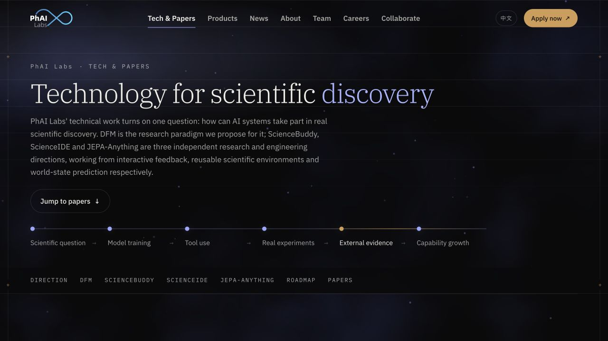
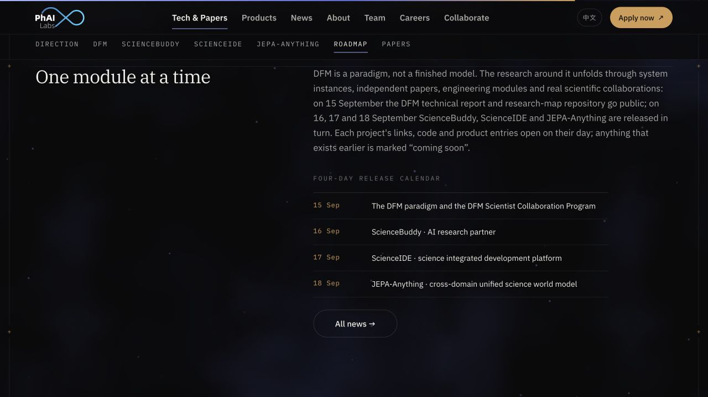
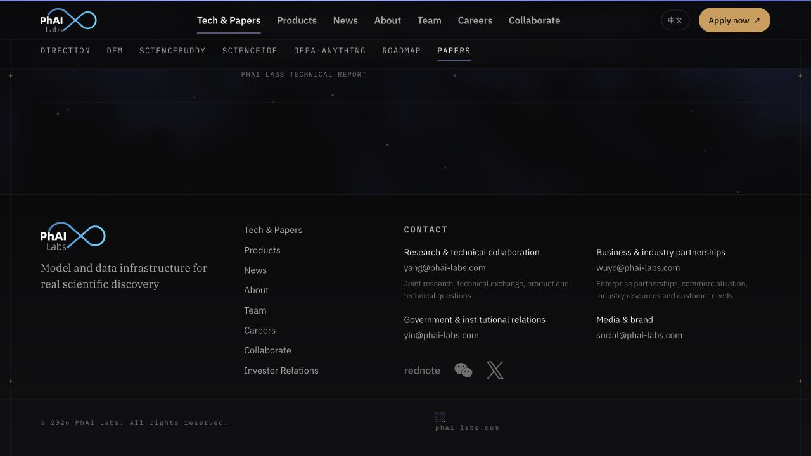
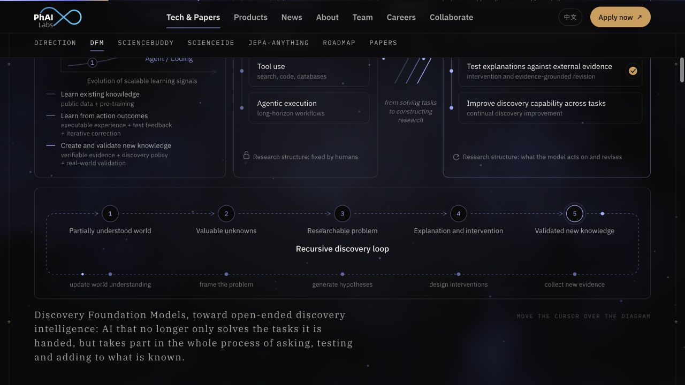
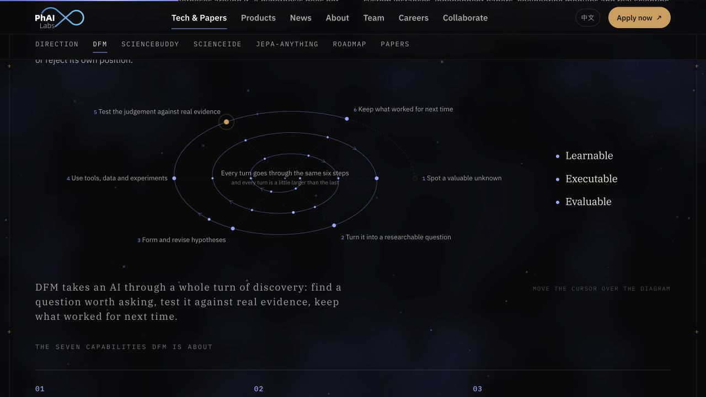
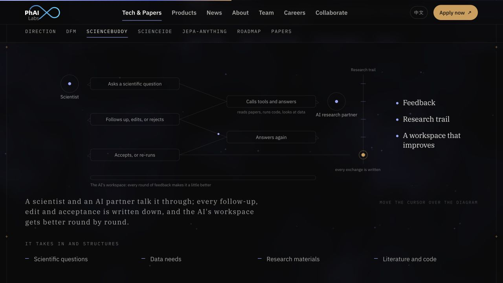
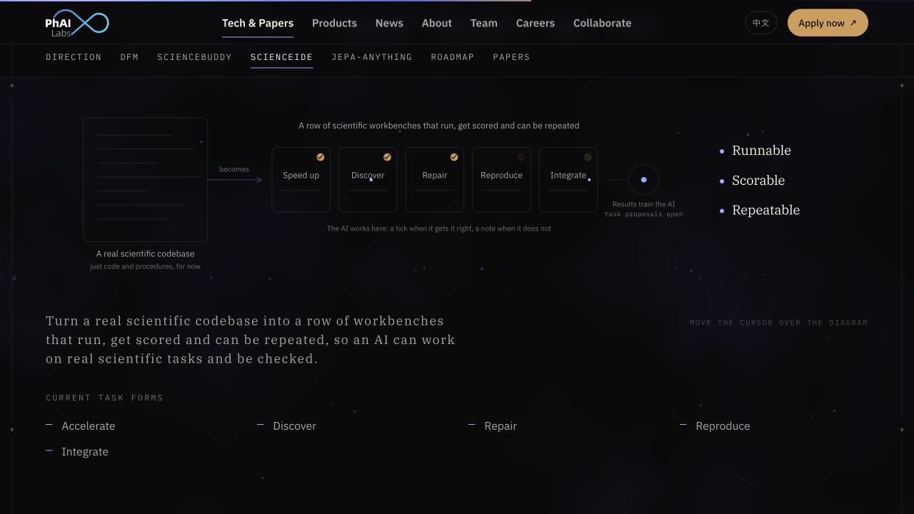
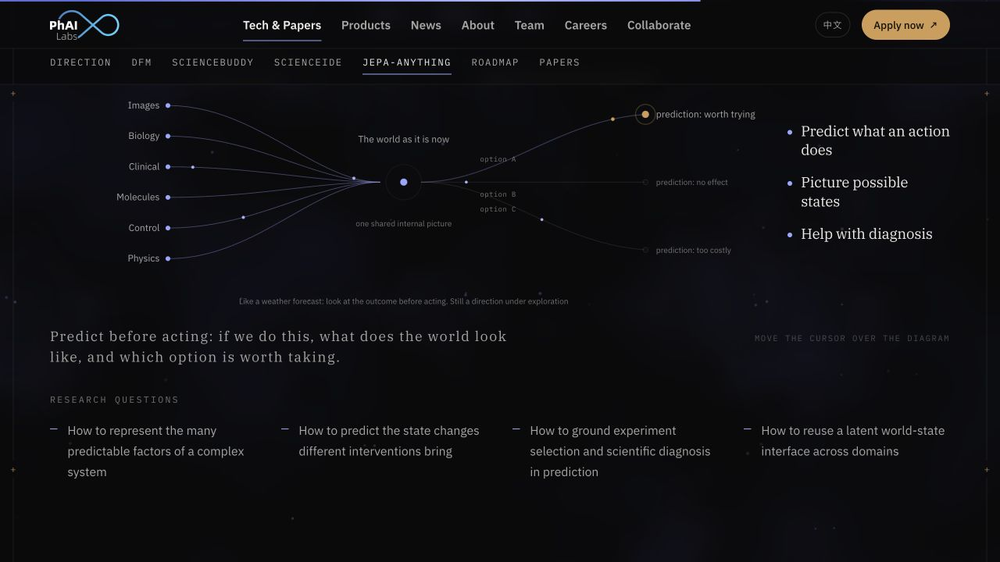
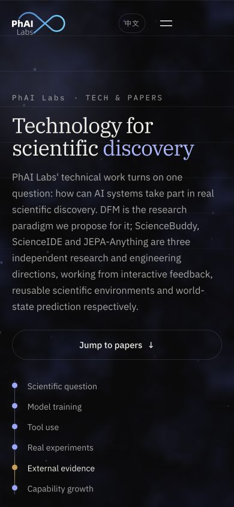

# PhAI Labs 技术页面设计调查

PhAI Labs 的英文技术页面通过衬线排版、精细的线框图解、紫蓝与琥珀色的语义分工，以及缓慢运行的背景与路径信号，形成一种兼具学术出版物、科学仪器和计算环境特征的视觉语言。它最值得研究的部分，是如何让字体、布局、图形与运动共同表达研究过程，并在一篇较长的技术叙事中保持一致。

本调查面向希望理解、借鉴或建立类似视觉体系的设计师与前端工程师。范围包括 UI、信息架构、版式、设计原语、动画编排、微交互、响应式、可读性及实现取舍。文中的“暗色科研编辑风格”是分析性命名，不是该网站公布的官方风格名称。

| 项目 | 说明 |
| --- | --- |
| 调查对象 | [PhAI Labs 英文 Technology 页面](https://phai-labs.com/en/tech/) |
| 调查日期 | 2026 年 10 月 11 日 |
| 桌面观察尺寸 | 1280 × 720 CSS 像素 |
| 窄屏观察尺寸 | 390 × 844 CSS 像素，浏览器视口重排 |
| 证据 | 12 张页面截图、可访问性树与 DOM、计算样式、页面加载的公开 CSS 和 JavaScript |
| 输出 | 本文 Markdown、含截图和目录的 HTML 阅读版、证据清单 |
| 范围边界 | 以当前技术页面为主；不把首页专属视觉、论文详情功能或共享样式中的未使用组件当成本页效果 |

## 01 核心发现

**最有价值的设计资产是一套贯通静态与动态的语法。** 圆点代表节点，细线代表连接，箭头代表方向，圆环代表反馈，颜色区别一般过程与关键结果。相同语法既出现在首屏流程中，也出现在 DFM、ScienceBuddy、ScienceIDE 和 JEPA 的信息图里。

**字体承担明确的内容角色。** 衬线字呈现主题、观点和结论，无衬线字承担论述与导航，等宽字负责编号、日期和索引。字体差异帮助读者识别“这是观点”“这是解释”“这是元信息”，而不仅仅用于制造形式变化。

**页面以长篇编辑结构组织技术内容。** 首屏提出主题，后续逐步介绍立场、框架、研究实例与论文记录。非对称双栏、跨栏图解和吸附目录，让连续阅读与跳转查阅能够共存。

**动画按意义分工。** 内容以对焦式进入出现，关系线逐渐建立，信号沿路径移动，关键节点扩散出环。用户接近局部图解时，部分运动暂停，视觉焦点转向当前关系。

**克制也产生代价。** 小字号、细字重与低透明度叠加，会牺牲次级信息可读性；长篇内容的逐段入场会增加快速扫描的等待感；部分悬停增强缺少同等明确的键盘与触屏入口。这些取舍应与视觉优点一起评估。

图 01 展示了基本语言的组合：暖白衬线标题、紫蓝关键词、等宽标签、描边胶囊按钮、节点线、暗色云雾和两侧细轨道。截图记录的是动画稳定后的一个时刻，不能单独证明运动轨迹或时长。

## 02 证据等级与调查边界

### 观察与实现的区别

本调查使用三种证据等级。读者可据此判断哪些内容可以直接作为设计参数，哪些仍需结合目标环境验证。

| 等级 | 定义 | 本文示例 |
| --- | --- | --- |
| 观察确认 | 在实际页面、截图、DOM 或计算样式中确认 | 桌面双栏、手机菜单、章节跳转、当前标题字体 |
| 实现确认 | 在本页加载的源码中找到具体规则 | 悬停追光、750ms 点击涟漪、减少动态效果分支 |
| 设计解读 | 基于已确认特征解释感受、作用或复用价值 | 出版物气质、科学仪器联想、暖色作为注意力锚点 |

表格中的精确动画时长大多属于“实现确认”，并非通过录像逐帧测量获得。悬停规则与跨页转场没有逐项完成可视化复现；报告会将它们标明为实现规则或条件性能力。窄屏检查确认布局重排，不等同于手机真机上的触控、功耗或浏览器兼容性验证。

### 已检查的主要路径

| 步骤 | 页面状态 | 观察结论 |
| --- | --- | --- |
| 1 | 桌面首屏 | 主题和行动入口清楚，环境视觉较弱 |
| 2 | 点击 DFM 目录项 | 定位正常，导航与章节层级保持可见 |
| 3 | DFM 总览与循环图 | 关系表达完整，图内次级字偏小偏暗 |
| 4 | DFM 螺旋图 | 图形能够表现循环中的积累，侧栏提炼关键属性 |
| 5 | ScienceBuddy | 对话、反馈轨迹与工作空间形成完整视觉流程 |
| 6 | ScienceIDE | 工作台流程清楚，细标签需要较近距离阅读 |
| 7 | JEPA | 汇聚与分叉关系明确，分支亮度有明显层次 |
| 8 | 发布安排与论文列表 | 日期、分类和内容分区便于扫描 |
| 9 | 页尾 | 联系目的分组明确，辅助文字对比度偏低 |
| 10 | 390px 窄屏首屏 | 标题和正文正常换行，流程线转为纵向 |
| 11 | 窄屏菜单展开与关闭 | 操作正常，采用覆盖全屏的目录形式 |

本调查不评判网站科研结论的有效性，不验证外部产品能力，也不构成完整 WCAG 合规或性能审计。截图和参数代表调查日期的版本。源文件识别信息及截图校验值保存在 [evidence-manifest.json](evidence-manifest.json)。

## 03 风格定位与品牌表达

### 学术出版物的视觉层

细字重衬线标题、长段落、章节编号、作者斜体、日期栏和横向分隔线，使页面接近研究机构的编辑出版物。它允许读者在页面上停留和阅读，而不是要求每个区块都立即触发一个操作。

正文和标题共享较为平静的对齐关系。大标题的作用是建立论点和章节节奏；小标题负责区分议题；论文作者与说明退到较低的视觉层级。整体权威感主要来自一致的排版与充分的内容空间。

### 科学仪器的视觉层

页面边缘的轨道与十字、等宽小标签、低亮度坐标线以及细线节点，让空间具有“被测量、被组织”的感觉。这些元素大部分没有直接操作功能，却提供了稳定的秩序背景。

图解中的节点、连接线、分叉和反馈环与研究概念相匹配。读者既能看见系统由哪些部分构成，也能看见信息如何经过这些部分。这种匹配是工程感成立的关键。

### 计算环境的视觉层

近黑底色上漂浮的蓝紫云雾与稀疏粒子，形成持续存在的环境层。它的亮度、密度和速度都较低，内容仍然是主角。背景具有缓慢变化，页面因而呈现“系统处于运行中”的感受。

从设计解读上，可以使用以下术语描述这一组合：编辑式排版、暗色科学视觉、仪器式元信息、细线信息图、环境动效、语义化运动。若用于设计 brief，应同时列出具体特征，避免只写“高级科技感”而失去执行边界。

## 04 信息架构与阅读路径

### 页面内容结构

| 区域 | 内容任务 | 主要视觉组织 | 证据 |
| --- | --- | --- | --- |
| 首屏 | 提出技术主题并提供论文捷径 | 左对齐标题、导语、按钮、节点线 | 图 01 |
| 技术立场 | 解释研究问题与方向 | 左标签、右长文 | 页面结构与样式 |
| DFM | 定义研究框架与能力 | 双栏导入、总览图、解释、螺旋图、编号列表 | 图 02、03、12 |
| 三方向导语 | 明确三个方向的独立性 | 章节编号与短论述 | 页面结构 |
| ScienceBuddy | 表现科研交互和反馈积累 | 项目双栏、对话流程图、属性和能力列表 | 图 04 |
| ScienceIDE | 表现科研环境与任务执行 | 项目双栏、横向工作台流程 | 图 05 |
| JEPA | 表现跨领域预测与候选结果 | 项目双栏、汇聚和分叉图 | 图 06 |
| 未来组合关系 | 说明可能的协同路径 | 文字说明与节点链 | 页面结构与样式 |
| 发布安排 | 将研究方向与发布次序连接 | 左标题、右说明与日期表 | 图 10 |
| 论文记录 | 提供公开成果入口 | 左元信息、右论文内容 | 图 07 |
| 页尾 | 组织全站入口和不同联系需求 | 品牌、导航、联系组、社交入口 | 图 11 |

这是一条从抽象到具体、从观点到记录的阅读路径。对首次访问者，它提供完整叙事；对带着明确任务来的研究者，目录和首屏论文入口提供快捷路线。[页面内容与结构](https://phai-labs.com/en/tech/)

### 两级导航如何配合

全站导航固定在页面顶部，回答“网站还有哪些栏目”。章节导航位于首屏下方，随后吸附在主导航之下，回答“当前文章有哪些部分”。两者的字体、字号和间距有所区别，降低层级混淆。

主导航使用无衬线字，当前栏目显示亮色文字和紫蓝下划线；章节导航使用等宽、大写和较宽字距，当前章节同样通过亮字和细线强调。它们共享状态语言，但保留各自的内容角色。

章节链接由脚本触发平滑滚动，并通过 `history.replaceState` 更新片段地址。当前章节使用 IntersectionObserver 观察视口中部区域。这里的地址更新适合分享具体章节，但不会为每次目录跳转增加新的浏览器历史项。该行为来自 [site.js](https://phai-labs.com/assets/js/site.js)，不是对用户偏好的推测。

## 05 颜色与亮度原语

### 颜色 token

| 角色 | Token | 值 | 使用逻辑 |
| --- | --- | --- | --- |
| 主背景 | `--bg` | `#0A0A0B` | 提供连续的近黑画布 |
| 次级背景 | `--bg-2` | `#101012` | 页尾或浮层等轻微表面差异 |
| 更高一级背景 | `--bg-3` | `#151518` | 少量需区别于主底的表面 |
| 主文字 | `--ink` | `#F0EEE8` | 暖白标题和关键内容 |
| 正文层 | `--ink-2` | 主文字 68% 透明度 | 大部分论述与常规说明 |
| 辅助层 | `--ink-3` | 主文字 44% 透明度 | 日期之外的弱信息、注释等 |
| 最弱层 | `--ink-4` | 主文字 26% 透明度 | 极弱提示和装饰性信息 |
| 常规分隔 | `--rule` | 主文字 12% 透明度 | 列表和框线 |
| 弱分隔 | `--rule-soft` | 主文字 7% 透明度 | 章节线、轻量结构 |
| 主强调 | `--blue` | `#9BA7FF` | 链接、节点、数字 |
| 更亮强调 | `--blue-2` | `#AAB4FF` | 高亮、信号和局部增强 |
| 深蓝 | `--blue-deep` | `#5D6BD6` | 进度与环境层 |
| 蓝墨色 | `--blue-ink` | `#3A45A8` | 低亮度云雾 |
| 关键暖色 | `--amber` | `#D29C52` | 行动、证据、关键节点 |
| 暖色悬停 | `--amber-2` | `#E0AE66` | 行动按钮的增强状态 |

这些值直接来自 [site.css 的根变量](https://phai-labs.com/assets/css/site.css)。透明色会与实际背景合成，截图中看到的像素颜色不一定等于 token 本身。

### 冷暖分工

紫蓝出现频率较高，承担研究结构、系统连接、信息传递和链接等角色。琥珀色出现得少，常落在验证、证据、完成标记或行动入口。因此，一般过程与关键结果在视觉上有可辨识的区别。

例如，首屏流程的外部证据节点使用琥珀色；DFM 图中与真实证据相关的位置得到暖色强调；ScienceIDE 的检查标记和 JEPA 候选结果也使用暖色。它不是一套严格的产品状态枚举，复用时不应直接假定“琥珀永远等于成功”。更稳妥的提炼是：暖色分配给需要停下来关注的证据或行动。

### 亮度比饱和度更重要

页面的绝大部分面积处于近黑与低透明灰之间。品牌色只覆盖少量文字、细线和小节点。即使背景持续变化，文字与图形的亮度层次仍然决定读者的注意顺序。

因此，复用时首先应稳定文字层级和背景亮度，再安排色相。若把同样的紫蓝大面积铺成高亮表面，或让所有连接线都发光，视觉气质会明显改变。

## 06 字体与文字排版

### 三类字体的职责

| 字体 | 页面别名 | 主要位置 | 视觉作用 |
| --- | --- | --- | --- |
| IBM Plex Serif | Plex Serif | 主标题、章节标题、图解结论、论文标题与作者 | 建立编辑和学术语气 |
| IBM Plex Sans | Plex Sans | 正文、导航、按钮、图解标签 | 保持长文与交互信息的清晰度 |
| IBM Plex Mono | Plex Mono | 编号、日期、章节目录、小标签、提示 | 建立索引与仪器读数感 |

字体由站点自行托管，使用 WOFF2，并采用 `font-display: swap`。本页计算样式确认正文为 Plex Sans、主标题为 Plex Serif。字体家族名称和字号属于可验证事实；“学术”“仪器感”属于设计解读。[字体声明](https://phai-labs.com/assets/css/site.css)

### 字级与节奏

以下 rem 换算以根字号 16px 为例；响应式字号会随视口改变。

| 文字角色 | 规则或当前尺寸 | 行距与字重 |
| --- | --- | --- |
| 本页主标题 | `clamp(2.2rem, 4.4vw, 3.8rem)`；1280px 时 56.32px | 约 1.06；桌面 300 |
| 二级标题 | `clamp(1.55rem, 2.6vw, 2.4rem)`；1280px 时 33.28px | 约 1.12；400 |
| 小标题 | `clamp(1.1rem, 1.35vw, 1.3rem)` | 约 1.35；常为 500 |
| 正文 | `clamp(.98rem, 1.05vw, 1.06rem)`；1280px 时 15.68px | 约 1.7；400 |
| 导语 | `clamp(1.02rem, 1.25vw, 1.22rem)` | 约 1.65 |
| 小正文 | `.88rem`，约 14.08px | 视组件约 1.65–1.7 |
| 章节眉题 | `.78rem`，约 12.48px | 等宽，大写，约 `.2em` 字距 |
| 章节导航 | `.76rem`，约 12.16px | 等宽，大写，约 `.12em` 字距 |
| 部分图解提示 | `.66rem`，约 10.56px | 等宽，约 `.14em` 字距 |

站点还定义了更大的首页 hero 字级，但本页主标题使用的是上表中的普通页面标题级。不能把共享样式中的最大 hero 值直接当成本页字号。

标题使用略收紧的字距和紧凑行距，让大字号保持成块的整体性；正文用更宽松行距减轻深色背景上的阅读压力。标题采用平衡换行，部分图注采用更自然的换行策略，减少孤立短词。

### 阅读宽度与图注

常规正文宽度上限约为 40em，导语也控制在相似量级。容器可以很宽，但长段落不会无限延展。图注则使用衬线字，形成从技术标签切换到解释性结论的声音变化。

需要注意，图注仍可能继承图形组件设置的较宽字距。它强化了编辑气质，但在长英文句子中也会延长文本块。对长文阅读效率要求更高的场景，宜单独检查图注的字距与行长。

### 中文适配线索

共享样式定义了中文衬线字体子集、中文标题字距、较宽正文行距，以及 Windows 中文字体的尺寸校正。中文标题不直接沿用英文的负字距。这说明字体体系考虑了中英文差异；本调查没有完整浏览中文页面，因此不将这些源码规则等同于中文全站的视觉验收结果。

## 07 布局与空间系统

### 容器和间距

| 项目 | 实现值 | 1280 × 720 视口下的解释 |
| --- | --- | --- |
| 主容器上限 | 1280px | 包含容器内部左右 padding |
| 窄容器上限 | 760px | 共享样式中的辅助阅读宽度 |
| 页面横向 padding | `clamp(1.25rem, 5vw, 4.5rem)` | 约 64px |
| 栏间距 | `clamp(1.5rem, 3vw, 3rem)` | 约 38.4px |
| 章节基础间距 | `clamp(4rem, 10vh, 8rem)` | 约 72px，具体位置受章节规则影响 |
| 普通双栏 | 5fr 与 7fr | 标题列较窄，解释列较宽 |
| 项目双栏 | 4fr 与 8fr | 左侧项目身份，右侧论述 |
| 论文列表 | 3fr 与 9fr | 左侧元信息，右侧论文主体 |
| 图解属性侧栏 | 13rem | 图形右侧的概念提炼区域 |

在 1280px 视口中，主容器内容区约为 1152px。这里的容器上限并不意味着大屏幕上的正文净宽为 1280px，因为盒模型包含内边距。实现或复刻时应按实际内容区测量。[布局规则](https://phai-labs.com/assets/css/site.css)

### 横向对齐建立秩序

主标题、章节编号、图形左缘和页尾品牌大体共享同一外侧基线。双栏内部建立第二条基线，承接正文、链接和发布表格。读者通过位置就能判断信息级别，不必依赖大量有色面板。

章节之间的细横线定义节奏边界；大段留白在主题变化时提供暂停。项目图解往往在双栏文字结束后横向展开，使视线从阅读列切换到关系空间。

### 形状与表面

按钮和语言切换采用胶囊形状，图中工作单元采用轻微圆角的细框，正文区块保留开放边界。导航滚动后的半透明模糊表面提供前后层次。阴影的使用较少，在页尾二维码浮层等需要明确悬浮关系的位置更明显。

首屏背景包含横向重复线与渐隐遮罩；两侧还有纵向轨道。它们在观感上产生网格和坐标联想，但首屏并不是一个满屏等距方格。应区别实际线条结构与风格联想。

## 08 组件与状态系统

### 顶部导航

导航初始状态较轻，背景基本融入页面。滚动超过 24px 后，垂直 padding 从约 1.05rem 缩到 .65rem，背景变为透明度 74% 的近黑，增加 12px 背景模糊和底部分隔线。相关过渡约 350ms。

这个变化同时完成两个任务：减少固定导航占用的高度，并在内容经过其下方时维持文字可读性。它是状态驱动的紧凑化，不依赖用户理解额外控件。[导航样式](https://phai-labs.com/assets/css/site.css)、[滚动状态逻辑](https://phai-labs.com/assets/js/site.js)

### 按钮与普通链接

| 组件 | 默认状态 | 增强状态 | 注意点 |
| --- | --- | --- | --- |
| 描边按钮 | 1px 弱边框、胶囊、暖白文字 | 上移 1px、轻微背景变化、边缘追光 | 追光有设备与减少动态效果条件 |
| 顶部申请按钮 | 琥珀填充、深色文字 | 更亮琥珀、上移 1px | 本页使用导航专用类 |
| 正文链接 | 紫蓝文字、方向符号 | 颜色变亮 | 外链由脚本设置新标签页打开 |
| 语言切换 | 小胶囊、等宽字、弱边框 | 字和边框变亮 | 语言行为与视觉入口分离 |
| 章节链接 | 等宽小字、透明下划线 | 当前项和悬停项加亮并显线 | 视觉上两类增强较接近 |

共享样式定义了主按钮的扩散环，但本页顶部申请入口使用 `.mast__cta`，不应据此宣称该入口会播放 `.btn--primary` 的双次扩散环。组件名相似，不代表套用相同的动画规则。

### 编号能力列表

七项能力使用三列网格、编号和上下分隔线。它们没有强烈的独立卡片底色，内容仍属于同一篇文章。每项内部遵循“编号—标题—解释”的次序，增强横向比较能力。窄屏时改为单列。

### 发布安排

图 10 中，左侧单独放置章节标题，右侧延续文字与表格。日期列宽约 5.6rem，右侧描述自动占据剩余空间。细横线让每行可被扫描，日期颜色与整站的关键暖色呼应。表格最大宽度受到限制，避免一行跨度过大。

### 论文目录

图 07 的左列承载日期与研究主题，右列依次显示标题、作者、摘要和出版类别。标题使用衬线字，作者用较暗的衬线斜体，摘要回到无衬线字。摘要以三行截断，完整文字仍在页面标记中；不能把这种摘要截断描述为点击展开控件，本页可见入口是论文标题链接。[论文目录样式](https://phai-labs.com/assets/css/papers.css)

### 页尾与二维码浮层

页尾将品牌、站内导航与联系信息分开。联系信息按沟通目的分组，再提供地址和简短说明。社交入口保持低亮度，与正文主任务之间有清楚的权重区别。

二维码浮层在实现中通过悬停或 `focus-within` 显示，约 200ms 淡入并轻微上移。浮层上开，入口与面板之间有透明桥接区域，避免指针跨过空隙时面板立即关闭。此细节由样式确认，未单独进行完整的触屏和辅助技术测试。

页尾还包含一个小型点阵装饰，圆点通过约 2.8s 的离散透明度动画依次变化。它沿用节点语言，属于低权重品牌装饰，不承载真实加载状态。[点阵样式](https://phai-labs.com/assets/css/pulse.css)

## 09 信息图的统一语法

### 图形不是插画附件

本页图解负责将抽象概念转成空间关系。线条连接的是具有意义的实体，运动沿着信息实际被描述的方向前进，暖色落在重要反馈或结果处。因此，图形和正文能够互相解释。

| 图形原语 | 表现 | 常见意义 | 复用注意 |
| --- | --- | --- | --- |
| 实心圆点 | 小型紫蓝或琥珀点 | 实体、阶段、信号位置 | 区分静态节点与移动信号 |
| 空心圆和环 | 低亮描边或扩散环 | 潜在位置、活动范围、反馈 | 不应将所有圆环都解释为加载 |
| 实线 | 连续细路径 | 已定义连接和过程 | 线宽约 1–1.4 SVG 单位，并非所有显示尺寸都为 1 CSS px |
| 虚线 | 间断路径或延续段 | 弱关系、未完成或未来延展 | 具体含义由上下文确定 |
| 箭头 | 细折线或方向标记 | 流程方向 | 保持与文字顺序一致 |
| 细框 | 透明填充、轻圆角 | 工作单元、任务、阶段 | 边框不宜压过内部文字 |
| 辐射线与分支 | 汇入或分出中心节点 | 多源输入与多个候选结果 | 需要焦点层次避免所有线等重 |
| 螺旋 | 多轮向外扩张 | 重复过程中的积累 | 需说明每轮与能力列表的关系 |

### 图解共同版式

项目图采用“左侧宽图—右侧短属性—下方解释句”的结构。右栏约 13rem，图形主体遵循 1200:450 的宽高关系。属性栏用大于图内标签的衬线字提炼结果，读者可以先读大字，再选择是否进入图中细节。

图底部左侧给出较完整的解释，右侧放置低亮度的悬停提示。这样的分工使同一图解具备两种阅读速度：快速理解主题，以及停下来追踪过程。

## 10 逐幅图解分析

### DFM 总览

总览采用横向对照：左侧建立能力演进的图形叙事，中间显示既有基础模型的组成，右侧强调发现过程所需的能力组织。列间使用箭头关系，并通过右侧较亮边框强化关注点。它把“类别演进”和“体系差异”放在一个宽画布中。

下部将流程组织成回路，节点与箭头表达从问题到新知识再反馈到研究过程的关系。这里的循环图与后面的螺旋图承担不同任务：前者解释闭环，后者强调跨轮积累。

总览 SVG 的坐标范围为 1200 × 706。在桌面中按容器宽度缩放；899px 以下改为宽约 980px 的内部横向滚动图。这样可以避免整幅复杂图无限缩小，但手机读者必须在局部窗口里追踪全图。[总览样式](https://phai-labs.com/assets/css/site.css)

### DFM 螺旋

螺旋图把重复研究过程放在逐渐扩大的轨道上。相似阶段出现在不同轮次，外圈比内圈更大，从几何上表达研究结构和能力的积累。真实证据位置使用琥珀节点和扩散环，给整个循环提供一个明确锚点。

实现中的慢描线约 2.6s，螺旋路径上的信号周期为 24s，并使用错开的起始相位。这种慢速运动适合较复杂的路径，避免信号在密集线圈中显得急促。右侧三个属性把复杂图形重新概括成可快速理解的能力结果。

图中过程被压缩成六步，而下方文字列出七项能力。两者不是逐条一一对应的同一列表。设计上可理解为“简化流程图”和“完整能力目录”两个层次；若用于教学或需要严格映射的产品，应增加两者之间的关系说明。

### ScienceBuddy

图形采用左右往返的对话结构。科学家和研究伙伴分别占据两侧，对话框以斜线连接，形成明确的交互顺序。右侧轨迹轴收集每次交流，底部长条代表工作空间的改进。

该图的运动强调反馈积累：移动信号沿折线路径经过多个交互节点，当前计算样式确认周期为 9s；进度条存在约 9s 的循环增长动画。后者是概念演示，不是连接真实系统的进度读数。把概念动画理解成实时指标会误读页面。

### ScienceIDE

该图从左侧代码库出发，进入一排任务工作台，再到右侧模型节点。工作台保持一致尺寸，便于读者把注意力放在任务类别和验证反馈上。琥珀检查标记表达工作结果的验证语义。

它的可复用价值是把“基础设施”转译为可以运行、评分与复现的工作单元。重复单元建立系统性，输入输出关系建立方向性，少量状态符号提供反馈。

### JEPA

多领域输入从左侧汇入一个共享的内部表征，再分成右侧多个候选未来。输入、内部状态、预测结果分别占据三个空间层级。值得关注的结果以琥珀节点标出，其他结果保持更低亮度。

本页图形用可见的少量领域标签说明汇聚关系，正文对领域范围的描述更完整。图形应被视为说明机制的抽象示意，不应拿图上标签数量代替完整研究范围。悬停相关分支时，样式会弱化同组其他候选分支，帮助局部比较。

## 11 动效系统与时间编排

### 四种运动职责

**进入运动**负责让新内容被看见。**过程运动**负责解释连接与传递。**反馈运动**负责响应用户操作。**环境运动**负责维持页面氛围。四者应分别评估，不能用一个统一的“动画快慢”判断整体质量。

本页的进入运动幅度较小，但时长相对从容；过程运动多采用线性和周期性；反馈运动通常短；环境运动缓慢并持续。这种分工支持研究叙事的节奏。

### 动效参数表

下表均为实现确认。类名用于定位规则，不要求复用时沿用原站命名。个别实例会通过 CSS 变量覆盖默认时长。

| 动效 | 触发 | 变化 | 时长和节奏 | 生命周期 |
| --- | --- | --- | --- | --- |
| 内容对焦进入 | 元素进入视口 | 透明到可见、上移 12px、模糊 8px 到 0 | 800ms；章节内每项延迟 70ms，上限 630ms | 触发后停止观察，通常一次 |
| 标题分词进入 | 标题进入 | 透明到可见、上移 .35em、模糊 6px 到 0 | 600ms；词间 50ms | 随所在标题出现 |
| 章节横线 | 章节进入 | 水平缩放 0 到 1，左侧为原点 | 1.1s | 一次 |
| 首屏流程线 | 流程进入 | 横向展开 | 1.4s | 一次 |
| 流程节点点亮 | 流程进入 | 空心到填充、增加轻光晕 | 500ms；起始约 250ms，加每节点 170ms | 一次 |
| 流程标签 | 流程进入 | 上移 6px 并显示 | 600ms；起始约 350ms，加每节点 170ms | 一次 |
| 流程线上光点 | 流程进入后 | 从起点移动至关键节点附近后消失 | 1.8s；延迟 1.5s | 一次 |
| 普通 SVG 描线 | 图形进入 | 路径逐渐显露 | 1.6s | 一次 |
| 慢速 SVG 描线 | 图形进入 | 路径逐渐显露 | 2.6s | 一次 |
| SVG 标签淡入 | 图形进入 | 透明度变化 | 600ms，可设独立延迟 | 一次 |
| 路径信号 | 实例规定的条件 | 沿 offset-path 移动 | 默认 6s；ScienceBuddy 9s；螺旋 24s | 循环 |
| 节点扩散环 | 实例规定的条件 | 放大至约 1.9 倍并淡出 | 默认 3.6s，慢版本 6s | 循环 |
| 局部呼吸 | 页面/图形实例 | 透明度周期变化 | 4s 或 6s | 循环 |
| 工作空间增长条 | 概念图实例 | 横向长度增长并复位 | 9s | 循环示意 |
| 页面阅读进度 | 滚动 | 顶部 2px 条横向填充 | 位置过渡约 100ms；亮带 2.4s 往返 | 随滚动与循环 |
| 点击涟漪 | pointerdown | 小圆扩散并淡出 | 750ms | 每次点击短暂出现 |
| 导航紧凑化 | 滚动超过 24px | padding、底色、分隔线改变 | 350ms | 可逆 |
| 按钮状态 | 悬停 | 上移 1px、颜色变化 | 约 250ms | 可逆 |
| 按钮边缘追光 | 指针进入与移动 | 边缘局部反光跟随 | 显隐约 260ms | 跟随指针 |
| 菜单图标 | 展开/关闭 | 双横线旋转成交叉 | 300ms | 可逆 |
| 页尾点阵 | 页面运行 | 圆点亮度离散变化 | 2.8s，steps 节奏 | 循环 |

参数来源：[site.css](https://phai-labs.com/assets/css/site.css)、[site.js](https://phai-labs.com/assets/js/site.js)、[field.js](https://phai-labs.com/assets/js/field.js)、[pulse.css](https://phai-labs.com/assets/css/pulse.css)。

### 缓动的性格

主缓动曲线为 `cubic-bezier(.22,1,.36,1)`，呈现较快展开、缓慢收尾的特征。进入时的位移不大，主要感受来自清晰度和透明度的恢复，因此像逐渐对焦。路径信号使用线性运动，保持匀速传递；扩散环用减速与淡出表现能量释放。

这种组合强调稳定与从容。弹性、回弹或大幅缩放不是本页主要语法。若复用到高频操作工具中，应优先缩短内容进入时长，保留关系和状态反馈的清晰度。

### 编排中的细节

DFM 总览对移动光点和圆环设置了入场门槛，让它们在图形进入后开始，避免尚未建立的关系线上已经有信号运行。不能把这个专门规则推广为所有图解都在离屏时暂停；其他图解的循环声明和可见性规则并不完全相同。

内容进入使用 IntersectionObserver，阈值约为 0.06，底部触发区域向内收缩约 7%。进入后解除该元素的观察，所以往回滚动通常不会反复播放同一块的初次入场。延迟按章节中的元素顺序计算，并有上限；快速滚动时，靠后的元素仍可能带着较长延迟进入。

标题分词动画和外层内容动画可能叠加，不能把 600ms 或 800ms 单独理解为整个标题在所有条件下的总等待时间。复用前宜以真实内容长度检查最终节奏。

### 跨页转场的条件

样式启用了原生 View Transition 导航。规则为旧画面约 220ms 淡出，新画面约 340ms 淡入并从下方 6px 位置恢复，同时给主导航单独的转场名称。生效取决于浏览器与目标页面条件。本次未把跨页转场作为视觉实测项，也不能仅凭注释断言所有背景层在跨页时都保持不动。

## 12 微交互与指针行为

### 描边按钮的局部反光

普通描边按钮将指针位置转成局部坐标，交给 CSS 控制渐变中心。反光经过遮罩，只出现在边框上。渐变从暖白过渡到琥珀，再逐渐融入紫蓝，但强度很低，主要形成“边缘接住光”的感觉。

该效果要求可悬停设备、精细指针、未请求减少动态效果，并支持所需遮罩合成能力。它并非所有设备上都强制执行。指针离开、页面切换或页面隐藏相关事件会清除对应状态，避免高亮残留。[按钮交互实现](https://phai-labs.com/assets/js/site.js)

它可被称为“指针驱动的边缘高光”或“局部镜面反光”。更准确的描述比“磁吸按钮”有用：本页按钮没有随指针大幅位移或吸附的已确认行为。

### 信息图的关注状态

| 触发区域 | 局部变化 | 阅读目的 | 证据等级 |
| --- | --- | --- | --- |
| 可悬停分组 | 文字与节点加亮，部分路径换色 | 指明当前关系 | 实现确认 |
| 隐藏标签或弦线所在分组 | 标签和关系显现 | 展示次级解释 | 实现确认，取决于图形实例 |
| 辐射关系 | 虚线变实线或颜色提高 | 减少追踪难度 | 实现确认 |
| 图内任一指定分组 | 移动信号暂停 | 减少运动对局部阅读的干扰 | 实现确认 |
| 预测候选分支 | 同组其他分支降低透明度 | 支持比较 | 实现确认 |

本页的悬停是附加阅读状态，通常不意味着点击后打开详情。实现借助透明的较宽命中线扩大部分交互区域，避免要求用户准确命中很细的可见线。但视觉命中改善不自动解决键盘与触屏等价操作。

### 点击和粒子的短反馈

点击位置出现薄环，半径从很小扩到约 49 CSS px，并在 750ms 内消失。距离点击位置约 150px 内的粒子受到短暂排斥，随后通过衰减回到背景流动中。这里的排斥作用由点击触发，不能泛称为“鼠标移动到哪里粒子就避让”。

该反馈属于环境响应，不代表数据已经保存、任务已经完成或某个操作成功。复用到功能产品时，必须为真实成功与错误提供独立且明确的反馈。

### 菜单与键盘

手机菜单按钮维护 `aria-expanded`，菜单关闭时使用隐藏状态，展开时锁定页面滚动。点击菜单链接或按 Escape 会关闭菜单。图标有旋转过渡，但菜单面板本身由隐藏状态切换，不能因为它被称作 drawer 就推断它一定有滑入滑出的面板动画。

源码中未看到完整的焦点圈定或展开后将焦点主动移入菜单的逻辑。其具体键盘体验还需端到端检查；目前可确认的是状态属性与 Escape 关闭路径存在。

## 13 背景环境的运动机制

### 两个画布的分工

背景由两个固定画布组成：低分辨率画布绘制蓝紫密度云雾，另一画布绘制粒子与点击涟漪。画布放在内容下方，不接管指针事件，并对辅助技术隐藏。

云雾画布宽度为 320px，再按视口比例计算高度并放大。放大本身提供柔化感。粒子画布根据视口和受限设备像素比设置尺寸，不直接无限追随高分辨率屏幕。这是一种以较低像素成本获得柔和环境的实现选择。

### 本页章节与背景状态

| 章节 | 声明状态 | 行为倾向 |
| --- | --- | --- |
| 首屏 | flow | 云雾与粒子流动更明显 |
| DFM | flow | 延续流动和过程感 |
| ScienceBuddy | grid | 更慢、更规则，粒子趋近网格 |
| ScienceIDE | grid | 延续工作环境的秩序感 |
| JEPA | grid | 维持较稳定的结构背景 |
| 未来组合关系 | flow | 恢复连接与流动感 |
| 发布安排 | calm | 较平静的背景 |
| 论文 | calm | 适合阅读记录的平静背景 |

未声明 `data-field` 的章节不会单独指定新状态；实际状态会受前后被观察到的区域影响。状态切换区域位于视口中间较窄的带状范围，参数通过指数趋近平滑变化，时间常数约 0.9s，而不是立即跳到新值。[状态与背景实现](https://phai-labs.com/assets/js/field.js)

### 背景为文字让位

实现会找到当前可见的大标题、部分特定标题和导语，在它们后面的云雾层上削弱密度。这个处理仅针对被选择的文字区域和云雾层，不意味着所有正文背后都被自动清空，也不意味着粒子与全部文本具有完整避让关系。

这种局部压暗值得借鉴：可以保留环境的整体连续性，同时保护关键文字的对比。与其把整张背景压得几乎不可见，不如对真正影响阅读的区域做有边界的处理。

### 运行与节能策略

桌面背景设置约 33ms 的更新间隔，窄屏约 41ms；粒子数量分别为 64 和 26。背景在页面隐藏时停止请求动画帧；检测到节省流量、关闭字段配置或特定关闭条件时，不启动完整环境。减少动态效果偏好下绘制静态状态。

这些是实现中的成本控制策略，不是实测帧率。没有记录低端设备的长时间性能、掉帧或耗电，不能据此声称所有设备都达到稳定 30fps 或 24fps。

## 14 响应式设计与移动体验

### 手机首屏

图 08 中主标题自然换成两行，紫蓝关键词保留强调。导语按窄宽度重排，按钮横向扩展，节点流程由水平线改为竖线。品牌标志、语言入口和菜单按钮占据顶部。桌面的大面积横向留白转换成纵向阅读节奏。

### 全屏目录

移动菜单使用大号衬线目录和细分隔线，当前栏目为紫蓝色，申请入口为琥珀色。与桌面导航相比，文字更像目录页，延续出版物气质。菜单展开和关闭已实际检查。

### 断点规则

| 条件 | 主要变化 | 确认方式 |
| --- | --- | --- |
| 1200px 及以下 | 多栏正文合并为单栏 | CSS |
| 899px 及以下 | 主导航折叠；主要双栏改为单栏；图解属性移到下方；隐藏悬停提示 | CSS，与 390px 观察相符 |
| 899px 及以下 | DFM 总览使用内部横向滚动，图宽约 980px | CSS |
| 860px 及以下 | 论文目录改为单列，日期和主题横向排列 | CSS |
| 639px 及以下 | 首屏流程转纵向；按钮可扩展；章节间距调整 | CSS，与 390px 观察相符 |
| 560px 及以下 | 项目图的属性列表改为单列 | CSS |
| 1024px 及以上 | 显示页面两侧装饰轨道 | CSS |

这里只对桌面与 390px 两个视口做了实际视觉检查。899、860、639、560px 等临界宽度及其相邻值仍属于源码规则，未逐点做截图验收。[响应式规则](https://phai-labs.com/assets/css/site.css)、[论文断点](https://phai-labs.com/assets/css/papers.css)

### 移动端的剩余问题

复杂总览采用横向滚动，可以保护图中文字尺寸，但读者需要记住屏幕外的关系。更简单的项目图仍随容器缩放，内部 SVG 标签也会缩小。设计者需要分别处理这两种情况：复杂图的浏览负担，以及简单宽图在手机上的小字问题。

窄屏隐藏悬停提示是合理的设备适配，但仅隐藏提示不等于提供了替代交互。如果局部高亮承担必要解释，应增加可点击的节点、稳定的说明文字或结构化替代内容。

## 15 可读性与无障碍观察

### 对比度的可复核计算

将暖白 `#F0EEE8` 按各 token 的透明度叠加到纯背景 `#0A0A0B`，再按 sRGB 相对亮度计算，可得到下列近似结果。为便于复核，合成颜色先按 8 位通道取整；结果只保留两位小数用于说明。

| 文字层 | 合成颜色约值 | 对比度约值 | 含义 |
| --- | --- | --- | --- |
| 100% 主文字 | `#F0EEE8` | 17.06:1 | 与纯背景区别明显 |
| 68% 正文 | `#A6A5A1` | 8.03:1 | 纯背景条件下余量较大 |
| 44% 辅助字 | `#6F6E6C` | 3.89:1 | 低于普通小字常用的 4.5:1 门槛 |
| 26% 最弱字 | `#464544` | 2.07:1 | 用于需要阅读的文字时风险较高 |

WCAG 2.2 的最低文字对比要求通常为普通文字 4.5:1、大字 3:1，并有装饰、标志等适用例外。是否属于例外需根据具体内容判断，不能把所有次级信息都视作装饰。[W3C 对比度说明](https://www.w3.org/WAI/WCAG22/Understanding/contrast-minimum.html)

真实背景含云雾与粒子，不同位置和时刻会改变合成结果；图形也可能具有额外透明度。因此，该表不是全页逐元素合规结论。它足以说明：若重要作者信息、交互提示或研究标签采用最弱文字层，应优先重新评估。

### 已存在的支持

- 页面有跳过导航、进入主体的入口。
- 全局设置了可见的键盘焦点描边。
- 移动菜单维护展开状态，并支持 Escape 关闭。
- 背景画布对辅助技术隐藏，减少装饰噪声。
- DFM 总览提供图形语义描述。
- 减少动态效果规则会显示图解最终状态、关闭多类循环运动并取消平滑滚动。

上述支持不自动推出全站可访问。部分项目 SVG 整体被标记为装饰，由周边文字承担解释。若图中包含周边文字没有覆盖的重要关系，仍需补充等价描述。

### 优先关注的风险

| 风险 | 当前证据 | 可能影响 | 建议方向 |
| --- | --- | --- | --- |
| 小字低对比 | 截图、样式与合成计算 | 注释和关系标签难读 | 提高必要信息的亮度或字号 |
| 悬停增强缺少键盘入口 | 已检查的 SVG 分组无 tabindex 或交互角色 | 键盘用户不易触发相同聚焦 | 为必要交互提供可聚焦元素或等价文本 |
| 持续循环动画 | 图解与背景的循环声明 | 长时间阅读可能分心 | 提供静态阅读模式或更细的暂停控制 |
| 菜单焦点管理不完整 | 已检查脚本未见焦点圈定与主动迁移 | 键盘焦点可能落到覆盖层后方 | 单独检查 Tab 顺序、返回焦点和背景禁用 |
| 首屏与长文延迟 | 逐项进入与固定延迟 | 快速扫描时出现等待 | 正文缩短进入时间，关键索引及时显示 |
| 手机宽图缩小 | 响应式结构与 SVG 尺寸 | 图内标签可读性下降 | 按图形复杂度设计重排、缩放或说明版 |

对于自动持续的运动，是否需要暂停、停止或隐藏控制，应按其持续时间、与内容的关系及适用条件判断。系统减少动态效果支持很有价值，但不能直接替代对每个持续动效的具体评估。[W3C 暂停停止隐藏说明](https://www.w3.org/WAI/WCAG22/Understanding/pause-stop-hide.html)

## 16 实现选择与性能取舍

### 页面表现依赖的技术层

| 层 | 已确认手段 | 适合承担的任务 |
| --- | --- | --- |
| 内容层 | HTML 章节、列表、链接、图注 | 语义、阅读和索引 |
| 版式层 | CSS Grid、Flex、流体字号、媒体查询 | 宽窄屏组织与视觉层次 |
| 图解层 | 内联 SVG、路径、节点与文本 | 精确关系图与局部交互 |
| 动画层 | CSS transition、keyframes、offset-path | 进入、描线、传输与反馈 |
| 状态层 | 原生 JavaScript、IntersectionObserver | 进入触发、当前章节、菜单 |
| 环境层 | Canvas 2D、requestAnimationFrame | 云雾、粒子和点击反馈 |

在检查到的这组本页资源中，相关视觉行为由 CSS、SVG、Canvas 和原生脚本完成。没有证据要求将其描述为 Three.js 或某个大型动画库的作品；也不应从这一点推断整个站点不存在其他依赖。

### 低成本策略

背景使用低分辨率云雾画布，粒子数量和绘制像素密度受限；滚动回调用 requestAnimationFrame 合并；按钮只在实际悬停时计算位置，并缓存边界；进入动画完成后解除观察；页面隐藏时停止背景循环。这些做法减少持续无效工作。

### 仍需实测的成本

多段模糊进入、大范围背景模糊、透明画布持续绘制、多个 SVG 循环以及字体加载，都可能影响低端设备表现。背景循环有可见性控制，不代表每个 CSS 图形循环都有同样的离屏暂停策略。

如果用于生产产品，应至少实测首次加载、连续滚动、多个图解同时可见、切换菜单、缩放文字和低功耗设备。性能结论应来自这些场景，而不是仅依据文件体积或动画库是否存在。

### 容错与减少动态效果

页面包含无脚本时的可见性兜底，内容进入逻辑也处理了缺少 IntersectionObserver 的情况。减少动态效果下，图解应直接显示最终线条和文字，移动光点与扩散环被移除或停止，背景保留静态画面。

部分脚本在初始化时读取减少动态效果偏好，而部分 CSS 媒体查询会实时重新求值。操作系统偏好在页面运行中改变时，所有层是否一致切换仍需测试，不能把初始支持写成完整实时切换保证。

## 17 优点与改进优先级

### 最值得保留的设计选择

**统一但不单调的图形语言。** 各研究方向使用同样的点、线、环与配色，却采用不同拓扑：循环、螺旋、对话、工作台、汇聚与分叉。统一来自语法，差异来自内容结构。

**排版角色清楚。** 三类字体和非对称栏宽共同区分观点、论述与元信息，使页面能承载较多技术文本。

**运动与主题相连。** 线被建立、信号被传递、证据产生反馈，这些运动比纯装饰位移更能帮助理解研究过程。

**背景控制具有阅读意识。** 环境层降低密度，并对部分关键文字进行局部保护；章节改变背景状态，让氛围跟随内容。

**桌面与窄屏保持同一身份。** 手机目录仍然使用衬线、细线和冷暖强调，响应式没有丢失排版语言。

### 改进建议

以下是分析建议，不是已实施变更，也不是全部经过用户测试的问题排名。

| 优先级 | 建议 | 目的 | 验证方式 |
| --- | --- | --- | --- |
| 高 | 提高必要小字的亮度与字号 | 保证研究标签、作者和提示可读 | 逐元素对比度检查，普通亮度屏幕阅读 |
| 高 | 明确信息图的键盘和触屏等价方式 | 让必要关系说明不依赖鼠标悬停 | 键盘遍历与真机触控测试 |
| 中高 | 完善移动菜单焦点管理 | 保持覆盖层内的操作连续性 | Tab、Shift+Tab、Escape、返回焦点 |
| 中 | 为长文提供更直接的静态阅读体验 | 降低反复等待和持续运动干扰 | 快速滚动、减少动态效果、长时间阅读 |
| 中 | 分别优化总览图和项目图的手机版本 | 同时解决横向追踪与小字缩放 | 390px 与更窄视口逐图检查 |
| 中 | 解释六步螺旋与七项能力的关系 | 降低相邻表达层级的理解成本 | 读者能否准确复述映射关系 |
| 低至中 | 区分当前章节和普通悬停的细节 | 减少短暂关注与当前位置混淆 | 鼠标经过多个目录项时观察状态 |

## 18 如何借鉴这套设计

### 应先建立的规则

首先定义内容的语义角色：哪些是主题，哪些是解释，哪些是元信息，哪些是关键证据。随后为这些角色分配字体、亮度、位置和强调色。只有角色稳定，组件之间的统一才有依据。

接着建立容器和排版：统一外侧基线、两种主要双栏比例、合理正文宽度、章节间距以及跨栏图解。先检查没有动画时页面是否完整可读，再增加进入与过程动画。

最后为每类图形安排运动。连接线可以描出，信息可以沿线移动，证据可以触发短反馈，背景可以缓慢变化。每个运动应有明确对象、开始条件、结束或暂停方式，以及减少动态效果下的状态。

### 复用程度与风险

| 设计元素 | 复用价值 | 应调整的部分 |
| --- | --- | --- |
| 衬线、无衬线、等宽的角色分工 | 高，适合研究与知识型内容 | 根据品牌和语言选择字体 |
| 冷色过程与暖色关键点 | 高，便于建立语义 | 明确本产品的状态含义 |
| 非对称双栏与跨栏图解 | 高，适合长文技术页面 | 根据实际文本长度调整比例 |
| 点线环的信息图语法 | 高，可映射多种系统关系 | 图形拓扑必须来自真实内容 |
| 对焦式进入 | 中，能强化叙事 | 高频工具应缩短或取消 |
| 长周期路径信号 | 中，适合解释系统过程 | 明确为示意，避免被误读成实时状态 |
| 背景云雾和粒子 | 视品牌而定 | 控制亮度、成本和阅读干扰 |
| 极暗的小标签 | 不宜直接沿用 | 以内容必要性和可读性重新定值 |
| 仅悬停的聚焦 | 需要补足输入方式 | 提供键盘、触屏或文本替代 |

### 可直接使用的设计 brief

为科研或复杂技术内容建立一套暗色编辑式界面。以近黑作为连续背景，暖白承担阅读，紫蓝表示关系与一般强调，少量琥珀标出关键证据和行动。主题与结论使用有学术气质的衬线字，正文使用清晰的无衬线字，编号、日期和索引使用等宽字。布局采用非对称双栏、稳定外侧基线和跨栏信息图，使用细线与留白分组。信息图由节点、路径、环和轻框构成，根据真实内容选择循环、汇聚、分叉或序列结构。运动遵循出现、建立关系、传递、反馈的次序，并提供完整静态状态。背景保持低亮度，保护文字对比；必要信息不依赖悬停或动画才能理解。

这段 brief 是从调查中提炼的建议，不是原站规范。品牌标识、独特图解资产及原文内容应独立创作或确认使用权。

### 建议验收清单

- 静态页面是否已经具有清楚的主题、层级和阅读路径。
- 三类字体是否有稳定职责，而不是随区块任意切换。
- 暖色是否保留给少数有意义的关键位置。
- 正文、作者、图例和提示是否在实际背景上可读。
- 每个信息图是否能用文字解释输入、过程和结果。
- 动画是否有开始条件、结束或暂停方式，以及静态替代。
- 概念进度与真实状态是否可以明确区分。
- 鼠标、键盘和触屏是否能获取同等必要信息。
- 目录跳转后标题是否被固定导航遮挡。
- 复杂图在手机上是否有可发现、可操作的阅读方式。
- 隐藏页面与离屏内容是否减少无效计算。
- 页面在减少动态效果、文字放大和较慢设备上是否仍能完成核心阅读任务。

## 19 参数速查与术语

### 可复用参数摘要

| 类别 | 原站中值得记录的参数 | 适用说明 |
| --- | --- | --- |
| 基础配色 | 近黑 `#0A0A0B`、暖白 `#F0EEE8`、紫蓝 `#9BA7FF`、琥珀 `#D29C52` | 原站实际值，迁移时按对比度重新评估 |
| 容器 | 最大 1280px，横向内边距 20–72px 范围内流动 | 主容器包含 padding |
| 栏宽 | 普通 5:7、项目 4:8、论文 3:9 | 是布局关系，不是所有内容都必须使用 |
| 边框 | 常见 1px，低透明度 | 图形 SVG 单位会随缩放变化 |
| 按钮 | 胶囊、约 250ms、悬停上移 1px | 适合轻反馈 |
| 内容进入 | 12px、8px 模糊、800ms、70ms stagger | 长文可考虑缩短 |
| 标题进入 | .35em、6px 模糊、600ms、50ms stagger | 长标题需检查总节奏 |
| 主要缓动 | `cubic-bezier(.22,1,.36,1)` | 进入与收尾 |
| 描线 | 1.6s，慢版本 2.6s | 图形关系的出现 |
| 传输 | 线性，实例为 6s、9s 或 24s 等 | 根据路径长度调整 |
| 背景 | 双画布，桌面 64 粒子、窄屏 26 粒子 | 实现预算，不是视觉质量保证 |

### 设计术语对应

| 本页特征 | 常用术语 | 准确理解 |
| --- | --- | --- |
| 内容从模糊变清晰并轻移 | Blur-up reveal | 透明度、模糊和小位移共同进入 |
| 单词和元素错开出现 | Staggered reveal | 使用不同延迟建立次序 |
| 路径逐渐出现 | Stroke draw / Line draw | 通过路径显露表达关系建立 |
| 光点沿曲线移动 | Motion path | 路径上的位置变化 |
| 节点周期扩环 | Pulse / Expanding ring | 活动或反馈示意 |
| 缓慢云雾与粒子 | Ambient motion | 低权重环境运动 |
| 当前章节随滚动改变 | Scrollspy | 阅读位置映射到导航状态 |
| 吸附章节目录 | Sticky subnavigation | 长页内持续可用的索引 |
| 指针附近边缘发亮 | Cursor-driven edge highlight | 局部反光，不等于磁吸位移 |
| 非目标预测变暗 | Focus plus context | 保留整体同时突出当前对象 |
| 桌面宽栏和长文层级 | Editorial layout | 以阅读次序组织空间 |

## 20 截图与来源索引

### 截图清单

| 编号 | 截图 | 覆盖范围 |
| --- | --- | --- |
| 01 | [桌面首屏](assets/01-hero.jpg) | 色彩、字体、流程、背景 |
| 02 | [DFM 总览上部](assets/02-dfm.jpg) | 双栏导入、对照图 |
| 03 | [DFM 总览下部](assets/03-dfm-diagram.jpg) | 循环结构、图注 |
| 04 | [ScienceBuddy](assets/04-sciencebuddy.jpg) | 对话、轨迹、属性侧栏 |
| 05 | [ScienceIDE](assets/05-scienceide.jpg) | 工作台、检查标记、输出 |
| 06 | [JEPA](assets/06-jepa.jpg) | 输入汇聚、候选分支 |
| 07 | [论文目录](assets/07-papers.jpg) | 元信息栏、摘要截断 |
| 08 | [手机首屏](assets/08-mobile.jpg) | 窄屏排版、纵向流程 |
| 09 | [手机菜单](assets/09-mobile-menu.jpg) | 全屏目录、状态层级 |
| 10 | [发布安排](assets/10-roadmap.jpg) | 双栏、日期表、按钮 |
| 11 | [页尾](assets/11-footer.jpg) | 品牌、导航、联系分组 |
| 12 | [DFM 螺旋图](assets/12-dfm-spiral.jpg) | 递归积累、关键反馈 |

截图是实际网站的静态证据，没有使用生成图替代。编号用于文件识别；正文按分析主题重新组织，因而不必与捕获顺序一致。跨越视口的长图以局部视口截图展示，其余部分结合相邻截图和结构分析理解。

### 主要来源

| 来源 | 支持范围 |
| --- | --- |
| [目标页面](https://phai-labs.com/en/tech/) | 内容结构、组件实例、实际页面状态 |
| [站点样式](https://phai-labs.com/assets/css/site.css) | token、字体、布局、状态、动画、响应式与减少动态效果 |
| [站点行为脚本](https://phai-labs.com/assets/js/site.js) | 滚动、进入触发、菜单、目录定位、按钮指针状态 |
| [背景场脚本](https://phai-labs.com/assets/js/field.js) | 云雾、粒子、章节状态、点击反馈和运行策略 |
| [论文样式](https://phai-labs.com/assets/css/papers.css) | 论文目录、摘要截断、相关断点 |
| [点阵样式](https://phai-labs.com/assets/css/pulse.css) | 页尾装饰的离散脉冲 |
| [W3C 文字对比度说明](https://www.w3.org/WAI/WCAG22/Understanding/contrast-minimum.html) | 对比度计算结果的解释与适用条件 |
| [W3C 暂停停止隐藏说明](https://www.w3.org/WAI/WCAG22/Understanding/pause-stop-hide.html) | 持续运动需要进一步评估的条件 |

### 尚未覆盖的验证

完整的跨浏览器行为、手机真机触控、屏幕阅读器、菜单焦点循环、每个悬停分组、跨页转场、运行中切换系统动态偏好、低端设备性能及所有文字的逐元素对比度，均需要独立验证。当前文档提供的是有截图与实现依据的设计调查，以及明确标识的设计判断和复用建议。
