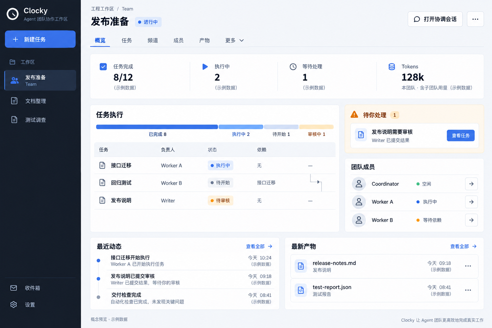
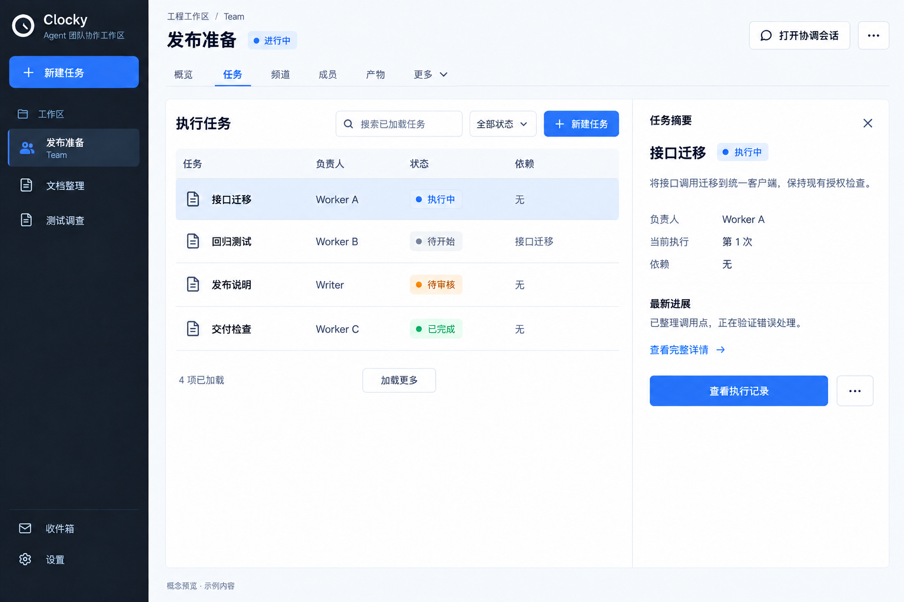
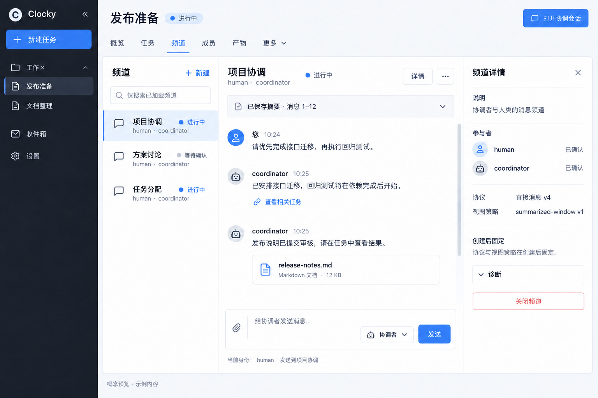
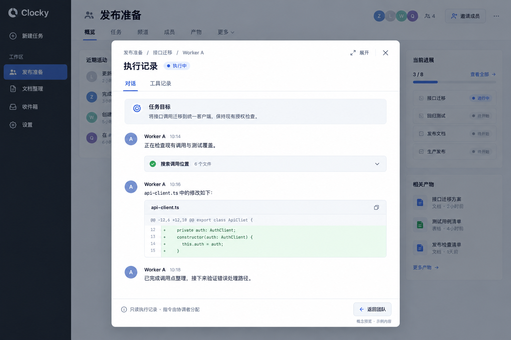

# Team 工作台视觉概念

2026-09-11 · 设计提案 · 全部内容为示例。完整的字段、交互、动效、数据和插件归属见 [设计方案](design-proposal.md)。这些图片尚未实现为产品页面。

## 团队概览

以任务执行与待处理事项作为焦点，指标集中成一条信息带。成员、动态和产物只做有限预览。

## 任务列表与摘要

列表保留比较与定位能力；右侧只解释选中的一个任务。执行记录和完整详情按需打开。

## Channel Hub

频道列表、消息和输入形成完整协作空间。右侧详情按需展开；协议配置和诊断不会挤占默认阅读路径。

## Session 子页面

宽幅页内子页面承载执行记录，标题说明来源，关闭后恢复团队工作区。工作成员示例保持只读。

## 使用图稿

使用内置 Image Gen 生成及修改，提示词保存在 [image-prompts.txt](image-prompts.txt)。图稿不是可点击原型；动画规格见完整方案。生成图中的品牌和背景细节尚非统一组件规范，应按设计方案的图稿核对说明收敛。所有实际操作、权限及指标以方案和现有 API 为准。
