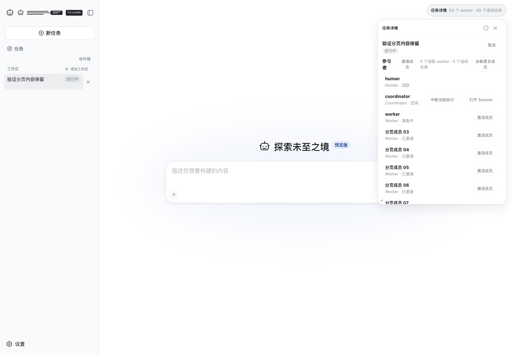
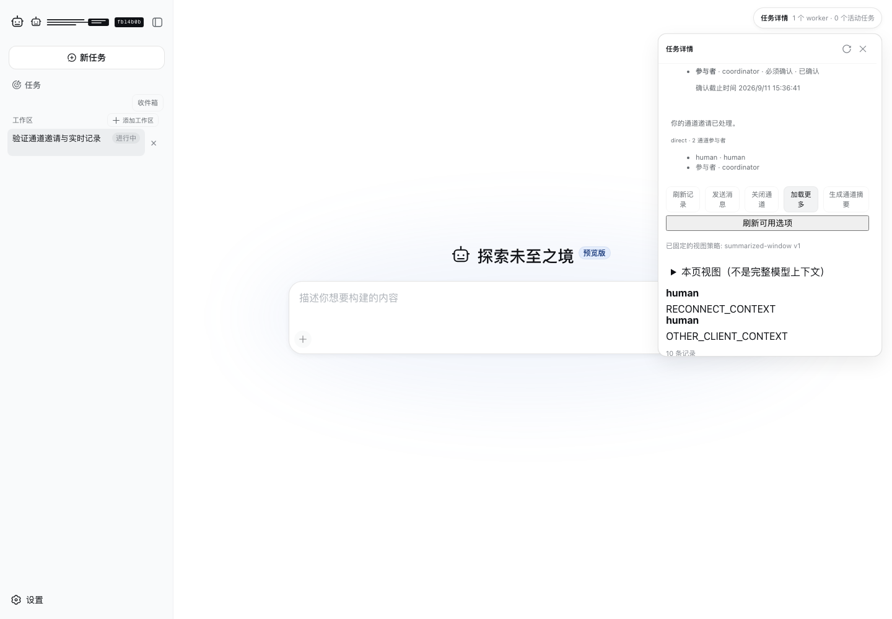
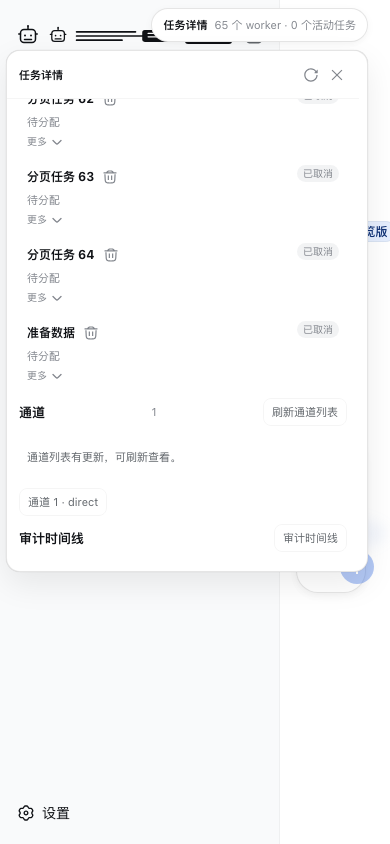

# Clocky Team 工作台 UI 重构方案

日期：2026-09-11。状态：设计提案，尚未修改产品实现。范围：Web 的 Team、Channel Hub、执行任务摘要及 Session 打开方式。调查基于当前工作区源码与本次隔离浏览器运行；概念图中的业务内容均为示例数据。

## 1. 推荐方向

将 Team 的默认入口改为团队工作台：用主区域回答“工作进行到哪里、谁在做、哪里需要我处理、产出了什么”。Session 成为点击后打开的执行记录子页面。原有任务详情浮窗收敛为简短摘要，完整管理能力移到对应模块。

视觉方向采用“精密工作台”：冷灰白工作区、石墨色导航、蓝色交互强调、清晰的执行关系、紧凑可读的表格。科技感来自真实状态变化、准确对齐和有目的的动效。首屏不使用霓虹背景、雷达、粒子、假趋势图或满屏同质化指标卡。

保留现有插件组成，重构现有插件内部组件及它们的 slot 组合。不创建 dashboard、task-inspector 或 session-modal 新插件。

视觉文件：[团队概览](concept-overview.png)、[任务摘要](concept-task.png)、[Channel Hub](concept-channel.png)、[Session 子页面](concept-session.png)。[四张图的集中预览](concepts.md) 可直接查看主要状态。下方规格定义最终的权限、数据与交互行为；生成图用于展示设计方向。

## 2. 调查发现与证据

本次运行：`pnpm exec vitest run --config vitest.web.config.ts apps/web/tests/team-collections.snapshot.ts apps/web/tests/team-channel.snapshot.ts`。2 个测试文件、5 个场景通过，使用真实 Host、HTTP/WebSocket、隔离持久化及 keyless replay。浏览器加载现有构建产物，本次提案任务未重新构建产品。现有常驻服务的匿名浏览器请求返回 401，因此截图采用本次隔离场景，不使用旧截图，也不把登录失败页面当作业务界面证据。

| 位置 | 观察到的问题 | 对操作的影响 | 重构决策 |
| --- | --- | --- | --- |
| Team 入口 | 选择 Team 后打开协调者 Session；空对话仍占主区域 | 团队工作缺少默认总览 | 选择 Team 默认打开概览，打开 Session 改为明确操作 |
| 详情浮窗 | 默认 360×520；成员、任务、预算、频道、产物、审计共享滚动区域 | 用户必须滚动寻找不同类别的信息 | 概览、任务、频道、成员、产物分区；浮窗只留摘要 |
| 成员区域 | 64 条成员记录排在任务前；标题及按钮挤到换行 | 高优先级任务和待处理事项首屏不可见 | 概览只显示少量相关成员，完整成员使用独立列表 |
| 频道区域 | 邀请确认、协议、消息、摘要、原始记录及管理按钮混排 | 阅读消息和管理协议互相干扰 | 独立 Channel Hub；阅读区、输入区、设置区分开 |
| 窄屏 | 浮窗覆盖大部分页面，背景导航仍占宽度 | 上下文与剩余空间都不足 | 切换为单列；详情和 Session 使用完整子页面 |
| 命名 | 导航“任务”是 Team；详情中又包含 TeamTask | 顶层任务与执行任务容易混淆 | 保持 Team 层级明确，任务页标注“执行任务”，Session 标注所属成员 |

源码定位：[`TeamDetailOverlay.tsx`](../../packages/client/ui-team/src/client/TeamDetailOverlay.tsx) 的面板尺寸和挂载；[`TeamPage.tsx`](../../packages/client/ui-team/src/client/TeamPage.tsx) 的各节内容；[`ui-team/index.ts`](../../packages/client/ui-team/src/client/index.ts) 的 `openTeam` / `openParticipantSession`；[`TeamBrowser.module.css`](../../packages/client/ui-team/src/client/TeamBrowser.module.css) 的密度和尺寸。`TeamPage.tsx` 当前为 1,025 行，说明它同时承担了多种呈现职责；行数本身不是拆分依据。

### 本次实际页面

Team 大列表：主区域空白与详情拥挤同时存在。



Channel：多种管理操作与消息阅读挤在同一窄面板。



窄屏：浮窗成为主体，却没有完整页面的导航和排布。



这些场景验证了布局问题和已有交互路径，不能代表所有真实任务规模、屏幕阅读器或生产性能均已检查。大列表场景是压力样本，日常任务的使用频率仍需实施后测量。

## 3. 信息架构与排布

| 层级 | 展示内容 | 主要操作 |
| --- | --- | --- |
| 全局侧栏 | 工作区、Team 列表、收件箱、设置 | 切换团队、新建团队任务 |
| Team 顶部 | 目标、生命周期、所属工作区 | 打开协调会话；更多团队操作 |
| Team 模块导航 | 概览、任务、频道、成员、产物；更多中放工作流与审计 | 切换模块，保留各模块状态 |
| 主区域 | 当前模块的高价值内容 | 查看、筛选、处理、追踪 |
| 任务摘要 | 一个任务的当前信息 | 查看执行记录、查看产物、展开完整详情 |
| Session 子页面 | 一个成员的一次执行上下文 | 阅读、查找、检查工具结果、按权限输入 |

```text
┌──────────────┬──────────────────────────────────────────────────────┐
│ Clocky       │ 工作区 / Team                 打开协调会话    更多   │
│ 新建任务     │ 发布准备 · 进行中                                    │
│              ├──────────────────────────────────────────────────────┤
│ 工作区       │ 概览   任务   频道   成员   产物   更多                │
│  · 发布准备  ├──────────────────────────────────────────────────────┤
│  · 文档整理  │ 任务完成       执行中       待处理       用量         │
│              ├────────────────────────────┬─────────────────────────┤
│              │ 任务执行                   │ 待你处理                │
│              │ 状态分布 + 相关执行任务    │ 需要决策的内容与操作    │
│              │ 任务 / 负责人 / 状态 / 依赖│                         │
│              │                            │ 成员活动                │
│              ├────────────────────────────┼─────────────────────────┤
│ 收件箱       │ 最近动态                   │ 最新产物                │
│ 设置         │ 可追溯、可点击             │ 文件名、来源、打开      │
└──────────────┴────────────────────────────┴─────────────────────────┘
```

默认不常驻右侧第三列，也不常驻对话输入框。未创建 Team 时，保留现有首次输入体验；创建成功切入 Team 概览。团队指令入口位于“打开协调会话”，实际输入仍走现有 Hub 授权链。

### 概览的内容预算

首屏限定为一个指标带、任务执行区、待处理区和少量成员。指标使用同一平面上的分隔列，不制作四个大卡片。执行任务预览优先显示运行中、审核中及明确受阻任务，最多 6 行，并提供“查看全部”。成员预览最多 4 人，最近动态最多 5 条，最新产物最多 3 项；这些是展示上限，不是数据总量限制。

待处理区优先级：人工授权或问题 → 待审核任务 → Team 停滞和失败。没有待处理事项时压缩成“暂无待处理事项”，将空间还给任务列表。不能为了填满布局创造“健康分”“效率指数”等没有定义的指标。

团队目标超过两行时提供“查看完整目标”。生命周期保留中文文字，取消中的执行显示“正在停止”，直到 Host 返回终态。任务完成率不替代 Team 的完成条件和最终交付状态。

### Task：摘要、完整详情、编辑分开

列表默认采用表格；不使用拖拽看板改变受调度器约束的阶段。每行 48–56px：任务名、负责人、状态、直接依赖、更多。任务名最多两行；保留清楚的选中态与焦点态。

点击任务打开 360px 的摘要检查栏，在宽屏任务列表旁展示；窄屏打开单页摘要。摘要默认不超过以下五组内容：

1. 任务名和当前状态。
2. 两到三行目标说明，可展开。
3. 负责人、当前或最近一次执行、真实阻塞原因。
4. 最近结果的一句摘要，以及产物入口。
5. “查看执行记录”主操作和更多菜单。

不在摘要中显示完整成员列表、全 Team 预算、频道 WAL、审计 JSON、全部尝试历史或编辑表单。“完整详情”展开为同一检查栏的深层视图，使用返回按钮；详细页才显示指令、依赖、尝试、审核、执行配置。所有摘要信息来自已有结构化字段或截断文本，不新增 LLM 摘要调用。

“更多”提供现有合法的编辑、停止、删除等操作。停止与删除不能做成紧邻标题的无说明小图标。Host 仍以任务 revision 和当前生命周期判定允许性；提交冲突时保留输入并提示刷新，不先移除任务。`review` 任务由真实审核流程处理，不能靠改状态完成。建议负责人属于调度建议，不保证重新分配。

### Channel Hub：独立协作空间

“频道”模块采用左列表、右内容的两栏结构。频道列表宽 240–264px，每行展示易读名称或类型、当前阶段、参与者摘要；当前没有业务名称时用角色组合或序号作为显示标签，真实 id 在详情中可复制。命名能力若要持久化，必须另行定义现有协议中的字段，不能偷偷只写浏览器标签。

内容顶部固定频道标题、参与者、阶段和“详情”入口。普通阅读默认展示消息流；生成的频道摘要以一条可折叠摘要置于消息前，并标注覆盖范围。参与者邀请待确认时在内容顶部出现明确的接受入口；查看频道不等于接受邀请。

输入区直接位于消息流底部，显示当前发送身份、协议允许的接收者和发送状态。保留真实图片/附件链；不能从展示样式推断有发送权限。等待指定发言者、邀请未完成、关闭或断线时显示原因并保留草稿。频道创建时的协议和 view policy 在高级设置中显式选择；保存后按现有不可变约束展示。不会为美观省去必要的配置或假设所有协议支持普通自由聊天。

刷新、摘要、查看原始记录、关闭频道归入清楚的工具菜单；只有发送和当前必要的接受操作维持较高强调。原始记录和完整审计位于“详情 → 诊断”，默认关闭。人类看到的本页消息、已保存摘要和模型获准读取的视图要分别命名，不能把任意消息分页标题写成“完整模型上下文”。

列表出现新内容时提示“有新消息”，用户正在阅读历史时不强制跳到底部。当前 API 没有完整的每频道未读游标契约，不将 `hasNewer` 或 WAL cursor 差值包装成精确未读条数；现阶段使用更新提示。

### Session：按需打开的页内子页面

点击“打开协调会话”、成员执行入口、任务的某次尝试或人工请求上下文，打开居中的宽幅子页面。桌面宽度为 `min(1120px, viewport - 64px)`，高度不超过 `88dvh`；小屏使用完整页面。内容宽度为代码和工具结果留足空间，避免把 transcript 塞入 360px 任务摘要。

子页面顶部显示 `Team / 任务或成员 / 执行记录`、成员角色、执行状态、返回和展开按钮。正文复用现有 transcript、工具卡、输入、授权与问题组件；展开模式保留返回 Team 的入口。一次只显示一个 Session，切换 Session 不叠加窗口。

Session 作为模态子页面时，背景不可操作，Tab 限制在子页面，Escape 关闭并回到原触发项；如果触发项被移除，则回到所属列表标题。任务摘要在宽屏是非模态检查栏，不应标成 `aria-modal`。浏览器返回、关闭和展开均保持来源模块、筛选、列表滚动、选中任务、Session 草稿和 transcript 滚动位置。关闭仅关闭视图，不能取消执行。

协调者输入仍经 `team.postInput`；工作成员 Session 的阅读入口不解锁直接 prompt 或模型修改。人工问题、授权和审核必须调用对应的现有操作。模态焦点规则依据 [WAI-ARIA Dialog Pattern](https://www.w3.org/WAI/ARIA/apg/patterns/dialog-modal/)。

## 4. 指标与数据口径

数据依据：[`TeamStateSnapshot`、`TeamTaskSnapshot`、`TeamUsageSnapshot`](../../packages/core/team/src/types.ts)、[`TeamTaskListState`](../../packages/client/runtime/src/client/contract/team-tasks.ts)、[`Team API`](../../packages/host/apiproxy/src/api/teams.ts)。

| 指标/视图 | 当前可用来源 | 口径及限制 |
| --- | --- | --- |
| Team 目标与生命周期 | `selected.state.team` / `goal` | 直接显示权威状态；任务全部结束不等于已交付 |
| 任务完成 | 完整 `state.tasks` | completed / 非 deleted 任务数；review、failed、cancelled 不算完成；分母为零显示“暂无任务” |
| 执行中 | 任务阶段和 execution | participant 看 assigned/running；child-team 按现有执行判定 helper 展示，不能要求每个任务都有 lease |
| 依赖等待 | `blockedBy` 与被依赖任务状态 | 显示未完成依赖；无依赖不代表一定可运行，资源或能力限制不能推测 |
| 待处理 | durable humanActions、pendingHumanActions、review 任务 | 按真实请求身份去重；请求已回答不等于关联工具已完成 |
| 成员活动 | participants、activations、当前任务 | 区分在线、活跃、空闲和执行中；选择当前有效 activation，不能使用历史数组第一个绑定 |
| Tokens | usage 的 input、output、cacheRead、cacheWrite | 四者分别展示；总数明确相加；reasoning 是 output 的子集，不重复相加；此聚合包含子团队 |
| 调用轮次 | `usage.turns` | 标成模型轮次，不等价于任务数或消息数 |
| 成本单位 | `usage.costUnits` | 只能标为成本单位；没有货币契约不能加 ¥ 或 $ |
| 预算 | provider 的 `budgets` | 只有可识别单位及明确上限时才显示占用比例；缺上限显示“未设上限”，缺用量显示“暂不可用” |
| 最新产物 | 有界 artifacts 集合 | 标明这是最近或已加载的产物；引用去重，不从局部页推断总数 |
| 最近动态 | Team 授权审计接口 | 使用返回的有界时间线；截断范围标明，不能编造历史 |
| Host 运维指标 | `team.metrics` | 请求不带 teamId，包含跨已加载 Team 及进程内计数；放诊断而非当前 Team KPI |

第一阶段不承诺任务时长趋势、每小时吞吐、每 Team 的 P95 延迟、历史费用曲线或预测 ETA。当前任务投影并没有通用的创建/完成时间字段，Host 内存直方图也不能还原单 Team 的时间序列。未来需要这些图表时，先定义现有 Hub/API 中有界、可恢复、带时间范围的读投影，再实现图表，不新增 UI 插件。

所有首屏统计从当前 Team 的同一完整快照派生，用 `useMemo` 而非另建业务 store；分页列表从 bounded collections 读取。二者在更新时以 revision/cursor 判断新旧，避免旧分页覆盖更新。若提供方只返回局部数据，明确显示“已加载 N 项”并暂不计算全量比例。任务列表当前 API 只提供 afterCursor/limit，未提供服务器搜索排序；第一版只能明确筛选“已加载任务”。面向全量的搜索排序必须先扩展现有 API，不能展示一个看似全局、实际只查首屏的搜索框。

## 5. 视觉与动效规范

这是提案色板，尚未写入产品 token。当前 [`DESIGN.md`](../../DESIGN.md) 明确禁止 Team dashboard，与本次用户需求相反；实施时应一并更新它的 Overview、Layout、Components 和 Do/Don't，并同步 [`design-platform.css`](../../packages/client/ui-theme/src/styles/design-platform.css)。只展示方案时保留现有文件，避免文档声称功能已经实现。

| 角色 | 浅色方向 | 深色方向 | 使用方式 |
| --- | --- | --- | --- |
| 画布 | `#F4F6FA` | `#111722` | 大面积背景 |
| 工作面 | `#FFFFFF` | `#1A2230` | 表格、消息、内容面板 |
| 导航 | `#151B26` | `#111722` | 持续导航，不铺满深色内容 |
| 主文字 | `#182230` | `#E6EDF7` | 标题与正文 |
| 次文字 | `#5B687B` | `#A8B5C8` | 元数据，仍需足够对比度 |
| 交互蓝 | `#4176E6` | `#85ABFF` | 选中与焦点；浅色底白字按钮用更深的 `#315FCC` |
| 边界 | `#DFE5EE` | `#334155` | 细分隔，不包裹每一行 |

正文 14px/22px，任务名 14px/20px，辅助信息最低 12px/18px；页面标题 24px/32px，指标 28px/34px。沿用现有原生 CJK 字体栈，数字与技术标识使用等宽字或 tabular-nums。主操作高 36px，触摸目标至少 44px；8/12/16/24px 组织间距；常规面板 10–12px 圆角，行和按钮 6–8px。状态图标加文字，颜色不能承担唯一含义。

| 触发 | 动效 | 目的 |
| --- | --- | --- |
| 进入概览 | 内容透明度与纵向 6px，180–220ms，最多 30ms 轻错峰 | 建立结构，不延迟按钮可用 |
| 切换模块 | 指示线或内容淡入，120–160ms | 保持位置连续；高频切换不做整屏滑动 |
| 打开摘要 | 右向 12px + 透明度，180ms | 表示它从所选任务展开 |
| 打开 Session | 纵向 12px + 透明度，220ms；遮罩 140ms | 建立子页面深度；关闭逆向 160ms |
| 数据状态变化 | 仅变化单元短暂背景强调，400ms | 让真实变化可见，不重播整个页面 |
| 运行状态 | 单个运行指示可轻微呼吸，1.8s；只在当前可见执行中启用 | 表达正在运行；页面失焦后停止 |
| 状态分布变化 | 条段宽度 200ms，保留文本数量 | 比较变化，禁止伪造实时计数 |

复用现有 easing 和主题动画变量；新增时集中到共享主题，不散落魔法数字。默认动画可中断，连续点击由最新目标决定。`prefers-reduced-motion` 下去除位移、呼吸和数字动画，更新直接呈现。表格行不因流式更新反复排序；新事件先提示，刷新由用户决定。执行关系图只在“工作流”内按需打开，默认任务页仍为高效列表。设计依据包含本项目 [Motion](../../.design-rules/references/hig/motion.md)、[Layout](../../.design-rules/references/hig/layout.md)、[Charting data](../../.design-rules/references/hig/charting-data.md) 与 [Accessibility](../../.design-rules/references/hig/accessibility.md)。

### 自适应与可操控性

宽屏 ≥1280px：侧栏 224px，主区域内两栏约 2:1；任务列表可以显示摘要检查栏。960–1279px：侧栏缩为 56px 导航，待处理区排在执行列表前，摘要按需打开。<960px：单列模块布局；<600px：侧栏改抽屉、任务表改同字段的紧凑列表、Session 满屏。不得让一个 360px 浮窗挡住移动端核心操作。

长页面由主内容区域滚动；表格、频道消息和 Session transcript 各自拥有清晰的滚动容器，互不抢滚动。导航和子页面操作固定在各自区域顶部；输入区必须避让虚拟键盘。滚动条可见，异步消息和错误区域预留空间。200% 缩放、390px 视口、长中文标题及英文标签都纳入验证。

所有操作使用语义按钮或链接；可见焦点、键盘与触摸可到达；不依赖 hover 才显示核心操作。按钮忙碌时保持宽度，失败反馈留在触发位置。复制 id、打开日志与切换模块等可逆动作不弹确认；停止和删除采用现有确认语义，明确对象和后果。

## 6. 组件归属与插件组合

| 现有归属 | 重构后职责 | 建议内部组件 |
| --- | --- | --- |
| `ui-layout` | 工作区框架、主内容选择、全局覆盖层 | 扩展现有 AppFrame；新增 Team 主区域 slot 与 Session 子页面容器 |
| `ui-team` | 团队导航、概览、执行任务、频道、成员、产物 | TeamWorkspace、TeamOverview、TaskList、TaskInspector、ChannelHub、ChannelList、ChannelThread、MemberList、ArtifactList |
| `ui-conversation` | Session 渲染、工具细节、输入与交互 | 复用 ConversationRoot / ConversationSession / InputBar；适配子页面尺寸 |
| `runtime` | Team 与 Session 权威数据、游标、缓存、连接 | 复用 teamTasks 和 sessions；共享浏览状态由声明的 store 承载 |
| `ui-primitives` | 通用按钮、菜单、状态、模态、反馈 | 复用 Button、Menu、Modal、StateDot、DisclosureRow、Toast；必要时扩展统一变体 |
| `ui-theme` / `locale` | 明暗主题、密度、动效、中文和英文 | 集中 token 与 locale 字典 |
| 现有 Host / Hub / API | 权限、状态转换、分页和未来聚合 | 只在当前读接口不足时扩展，UI 不实现调度或授权 |

组件名称是拟议的包内实现文件，不是新包或跨插件导出。遵守 [`packages/client/AGENTS.md`](../../packages/client/AGENTS.md)：业务组件只接收四类 props，数据经框架 hook，共享数据不复制订阅，组件不接触 ctx，注册使用 `ctx.slots.register` 并受 effect 生命周期管理。

需要解决的真实组合问题：`ui-conversation` 目前占用 `conversation`，并且在该注册中声明其整个子 slot 树；不能让 `ui-team` 直接抢占同一个 single slot，否则工具卡、输入、授权等子 slot 会一起消失。建议 `ui-layout` 在根注册中新增 `team.workspace`（root scope），由 `ui-team` 挂载；既有 `conversation` 注册仍负责 Session 和首次输入。AppFrame 根据 Team 选择与 Session 查看状态，决定主工作区和 Session 子页面容器的摆放；只有一个可见 conversation 实例。Session 内工具详情随 Session 容器布局，不再残留在背景右栏。

必须区分 `selectedTeamId` 与 `openedSessionId` / Session 查看状态。Team 选择不应隐式触发 `sessions.open(coordinatorSessionId)`；Session 的打开、切换和关闭由独立动作管理。用声明的 UI store 保存模块、任务、频道、查看模式、来源与滚动恢复信息；业务 Team/Session 数据留在 runtime 对象层。路由用可恢复的 Team/module/task/channel/session 标识和筛选参数；权限每次由 Host 重新验证，URL 中不存草稿或授权材料。

实施前应对现有聊天组件从页面内移动到模态容器的 React 挂载身份做一次小范围验证，确保草稿、IME、附件、工具展开和订阅不会意外重建；不能简单通过两处调用 renderSlot 同时挂两份会话。关闭后保留 runtime 状态，只释放本视图拥有的观察者和 DOM。新 slot 的 children、scope、owner props 与提供者声明须一起修改，不能绕过类型检查直接导入另一个插件的 React 组件。

## 7. 状态和一致性约定

| 状态 | 统一行为 |
| --- | --- |
| 初次加载 | 保留区域高度，显示现有加载指示；不能闪出零指标 |
| 空 Team / 空列表 | 解释当前状态并提供合法下一步，不铺空白卡片 |
| 筛选无结果 | 保留筛选条件，提供清除；明确筛选范围 |
| 续页失败 | 保留已加载内容，在该列表重试，不清空全页 |
| 收到较新版本 | 保留正在阅读的行，提示刷新；需要操作时读取正确 revision |
| 断线或权限不足 | 保留可读缓存并标注过期；禁止无授权写入，说明原因 |
| 操作进行中 | 禁止重复提交；保留输入和操作对象身份 |
| 审核或问题已失效 | 展示权威结果，不能继续提交旧请求 |
| 切换 Team / 子 Team | 保存来源，取消属于旧视图的请求；旧返回不能覆盖新 Team |
| 关闭子页面 | 恢复来源焦点与滚动；不停止任务、不丢草稿 |

保留当前通道邀请、版本冲突、续页失败、取消、已删除 tombstone、子 Team 导航等真实行为。重构只改变展示入口，不能改变协议能力或绕过权限。

## 8. 实施顺序与验收

1. **工作区结构与选择解耦。** 增加 Team 主 slot，选择 Team 打开概览；Session 移入子页面；验证 draft、IME、工具详情、人工请求和子 Team 返回。此阶段同步 DESIGN.md 和行为约定，删除“默认打开协调 Session”的旧 UI 路径。
2. **任务摘要与模块迁移。** 拆分 TeamPage；任务、成员、产物形成独立列表；摘要严格执行内容预算；停止、删除、编辑、审核全部沿用现有权威操作。
3. **Channel Hub。** 消息、邀请、参与者详情、发送和诊断分区，迁移图片、协议限制、消息分页与断线恢复；不新增协议。
4. **指标与视觉收敛。** 接入准确的 Team 派生数据，落地共享 token 和动效；完成明暗主题、中文英文、窄屏、键盘和减少动态效果验证。
5. **按数据能力增加分析。** 只有明确需求和真实数据支持时，再扩展有界历史聚合、全量搜索或工作流图；不作为首版阻塞项。

验收标准：1440×900 首屏能看见团队目标、当前状态、任务分布和需要用户处理的入口；打开一个任务摘要或成员 Session 不超过一次明确点击；任务摘要默认无需滚动即可理解目标、负责人、状态、下一步；关闭 Session 能回到原模块与位置。频道首次进入可以辨认身份、阶段、最新内容与可执行操作，无需翻原始 JSON。

性能目标是实施后需实测的预算：用户点击反馈在 100ms 内出现，核心过渡 ≤240ms；初始化不预加载所有成员 transcript 或所有频道 WAL；对 1,000 个任务、50 个成员的样本验证分页、长列表和交互响应，并记录机器与浏览器版本。达不到时调整列表渲染，不伪称已经测得达标。

行为验证以现有 Team collections、channel、child-navigation 以及 details-session-lifecycle 浏览器场景为基础，增加默认概览、任务→Session→返回、权限拒绝、stale revision、旧请求晚到和 reduced-motion 的关键覆盖。模型和协议不变的纯展示提案不新增 Session 事件；实现用户可见重构时补 keyless runnable-example snapshot，并为正式 UI PR 录制真实服务与模型流 GIF。完成源码相关 typecheck/lint、focused tests、构建和视觉验证后再主张实现完成。

## 9. 取舍与已有设计的关系

不选择“继续给浮窗加折叠”：它仍把多种任务放在错误的空间层级。不选择“默认大 Session + 旁边小 dashboard”：主区域仍被对话占据。不选择“所有任务做成看板”：状态受调度器和审核约束，拖拽会暗示用户并不拥有的控制。不选择“新建 UI 插件集合”：现有 ui-team、ui-layout、ui-conversation 已有相应职责。

这项设计将让偏好持续聊天的用户多一次打开会话操作，因此顶部保留稳定的协调会话入口并支持展开。仪表盘也可能再次膨胀，内容预算和数据口径必须成为验收条件。原生模态的焦点与 React 移动挂载是主要实施风险，应在第一阶段处理。

现有 [compact Team detail 决策](../../.agents/notes/implemented/feature/2026-09-07-team-detail-compact-delete.md) 中的权限、任务停止/删除、负责人追溯仍有效；其浮窗主展示选择仅列为本提案拟替换的部分。[Team closure 权威决策](../../.agents/notes/implemented/architecture/2026-08-31-team-closure-authority-and-detail-inspection.md) 和 [P1 产品收敛提案](../../.agents/notes/proposed/architecture/2026-09-04-native-multi-agent-p1-product-convergence.md) 的生命周期与协议目标仍由原文拥有。本次不归档这些记录，不把未实施方案当成已取代的产品事实。

## 10. 交付与验证边界

本目录保存调查截图、视觉概念和本方案；正式提案登记于 [Agent Note](../../.agents/notes/implemented/architecture/2026-09-11-team-workspace-ui.md)。图片用于讨论布局与风格，文字规格拥有字段、权限、数据及动作含义的准确解释；图中的示例数量不是当前项目统计。

本次没有改产品代码、插件配置或现有 DESIGN.md，没有提交、推送或发布。现有浏览器场景通过不代表拟议界面已经实现。Frontend Design Premium 静态检查为 0 findings，但静态扫描不能证明运行时可访问性或视觉质量；实施后的完整矩阵仍需执行。

图稿核对范围为原生 1536×1024 概念图与 1440×1000 / 390×844 的现有页面截图，不是概念与新产品实现的像素比对。已检查主次区域、任务摘要字段、文字层级、颜色、Session 阅读宽度、频道操作位置六个方面。建议色板的正文对比度为 16.03:1，次文字 5.66:1，深蓝按钮白字 5.77:1；这些是指定色值计算结果，不能替代实现后的实际控件对比度测试。

概念稿仍需在实施时统一的细节：沿用项目现有品牌图标，不采用各生成图不同的 Clocky 标志；以概览图作为背景布局基准，Session 图只规定前景子页面；去掉概览图底部自动生成的宣传句；示例数据说明只在演示中出现；按钮采用上述可读性更好的实色方案。Task 图中的“最新进展”仅说明可选摘要位置，当前任务没有独立进展字段，正式页面应显示已有最近结果，没有结果时省略或显示“尚未提交结果”，不读取所有 Session 来生成进度文案。

文档验证：新 Agent Note 的配对检查通过；全仓 `doc-sync` 为 24 项通过、4 项失败。失败来自本次未编辑文件的翻译配对、Markdown 硬换行，以及配置/持久化生成目录过期，详见 [检查日志](evidence/doc-sync.log)。本次不修复无关工作区修改，也不主张全仓检查已通过。
