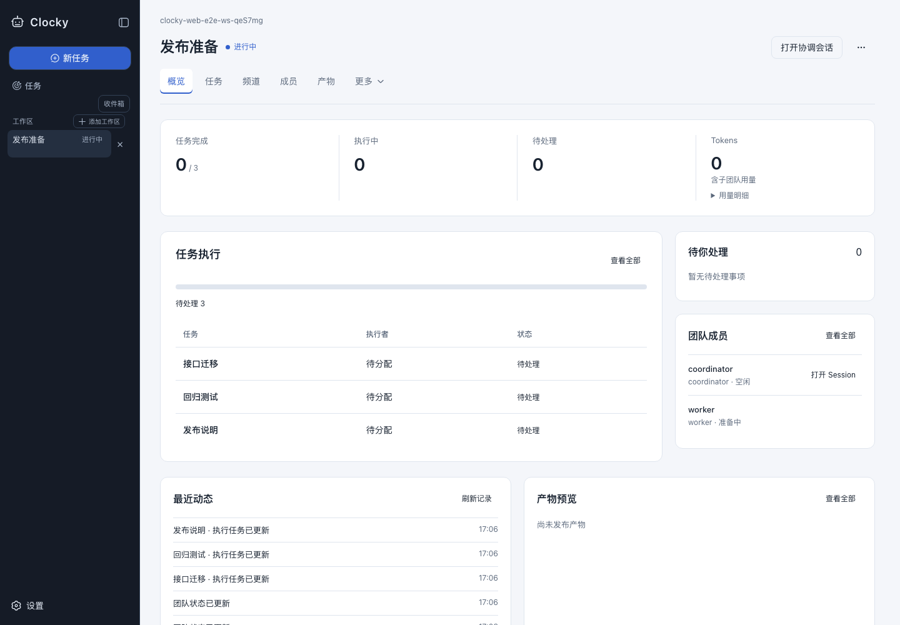
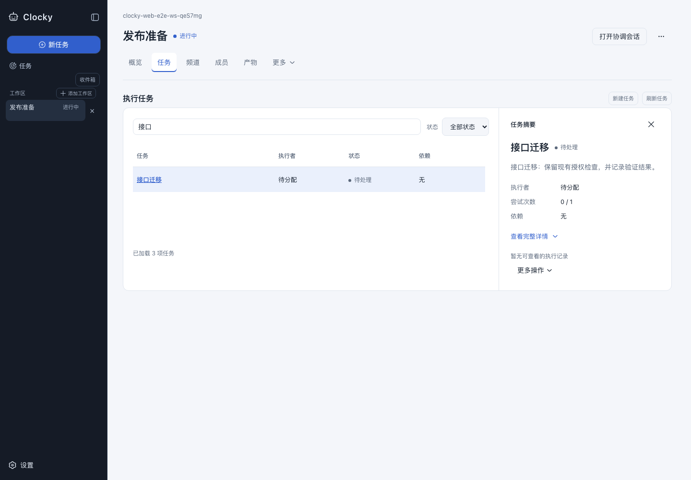
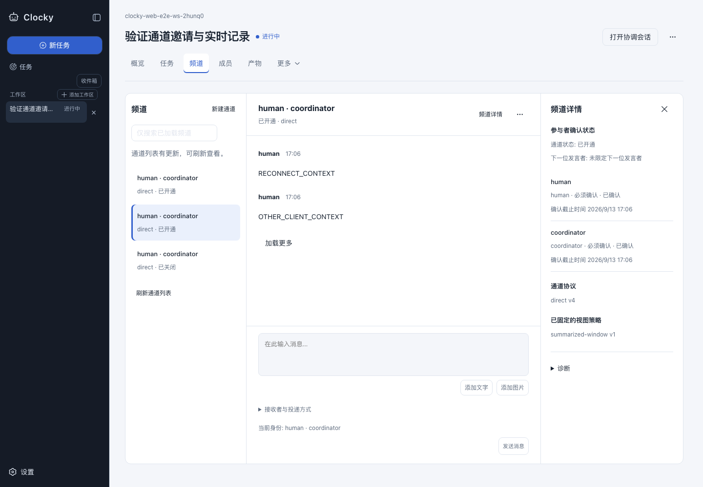
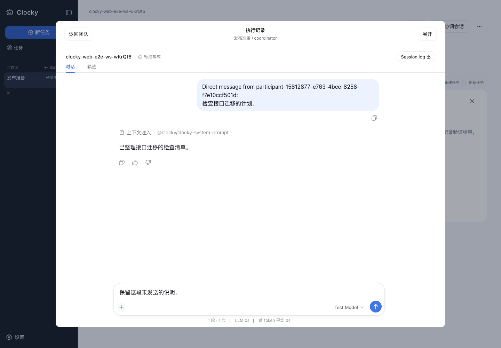

# Team 工作区实现与验证记录

本次重构在现有插件内实现：默认进入 Team 仪表盘，任务通过列表与摘要检查栏操作，Channel Hub 提供独立阅读和输入空间，Session 通过点击在页内打开。未新增 UI 插件。设计依据见[设计方案](design-proposal.md)，组合和生命周期决策见 [Agent Note](../../.agents/notes/implemented/architecture/2026-09-11-team-workspace-ui.md)。

## 已实现

- 总览：真实任务分布、执行预览、人工待办、成员、最近动态、产物；不编造趋势、金额或 ETA。
- 任务：有界列表、搜索与状态筛选、精简摘要、按需完整详情和历史、精确执行 Session、已有审阅与停止／删除操作。
- 频道：列表、消息、内联输入、独立协议与诊断面板；保留邀请确认、图片顺序、重试身份和频道草稿。
- Session：单一稳定 conversation 子树、原生模态、展开与返回；保留未发送草稿和来源筛选，不因关闭停止执行。
- 导航：独立 Team 选择与 Session 查看、可恢复 URL、浏览器前进后退、迟到请求取消、显式离线 Resume。
- 视觉：石墨导航、冷灰画布、清晰白色面板、层级字体、状态文字与颜色、180–220ms 过渡、减少动态效果、窄屏适配；触摸设备的工作区主要控件至少 44px 高。

## 视觉核对

核对保存概念与真实浏览器截图时按区域和层级比较；概念中的示例数字不是产品数据。真实截图使用无密钥回放驱动的隔离 Host。

| 维度 | 实现核对 |
| --- | --- |
| 主次区域 | 左导航固定，中央默认总览，Session 按需打开 |
| 信息密度 | 总览预览有数量上限；任务摘要与全量详情分开 |
| 对齐与间距 | 指标带、任务主区与右侧待办／成员保持稳定网格 |
| 字体和颜色 | 页面标题、模块标题、正文、辅助文本有层级；浅色工作区与深色导航区分 |
| 频道操作 | 输入在消息下方；邀请、协议、诊断不混入普通消息 |
| Session 深度 | 原生模态遮罩、来源上下文、返回与展开操作形成独立阅读层 |
| 响应式 | 窄屏摘要替代列表，深色英文及长目标可展开 |

### 实际截图

## 验证证据

| 检查 | 结果 |
| --- | --- |
| UI team/layout/sidebar/theme/primitives/conversation + runtime Team 单元测试 | 86 个文件，1,257 项通过 |
| 完整 `pnpm run build` | 通过，生成 197 个 client artifact |
| Team workspace/channel/collections/child-navigation 真实 Host 浏览器测试 | 4 个文件，7 项通过；覆盖 65 行分页与失败恢复、邀请和多种频道协议 |
| settings-chrome、details-session-lifecycle 浏览器测试 | 10 项通过 |
| 变更 TS/TSX 的 scoped lint、导出 JSDoc、client catalog freshness | 全部通过；最终日志保存在项目 `.tmp/team-workspace-implementation/` |

最后针对触摸目标和稳定截图的 workspace 场景再次通过。浏览器场景包括 URL 前进后退与 reload、Session 草稿、深色和英文、390px 布局、长目标折叠、减少动态效果；720×500 CSS 视口配 DPR 2 用作缩放等效布局检查，不等同于原生浏览器 200% 缩放。

## 检查限制

仓库级 doc-sync 为 24 项通过、4 项失败；hygiene 为 11 项通过、3 项失败。现有问题涉及其他 Team 文档的翻译配对与段落换行、config/persistence 生成目录、vendor rescope、knip 未使用项及 channel-admission invariant 说明。本次拥有的 client slot catalog 已重新生成并通过 freshness 检查；没有为使报告全绿而修改无关领域。

1,000 个任务／50 个成员的浏览器性能及点击反馈 100ms 预算没有完成实测，因此不宣称该规模性能达标。当前证据证明有界预览和 65 行真实分页行为。频道草稿支持模块切换，Session 草稿支持关闭后再打开；不承诺所有表单草稿跨模块或跨 reload 保留。未创建 PR 或发布；PR 阶段的真实流程 GIF 尚未制作。
