# WebUI 实测审查与截图证据

本轮审查基于重新执行 `pnpm run build` 后的隔离 Host，非旧图、设计稿或只读源码推测。浏览器为 Codex 内置浏览器，桌面 1280×720，窄屏 390×844；中文、浅色。源码基线为 `dbfb6e25b9` 加用户已有未提交改动。审查日期为 2026-10-01 至 10-02，Asia/Shanghai。

场景复用 [Web scaffold](../../apps/web/tests/scaffold.ts) 与 [Simulation 管理 fixture](../../examples/headless-agent/tests/fixtures/simulation/simulation-administration/cordis.yml)。一个普通 Team 有 3 个待执行任务，调度器被测试配置停用；一个采购仿真经真实创建 API 登记、准备并建立初始检查点，未点击开始调度。页面和后端均为真实实现，数据为本轮隔离测试数据；这不是生产负载或真实模型执行证明。创建与预检是本轮唯一仿真写入。

## 1. Team 概览：层级已有基础，宽度与文案有问题

路径：侧栏 Team → 概览。标题、模块、任务执行和待办已有分区，任务数来自业务数据。问题 F01：在 1280px 下，主区域可用宽 1056px，但 Team 根元素实测约 811.9px，右边留下约 244.1px 空白。切到带任务摘要的页面后工作底铺满，说明是模块内容参与了宽度计算。问题 F02：指标“待处理 0”和任务表“待处理 3”含义不同却同名。

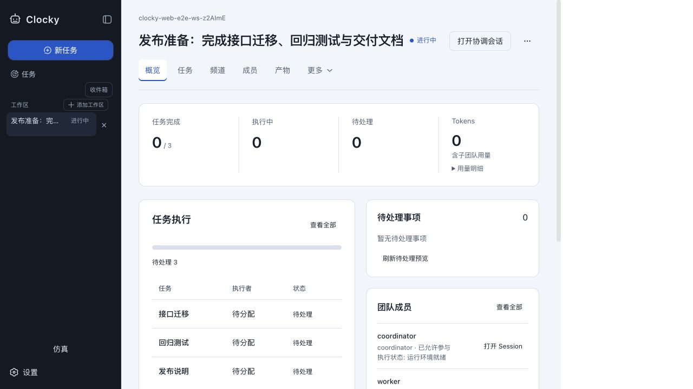

定位：[TeamWorkspace.module.css](../../packages/client/ui-team/src/client/TeamWorkspace.module.css) 根 `.workspace` 没有 flex 伸展；[AppFrame.module.css](../../packages/client/ui-layout/src/client/AppFrame.module.css) 的 `.productStage` 是横向 flex。DOM 同时确认根节点 `flex: 0 1 auto`。这支持从布局约束修复，不能靠把表格内容撑宽。文案位于 [TeamOverview.tsx](../../packages/client/ui-team/src/client/TeamOverview.tsx) 与 locale；attention 和 task phase 应保留独立统计。依据：本地 [Layout / Visual hierarchy](../../.design-rules/references/hig/layout.md) 的空间分配与信息分组原则。

## 2. 任务列表与摘要：可沿用的基准

路径：任务 → 接口迁移。列表与 360px 级别摘要并列，选择明显，详情有目的、执行者、尝试次数和后续入口，结构比其他模块清楚。问题 F03：刷新动作混合“刷新”和“返回首页”；本轮小数据不检验大规模分页。任务选择在 accessibility tree 暴露为 checkbox，后续需核对它表示选择还是多选，避免错误地承诺批量选择语义。

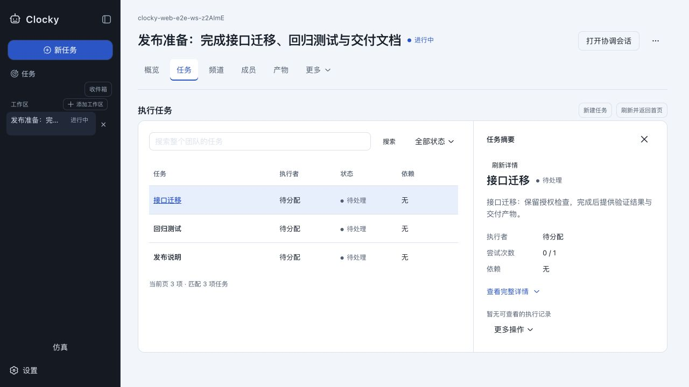

定位：[TaskWorkspace.tsx](../../packages/client/ui-team/src/client/TaskWorkspace.tsx)。建议保留整体结构，将它作为其他集合页的交互参照；不因为 Simulation 结构较弱而把 Team 也降为通用三列表格。

## 3. 频道：功能分区正确，输入区仍偏协议表单

路径：频道 → 选择 human／coordinator。列表、历史、输入区已经分开。F01 同样出现；未选择时标题和正文重复同一提示。问题 F04：命名混用“频道／通道”；`human · coordinator` 与 `direct` 占据主体标签；一个普通文本输入仍暴露“添加文字”和“丢弃此草稿”等表单感较强的控件。空历史没有与输入区衔接的引导。

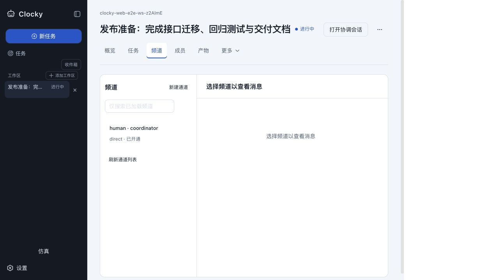

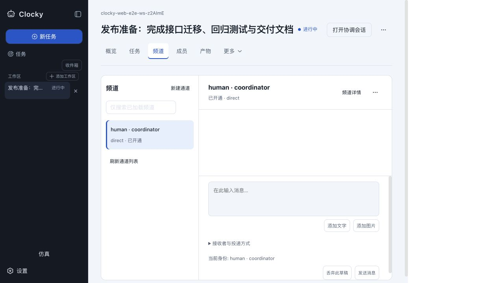

定位：[ChannelHub.tsx](../../packages/client/ui-team/src/client/ChannelHub.tsx) 及其 CSS。建议保持多内容块及投递语义，只对常见纯文本场景简化展示。没有发送消息，不能据截图判断发送、投递或消费行为。依据：[Entering data](../../.design-rules/references/hig/entering-data.md) 的减少输入负担原则。

## 4. 仿真目录：空状态被基础设施信息占据

路径：侧栏仿真。问题 F05：尚无运行时，主内容先展示 Host 共享模型池、长解释和多个刷新入口，“暂无已登记仿真”反而在下方。新建按钮为弱强调；用户需要先理解部署资源，才能建立第一个运行。侧栏仿真入口在底部、紧邻设置，与 Team 的主要导航地位不一致。

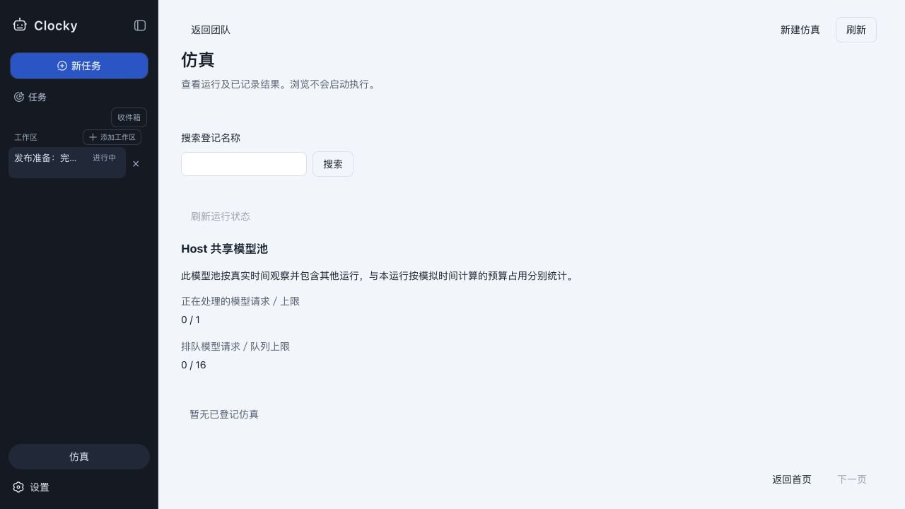

定位：[Workspace.tsx](../../packages/client/ui-simulation/src/client/Workspace.tsx) 目录分支与 [RunStatus.tsx](../../packages/client/ui-simulation/src/client/RunStatus.tsx) 的 `ModelPool`。主机资源的范围说明应保留，但放到次级区域。依据：[Layout](../../.design-rules/references/hig/layout.md) 的重要信息优先原则。

## 5. 仿真创建：成功可完成，首屏不能快速填写

路径：新建仿真 → 选择 Company procurement → 填基本字段 → 检查配置 → 创建 → 打开已登记运行。预检返回成功；创建原请求先显示已受理，后续持久记录显示已完成；初始检查点可见。问题 F06：380px 级别的窄对话框用于模板说明、9 个输入和额度解释；选模板后，名称等基本输入被推到折叠线以下。刷新模板和检查配置是窄条形按钮；底部三个动作几乎同等强调。

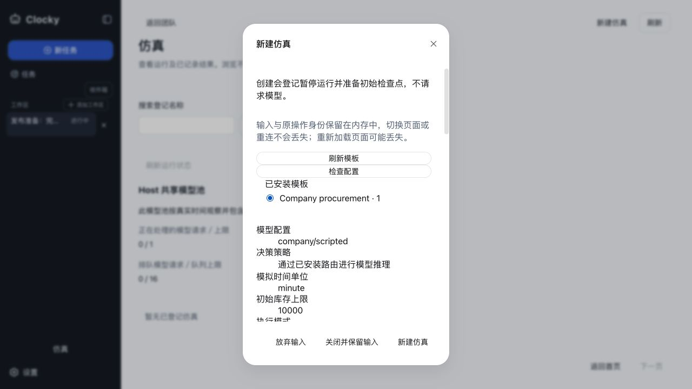

定位：[CreationDialog.tsx](../../packages/client/ui-simulation/src/client/CreationDialog.tsx) 使用 [Modal.module.css](../../packages/client/ui-primitives/src/Modal.module.css) 默认 `width: min(380px, …)`；本页面未指定更宽的表单布局。建议增加共享模态的明确尺寸变体或采用受控全页表单，不能全局放大所有确认框。进一步核对 portalled 内容的 token 继承；仅凭截图不能断言 token 漏失。依据：[Typography](../../.design-rules/references/hig/typography.md) 与 [Entering data](../../.design-rules/references/hig/entering-data.md)。

## 6. 仿真概览：状态多，但难以形成整体判断

路径：打开已登记运行 → 概览。问题 F07：运行名被压成窄列，“刷新”拆为两行，十组状态在右侧像连续文本流换行。模块导航在约 y=302px；下方首先展示所有权、观察版本等诊断值。连接、调度、在途工作、版本和操作按钮缺乏主次。

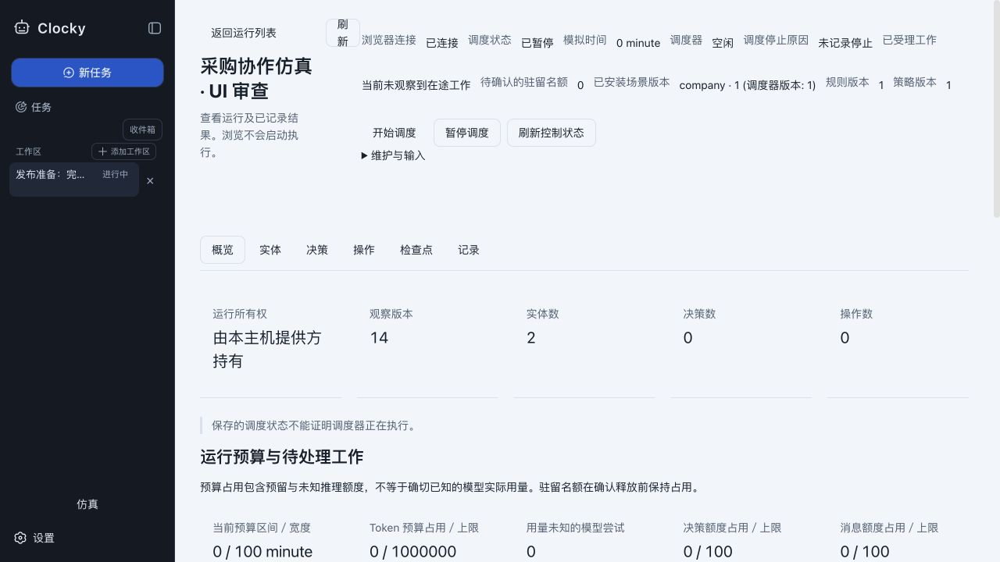

定位：[Workspace.module.css](../../packages/client/ui-simulation/src/client/Workspace.module.css) `.header` 横向布局及 `.identity` flex；[RunStatus.tsx](../../packages/client/ui-simulation/src/client/RunStatus.tsx) 将 `dt`／`dd` 独立排布。正确区分了调度、实际执行和模型池；应保留事实，只重组披露层级。依据：[Layout](../../.design-rules/references/hig/layout.md) 与 [Typography](../../.design-rules/references/hig/typography.md)。

## 7. 实体详情：有读取能力，业务对象被技术字段淹没

路径：实体 → buyer 详情。问题 F08：列表主标题是 ID，实体名称为副行；通用“状态／查看详情”列难以比较类别和认知模式。详情前置返回、分区、刷新、观察版本、ID、复制 ID，名称排在后面。F07 的页头问题在每个集合页重复，详情在首屏只显示少量内容。

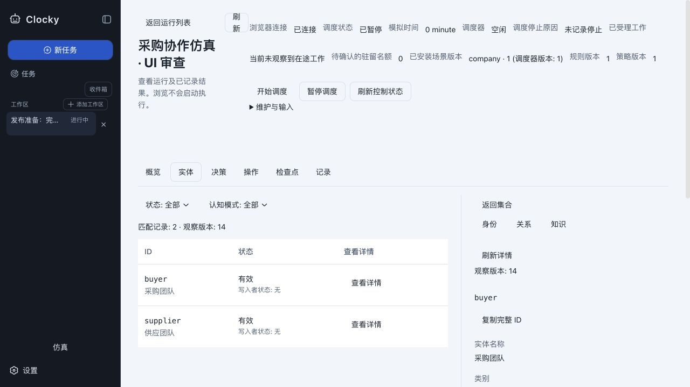

定位：[Workspace.tsx](../../packages/client/ui-simulation/src/client/Workspace.tsx) 通用表格和 inspector，以及 [ObjectDetails.tsx](../../packages/client/ui-simulation/src/client/ObjectDetails.tsx)。关系／知识等分区是可保留的渐进披露基础；建议补对象摘要、领域列及对象化动作名称。相同“查看详情”的按钮存在可访问名称辨识风险，尚未进行完整读屏测试。

## 8. 窄屏：内容能够纵向阅读，但详情发现成本过高

同一实体详情切至 390×844，等待侧栏自动收缩稳定后记录。问题 F09：状态与控制占据首屏，模块导航实测 y≈728px；可用内容区宽 334px，详情需向下滚动才出现。滚动到详情后名称、返回和模块导航又不能同时看见。根区域实测 `scrollHeight=1927`、`clientHeight=844`；这不是横向裁剪证明，而是主要任务被低优先级信息推远的可用性问题。

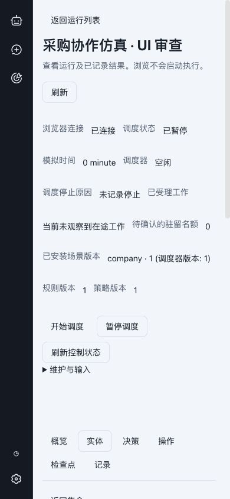

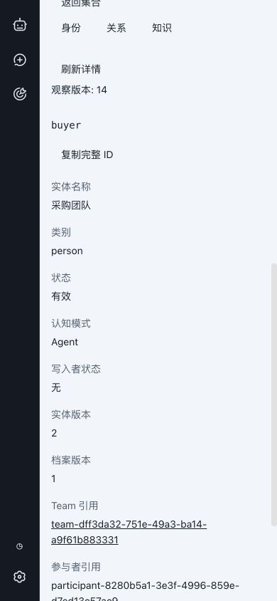

建议窄屏采用紧凑身份／状态、模块选择器和单对象详情层。不要只把桌面所有字段按行堆起来。依据：[Layout / Adaptability](../../.design-rules/references/hig/layout.md)；[WCAG Reflow](https://www.w3.org/WAI/WCAG22/Understanding/reflow.html)作为后续回流验收依据。本轮未跑 320px／400% 缩放，不能判定该条款通过或失败。

## 9. 关联 Team：权限拒绝正确，目标呈现错误

路径：实体详情 → 查看关联 Team。目标独立鉴权并拒绝访问，符合权限边界。问题 F10：URL 已指向新 Team，正文保留之前普通 Team 的标题和频道；右上仅附英文 `Authenticated principal cannot inspect this Team`。用户容易把旧 Team 当成目标，且“返回工作台”不能明确回到来源实体。浏览器 Back 确实恢复仿真运行、实体模块与 buyer 选择。

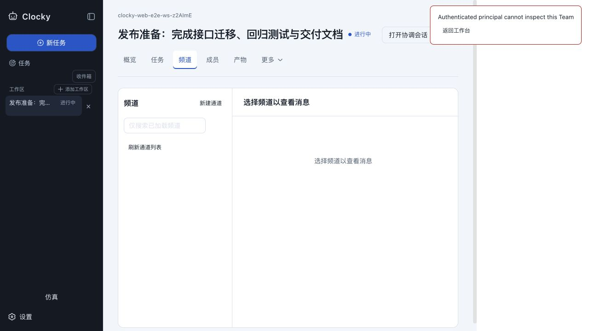

定位：[TeamWorkspace.tsx](../../packages/client/ui-team/src/client/TeamWorkspace.tsx) 的 `navigationError` 和旧 selection 保留路径。建议在目标加载失败时使用专属错误主体，保留但不展示旧对象为目标，提供来源返回。此发现不是权限绕过，也不能通过给仿真用户扩大 Team 权限来解决。

## 10. 检查点：准确但不便辨识

路径：检查点。初始检查点已保存，页面也明确“尚未验证当前来源”，没有将保存等同恢复可用。F08 同样出现：长内部 ID 是主要识别信息；通用三列不能迅速比较保存时间、来源检查与可用动作。截图只证明初始记录存在，不证明恢复成功。

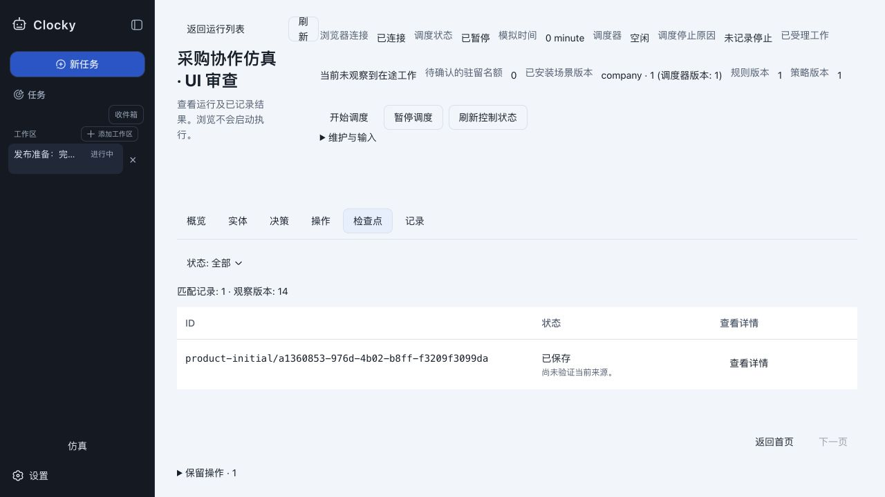

建议使用“初始检查点”等可读标签，并保持完整 ID 可复制；额外比较字段必须先核实 DTO 支持，不能为了显示时间去下载完整 manifest。

## 11. 记录：技术日志需要业务阅读层

路径：记录。序号与模拟／真实时间明确区分，原文权限和导出范围说明正确。问题 F11：记录类型是自由输入框，用户需知道 `run/created` 等内部事件名；列表的“动作：无”缺少说明，首屏只能容纳很少数据。fixture 页大小是 2，这是测试配置，不能把“两条一页”当作生产默认缺陷。

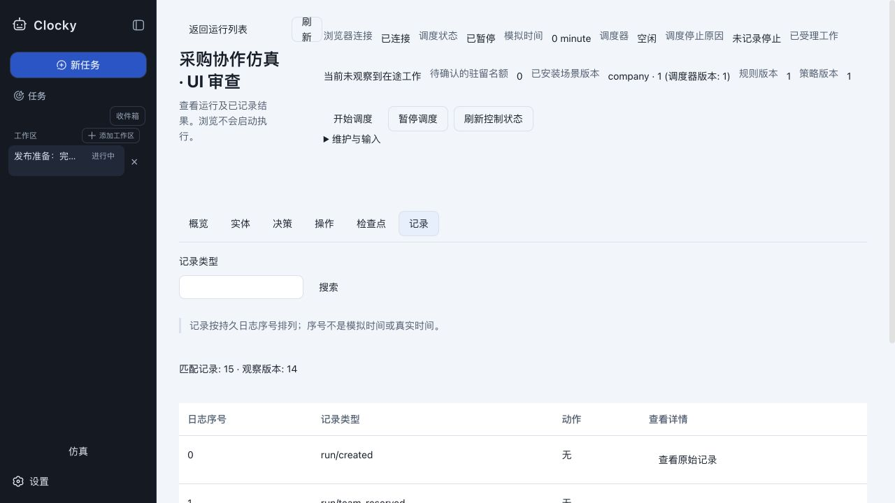

定位：[RecordsView.tsx](../../packages/client/ui-simulation/src/client/RecordsView.tsx)。建议增加已知事件类型标签与选择器，保留原类型用于精确筛选；不改变原文授权和完整导出的边界。本轮没有下载导出文件。

## 12. 原请求：同一身份的不同观察缺少解释

路径：概览 → 向下滚至持久原请求。问题 F12：同一 command ID 的持久条目显示“请求已完成”，嵌套旧回执却显示“已受理，准备仍待完成”，仍有“重试原操作”。底部还有“保留操作”入口，形成多处发现路径。重复查询读取不会执行，但用户缺少理由来判断哪个状态更新。

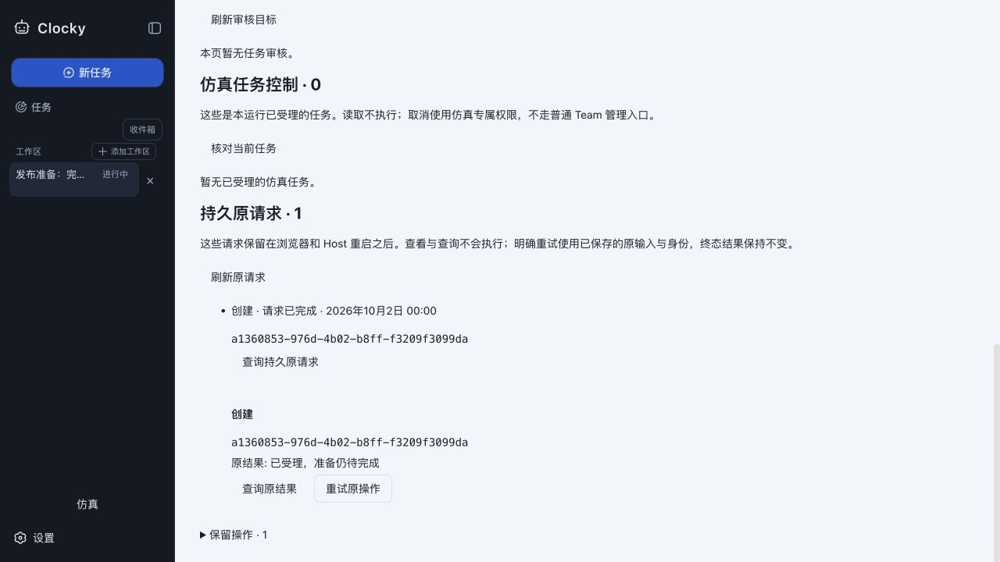

定位：[PersistentRequests.tsx](../../packages/client/ui-simulation/src/client/PersistentRequests.tsx)、[CommandRecord.tsx](../../packages/client/ui-simulation/src/client/CommandRecord.tsx) 与 `Workspace` 保留操作区。建议由 runtime 形成带来源／新鲜度的请求读取模型；在 UI 合并成一个可解释条目。截图只证明呈现冲突，不证明后端会重复执行。

## 13. 协调会话：返回关系清楚，空态上下文不合适

路径：返回普通 Team → 打开协调会话 → 返回团队。宽视图、所属 Team 与返回动作清楚，返回后保留频道选择。问题 F13：已有 Team 的空协调会话仍显示“探索未至之境／描述你想要构建的内容”的首次创建式空态，而标题叫“执行记录”；可写沟通与只读检查的目的不够明确。

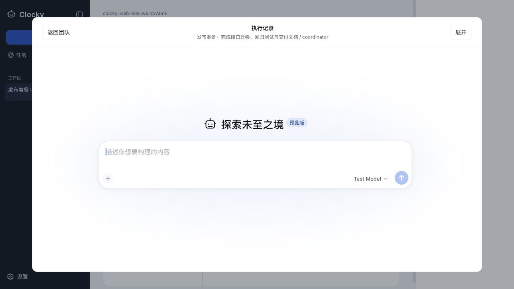

建议按 coordinator 可写／worker 只读选择标题与空态文案，继续复用现有会话渲染。没有发送消息，未检查流式输出、工具结果或执行中的键盘操作。

## 14. 验证范围与证据局限

所有截图均为本轮直接抓取并打开检查的本地文件；窄屏侧栏动画结束后重新截图，桌面尺寸已恢复。未使用旧设计图替代当前页面。辅助 DOM 测量支持 F01 与 F09，源码支持上述结构性定位；推断与已观察行为分别标出。

本轮覆盖中文浅色、真实创建／预检成功、空集合、列表与详情切换、窄屏、一次独立权限拒绝和返回恢复。未完整覆盖深色、英文长文本、键盘遍历、读屏、数值对比度、慢网／断线、过期版本、IME、所有表单错误、运行调度、复杂依赖、真实模型与大数据。初次未认证连接产生的 401 和重连日志属于审查环境启动过程，不作为产品故障证据。其他状态必须按[实施验收矩阵](implementation-plan.md)补测。

本轮验证结果见 [verification.json](evidence/verification.json)：当前构建成功，最终 `doc-sync` 的 29 个门禁全部通过，新文档链接及空白检查通过。截图尺寸、SHA-256 与相关源码／产物指纹见 [capture-manifest.json](evidence/capture-manifest.json)；[静态 UI 审查](evidence/static-audit.json)没有报告规则内错误，这不代表视觉与交互问题不存在。
